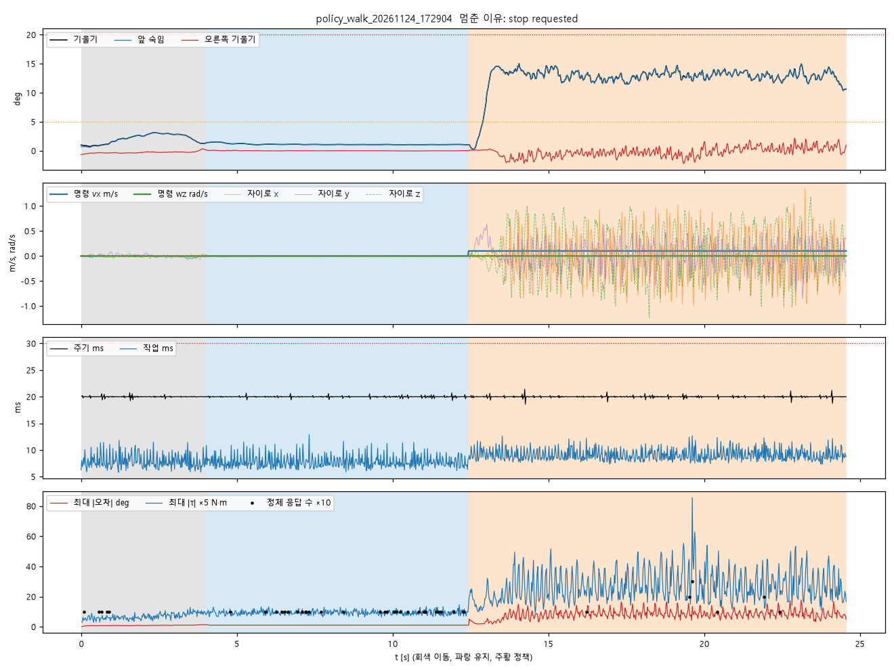
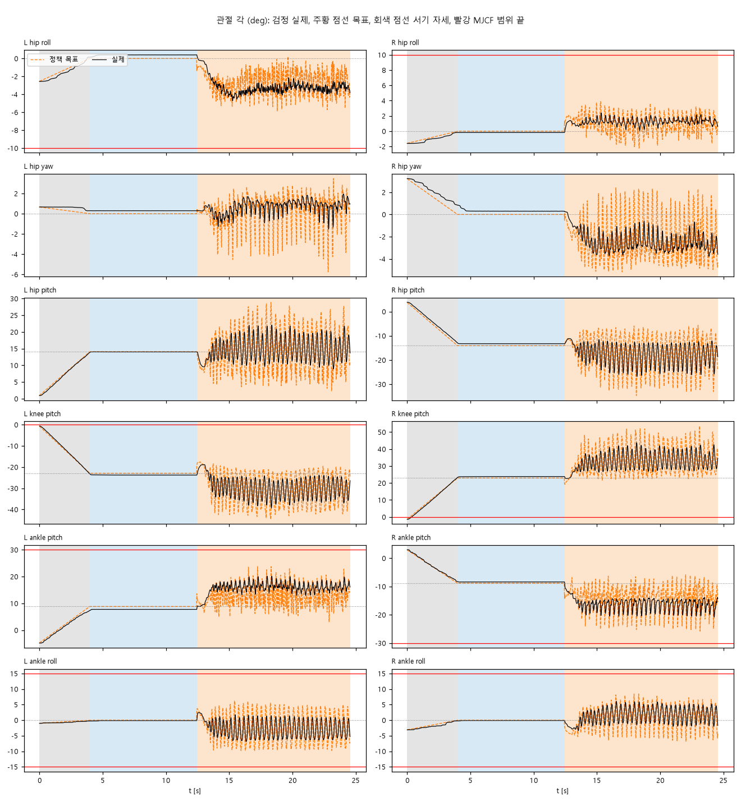
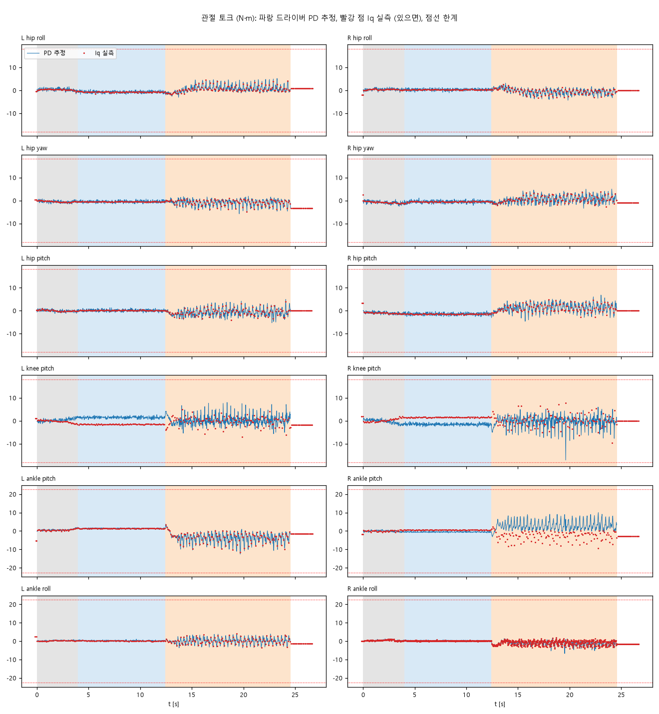
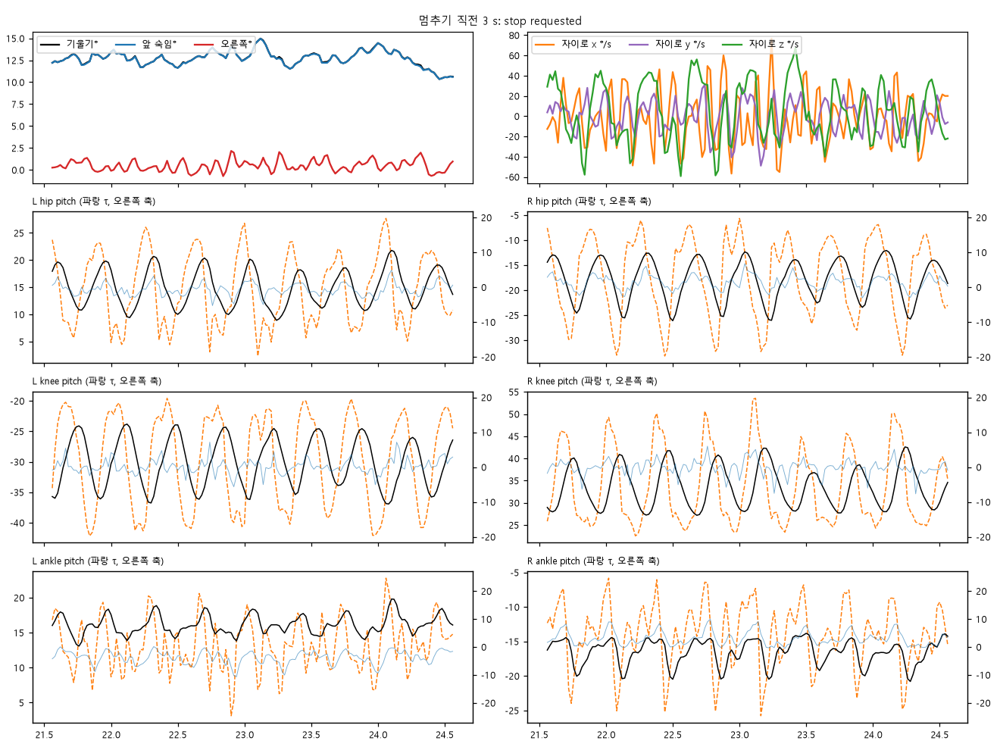
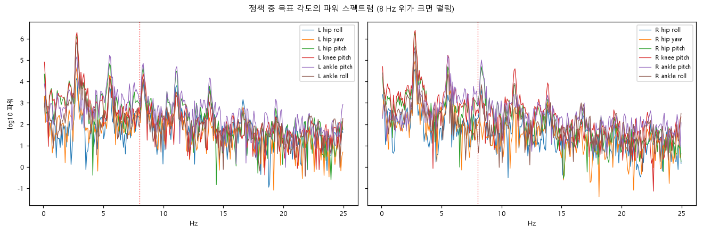

# 정책 보행 기록 분석: policy_walk_20261124_172904

## 한눈에

- ⚠ 정책 중 기울기 최대 15.1° (5° 넘은 시간 96 %). S3 통과 기준은 5° 안.
- ⚠ 정책 켜기 직전(발이 바닥에 닿은 서기 자세) IMU가 다리 기구학보다 앞 +3.1°, 오른쪽 +0.1° 기울어 있음 (학습 IMU 장착 기울기 ±2°). 수평계로 몸통 실제 기울기 확인 필요.
- ⚠ S2: 서기 자세 목표와 1° 넘게 차이: L ankle pitch +1.1° (마찰 0.36 N·m ≈ 0.2°, 다리 무게 포함).
- ⚠ L ankle pitch 토크가 학습 한계 6 N·m를 넘은 시간 17 % (최대 12.6 N·m; 학습 때는 6에서 잘림).
- ⚠ R ankle pitch 토크가 학습 한계 6 N·m를 넘은 시간 13 % (최대 10.0 N·m; 학습 때는 6에서 잘림).
- ⚠ Iq 명령이 학습 한계 6 N·m에 해당하는 전류(6512 5.97 A, 발목 4.79 A)를 넘음: L knee pitch 6.8 A, L ankle pitch 9.2 A, R knee pitch 9.8 A, R ankle pitch 7.3 A. 드라이버 전류 한계는 18 A 그대로 (ODrive 0.5.1의 CAN 0x00F는 속도 한계만 바꿈).
- ℹ 운영자·GUI 쪽에서 멈춤: 멈춤: 모두 힘 풀기 (Esc / 빨간 버튼)
- ℹ 엔코더 정체 응답 45번 (정책 중 0.14 %). 5주기 연속이면 Radxa가 멈춤.
- ℹ 엔코더 읽기가 8 ms 기다림 한도에 닿은 표본이 있습니다 (최대 9.3 ms).
- ℹ 정책 첫 목표가 서기 자세에서 최대 5.4° (R ankle pitch). 오프라인 점검(이상적 관측)에서는 4° 안.
- ✓ 주기 최대 21.4 ms (30 ms 넘은 적 없음).

## 개요

- 폴더: `logs\policy_walk_20261124_172904`
- 파일: real_walk.npz, status.csv, events.txt, meta.json, gui_frames.csv, gui_log.txt
- 시작: 2026-11-24T17:29:04.507, 시작 명령: [0.1, 0.0, 0.0], IMU 축: ['+y', '-x', '+z']
- 토크: 드라이버 전류 한계 18 A (CAN으로 못 바꿈). Radxa 목표 자르기: 없음
- 주기 1229개, 24.6 s: 이동 4.0 s → 유지 8.4 s → 정책 12.1 s
- Radxa 멈춘 이유 (npz): `stop requested`
- GUI 이벤트: `멈춤: 모두 힘 풀기 (Esc / 빨간 버튼)`
- meta.json ↔ npz: 관절 순서 같음, 부호 차이 0, 영점 차이 0.00e+00 turn

## 1. 타이밍·통신

Radxa 루프 (npz): 주기 = 이웃한 주기 시작 간격, 작업 = 한 주기에서 읽기+정책+전송에 든 시간

| 단계 | 주기 수 | 주기 p50 ms | p99 | 최대 | >25 ms | >30 ms | >30 연속 | 작업 p50 ms | p99 | 최대 |
|---|---|---|---|---|---|---|---|---|---|---|
| 이동 | 199 | 20.00 | 20.54 | 20.73 | 0 | 0 | 0 | 7.46 | 11.44 | 11.81 |
| 유지 | 422 | 20.00 | 20.51 | 20.71 | 0 | 0 | 0 | 7.42 | 11.33 | 12.92 |
| 정책 | 607 | 20.00 | 20.58 | 21.40 | 0 | 0 | 0 | 8.73 | 12.17 | 12.69 |


엔코더 정체 응답 (움직이는 중인데 값이 직전 주기와 완전히 같음 = 8 ms 안에 새 응답 못 받음, 지난 값 사용)

정체 응답이 있는 주기 41개, 그중 6개 넘는 관절이 한꺼번에 정체 (읽기를 통째로 놓침, 보통 Radxa 쪽 지연) 0개

| 관절 | node | 이동 | 유지 | 정책 | 연속 최대 |
|---|---|---|---|---|---|
| L hip yaw | 3 | 4 | 4 | 0 | 1 |
| L hip pitch | 5 | 0 | 3 | 0 | 1 |
| L knee pitch | 7 | 0 | 3 | 0 | 1 |
| L ankle pitch | 11 | 0 | 1 | 0 | 1 |
| L ankle roll | 13 | 0 | 1 | 0 | 1 |
| R hip roll | 2 | 1 | 3 | 0 | 1 |
| R hip yaw | 4 | 0 | 4 | 0 | 1 |
| R hip pitch | 6 | 0 | 2 | 0 | 1 |
| R knee pitch | 8 | 0 | 3 | 1 | 1 |
| R ankle pitch | 12 | 0 | 1 | 3 | 1 |
| R ankle roll | 14 | 0 | 5 | 6 | 1 |


GUI가 받은 상태 (status.csv, 10 Hz 표본): 엔코더 12개 읽기 시간, 정책이 쓴 IMU 값의 나이

| 단계 | 표본 | 읽기 p50 ms | p99 | 최대 | IMU 나이 p50 ms | p99 | 최대 | 놓침 연속 최대 |
|---|---|---|---|---|---|---|---|---|
| 이동 | 40 | 5.97 | 7.94 | 8.07 | 2.80 | 5.46 | 5.50 | 0 |
| 유지 | 83 | 5.93 | 8.32 | 9.30 | 2.90 | 5.84 | 6.00 | 1 |
| 정책 | 120 | 5.95 | 8.17 | 8.34 | 3.00 | 6.53 | 6.70 | 1 |

## 2. IMU

| 단계 | 기울기 평균° | p95 | 최대 | 앞 숙임 평균° | 오른쪽 기울기 평균° | 중력 평균 (x y z) | 자이로 평균 °/s (x y z) | |자이로| p99 °/s |
|---|---|---|---|---|---|---|---|---|
| 이동 | 2.1 | 3.0 | 3.1 | 2.0 | -0.3 | 0.035 0.005 -0.999 | 0.158 0.251 -0.729 | 1.7 4.2 3.0 |
| 유지 | 1.1 | 1.4 | 1.5 | 1.1 | 0.0 | 0.019 -0.000 -1.000 | -0.043 0.006 -0.111 | 0.7 1.0 0.7 |
| 정책 | 12.5 | 14.3 | 15.1 | 12.5 | -0.2 | 0.216 0.003 -0.975 | -0.666 0.653 2.933 | 55.4 35.8 57.3 |


쿼터니언 크기 1.0000~1.0000. 앞으로 숙이면 중력 x > 0, 오른쪽으로 기울면 중력 y < 0 (절차서 4절). 이동·유지는 매단 상태라 몸통이 하네스에 따라 기울 수 있음.


자이로 ↔ 쿼터니언 변화 (같은 축이면 상관·기울기 > 0; 걸을 때는 표본 시각 차이로 0.7–0.9도 정상. 축 혼동·부호 오류 점검용)

| 축 | 쿼터니언 각속도 표준편차 rad/s | 상관 | 기울기 (자이로/쿼터니언) |
|---|---|---|---|
| x | 0.261 | 0.919 | 0.88 |
| y | 0.202 | 0.767 | 0.61 |
| z | 0.336 | 0.982 | 0.97 |


IMU ↔ 다리 기구학: 디딤발 발바닥이 바닥에 평평하다고 보고 관절 각(MJCF)으로 계산한 몸통 기울기와 IMU를 비교. 서기 자세는 hip+knee+ankle pitch 합이 0이라 발이 평평하면 몸통이 수직. 차이가 일정하면 IMU 장착(또는 가속도계) 기울기, 영점 오차 합, 발이 평평하지 않음(하네스가 몸통을 당김) 중 하나. 발이 바닥에 닿아 체중이 실렸을 때만 의미.

| 구간 | IMU 앞° | 기구학 앞° | 차이° | IMU 오른쪽° | 기구학 오른쪽° | 차이° |
|---|---|---|---|---|---|---|
| 유지 마지막 3 s (정책 켜기 직전) | 1.1 | -2.0 | 3.1 | -0.0 | -0.1 | 0.1 |
| 정책 | 12.5 | 2.3 | 10.2 | -0.2 | -0.3 | 0.1 |

## 3. 서기 자세 (S2)

시작 자세 (첫 주기, deg): L hip roll -2.6, L hip yaw +0.7, L hip pitch +0.9, L knee pitch -0.6, L ankle pitch -4.8, L ankle roll -1.0, R hip roll -1.6, R hip yaw +3.2, R hip pitch +3.8, R knee pitch -1.4, R ankle pitch +3.0, R ankle roll -3.1

유지 구간 4.5~12.4 s (397주기, 유지 시작 0.5 s 뒤부터). 목표−실제 = 서기 자세 − 엔코더 (드라이버 PD가 남긴 오차), τ = Kp·오차 − Kd·속도

| 관절 | 서기 목표° | 실제 평균° | 목표−실제 평균° | 표준편차° | PD 토크 평균 N·m | 좌우 합° (L+R) |
|---|---|---|---|---|---|---|
| L hip roll | 0.00 | 0.40 | -0.40 | 0.01 | -0.69 | 0.22 |
| L hip yaw | 0.00 | 0.29 | -0.29 | 0.00 | -0.50 | 0.59 |
| L hip pitch | 14.08 | 14.01 | 0.07 | 0.00 | 0.09 | 0.75 |
| L knee pitch | -22.92 | -23.77 | 0.85 | 0.02 | 1.48 | 0.01 |
| L ankle pitch | 8.84 | 7.76 | 1.08 | 0.00 | 1.35 | -0.63 |
| L ankle roll | 0.00 | -0.15 | 0.15 | 0.02 | 0.19 | -0.26 |
| R hip roll | 0.00 | -0.17 | 0.17 | 0.00 | 0.32 |  |
| R hip yaw | 0.00 | 0.30 | -0.30 | 0.02 | -0.54 |  |
| R hip pitch | -14.08 | -13.26 | -0.82 | 0.00 | -1.43 |  |
| R knee pitch | 22.92 | 23.78 | -0.86 | 0.02 | -1.53 |  |
| R ankle pitch | -8.84 | -8.39 | -0.45 | 0.00 | -0.54 |  |
| R ankle roll | 0.00 | -0.12 | 0.12 | 0.00 | 0.13 |  |


좌우 합: 오른쪽 관절은 왼쪽의 거울(부호 반대)이라 대칭이면 0. 최대 0.75°.

이동 끝 (서기 목표 도달 직후) 목표−실제°: L hip roll -0.2, L hip yaw -0.3, L hip pitch +0.2, L knee pitch +0.4, L ankle pitch +1.5, L ankle roll +0.3, R hip roll +0.2, R hip yaw -0.8, R hip pitch -1.0, R knee pitch -0.5, R ankle pitch -0.5, R ankle roll +0.2

## 4. 관절 (정책 중)

정책 중 (첫 주기 제외). 오차 = 직전 목표 − 지금 실제 (deg), τ = 드라이버 PD 토크 추정 (N·m, 드라이버 전류 한계 18 A로 자름; 학습 한계는 6 N·m). 시뮬 보행: 오차 p99 23°, 최대 약 50°, 12° 초과 최장 0.26 s, 관절 속도 최대 11 rad/s.

| 관절 | 범위° | MJCF 끝까지 여유° | |오차| p95 | p99 | 최대 | 12° 초과 최장 s | |τ| p95 | 6 N·m 넘음 % | 6 N·m 넘음 최장 s | |q̇| 최대 rad/s | 정체 응답 |
|---|---|---|---|---|---|---|---|---|---|---|---|
| L hip roll | -5~+0 | 5.3 | 2.4 | 2.8 | 3.1 | 0.00 | 3.93 | 0.0 | 0.00 | 0.8 | 0 |
| L hip yaw | -2~+2 | 32.2 | 3.3 | 4.2 | 4.9 | 0.00 | 3.47 | 0.0 | 0.00 | 1.3 | 0 |
| L hip pitch | +9~+22 | 65.2 | 9.0 | 11.8 | 12.8 | 0.02 | 3.25 | 0.0 | 0.00 | 2.6 | 0 |
| L knee pitch | -39~-19 | 18.9 | 9.9 | 10.9 | 11.8 | 0.00 | 4.16 | 1.7 | 0.02 | 2.5 | 0 |
| L ankle pitch | +8~+20 | 9.8 | 8.3 | 9.5 | 11.1 | 0.00 | 8.69 | 17.0 | 0.10 | 2.5 | 0 |
| L ankle roll | -7~+2 | 8.1 | 5.4 | 6.1 | 6.8 | 0.00 | 3.10 | 0.0 | 0.00 | 2.1 | 0 |
| R hip roll | -0~+2 | 7.6 | 2.0 | 2.5 | 2.8 | 0.00 | 2.84 | 0.0 | 0.00 | 0.7 | 0 |
| R hip yaw | -4~+0 | 33.5 | 3.5 | 4.0 | 4.4 | 0.00 | 3.16 | 0.0 | 0.00 | 0.9 | 0 |
| R hip pitch | -27~-11 | 67.4 | 9.4 | 10.9 | 13.1 | 0.04 | 4.14 | 0.3 | 0.02 | 2.8 | 0 |
| R knee pitch | +23~+44 | 22.6 | 13.8 | 15.8 | 17.8 | 0.06 | 5.06 | 3.1 | 0.04 | 3.3 | 1 |
| R ankle pitch | -21~-8 | 9.2 | 6.8 | 8.3 | 8.6 | 0.00 | 7.78 | 12.5 | 0.08 | 3.6 | 3 |
| R ankle roll | -3~+6 | 9.0 | 5.5 | 6.1 | 7.8 | 0.00 | 3.00 | 0.2 | 0.02 | 1.8 | 6 |


관절 속도 (ODrive vel_estimate) ↔ 위치 차분 상관: L hip roll 0.93, L hip yaw 0.96, L hip pitch 0.99, L knee pitch 0.99, L ankle pitch 0.95, L ankle roll 0.98, R hip roll 0.91, R hip yaw 0.95, R hip pitch 0.99, R knee pitch 0.99, R ankle pitch 0.96, R ankle roll 0.96

## 5. 정책 입력·출력

관측 조립 점검 (기록된 값끼리 비교)

| 항목 | 최대 차이 | 결과 |
|---|---|---|
| 명령 0–2 | 0.0e+00 | 같음 |
| 각속도 3–5 | 0.0e+00 | 같음 |
| 중력 6–8 | 3.0e-08 | 같음 |
| 관절 각 9–20 | 3.6e-08 | 같음 |
| 관절 속도 21–32 | 1.1e-07 | 같음 |
| 직전 행동 33–44 | 0.0e+00 | 같음 |
| 목표 = 서기 + 0.25·clip(행동) | 3.6e-08 | 같음 |
| 정책 재생 (PC numpy) vs Radxa 행동 | 4.8e-07 | 같음 |


정책 첫 주기 (t = 12.44 s): 중력 [0.018, -0.0, -1.0], 각속도 rad/s [0.002, -0.001, -0.005], 관절 − 서기 최대 1.1°, 명령 [0.1, 0.0, 0.0]

첫 목표 − 서기 자세 (deg): L hip roll -1.4, L hip yaw +0.2, L hip pitch +0.0, L knee pitch +3.6, L ankle pitch +4.8, L ankle roll +3.2, R hip roll +1.3, R hip yaw -0.5, R hip pitch +0.3, R knee pitch -3.3, R ankle pitch -5.4, R ankle roll -1.8


행동 (정책 출력, 배율 전) 607주기. 진동수 = 목표의 주 성분 (0.3–5 Hz), 8 Hz 넘는 비율 = 떨림 지표, Δa/a = 이웃 주기 차이의 표준편차 ÷ 행동 표준편차 (1 Hz 부드러운 움직임 ≈ 0.13, 번갈아 튀면 ≈ 2)

| 관절 | |a| p50 | p99 | 최대 | ±20 잘림 % | 목표−서기 최대° | 주 진동수 Hz | 8 Hz 넘는 비율 | Δa/a |
|---|---|---|---|---|---|---|---|---|
| L hip roll | 0.18 | 0.37 | 0.41 | 0.0 | 5.9 | 2.80 | 0.57 | 0.96 |
| L hip yaw | 0.08 | 0.29 | 0.40 | 0.0 | 5.7 | 2.80 | 0.26 | 0.73 |
| L hip pitch | 0.37 | 0.95 | 1.03 | 0.0 | 14.8 | 2.80 | 0.07 | 0.47 |
| L knee pitch | 0.36 | 1.39 | 1.52 | 0.0 | 21.7 | 2.80 | 0.02 | 0.38 |
| L ankle pitch | 0.25 | 0.95 | 1.04 | 0.0 | 14.9 | 2.80 | 0.30 | 0.82 |
| L ankle roll | 0.29 | 0.67 | 0.69 | 0.0 | 9.8 | 2.80 | 0.04 | 0.43 |
| R hip roll | 0.07 | 0.24 | 0.27 | 0.0 | 3.9 | 2.80 | 0.16 | 0.66 |
| R hip yaw | 0.17 | 0.35 | 0.36 | 0.0 | 5.2 | 2.80 | 0.03 | 0.57 |
| R hip pitch | 0.37 | 1.27 | 1.44 | 0.0 | 20.6 | 2.80 | 0.04 | 0.43 |
| R knee pitch | 0.39 | 1.94 | 2.14 | 0.0 | 30.6 | 2.80 | 0.03 | 0.42 |
| R ankle pitch | 0.31 | 1.13 | 1.18 | 0.0 | 16.9 | 2.80 | 0.22 | 0.72 |
| R ankle roll | 0.22 | 0.52 | 0.59 | 0.0 | 8.5 | 2.80 | 0.06 | 0.46 |


명령 구간 (속도 측정이 없어 vx는 영상으로 확인; 회전은 자이로 z로 비교 가능, 시뮬 0.8 → 0.85 rad/s)

| t s | 길이 s | 명령 vx vy wz | 자이로 z 평균 rad/s | 기울기 평균° | 최대° | 앞 숙임 평균° | 오른쪽 기울기 평균° |
|---|---|---|---|---|---|---|---|
| 12.4~24.6 | 12.1 | 0.10 0.00 0.00 | 0.051 | 12.5 | 15.1 | 12.5 | -0.2 |

## 6. 드라이버 (GUI가 받은 값)

시각 맞추기: 엔코더 응답 10475개가 npz 값과 정확히 일치 → t_npz = t_gui − 708.559 s (차이 p5–p95 -3~+15 ms)


heartbeat 처음 상태: IDLE (node 1,2,3,4,5,6,7,8,11,12,13,14)

heartbeat 상태 변화

| t s | 상태 | axis_error | 관절 |
|---|---|---|---|
| 0.02 | CLOSED_LOOP_CONTROL | 0 | 12개: R ankle pitch, L hip yaw, L hip pitch, L knee pitch, L hip roll, R hip pitch, R knee pitch, L ankle pitch, R hip roll, L ankle roll, R ankle roll, R hip yaw |
| 24.62 | IDLE | 0 | 12개: R ankle pitch, L hip yaw, L hip pitch, L knee pitch, R knee pitch, L ankle pitch, R hip pitch, L hip roll, R hip roll, R hip yaw, L ankle roll, R ankle roll |


Iq (정책 중 표본; 없으면 기록 전체). 6 N·m 전류 = 학습 토크 한계에 해당하는 전류, '넘음 %' = |Iq 명령|이 그 95 % 이상인 표본. τ(Iq) = 방향 × torque_sign × Iq × kt × 15 를 드라이버 PD 추정 τ와 비교 (기울기 ≈ 1, 상관 ≈ 1이면 PD 모델이 맞음)

| 관절 | node | 표본 Hz | |Iq| p95 A | |Iq| 최대 | |Iq 명령| 최대 | 6 N·m 전류 A | 넘음 % | τ(Iq)/τ(PD) 기울기 | 상관 |
|---|---|---|---|---|---|---|---|---|---|
| L hip roll | 1 | 10 | 3.14 | 4.54 | 4.55 | 5.97 | 0.0 | 0.76 | 0.85 |
| L hip yaw | 3 | 10 | 3.52 | 4.78 | 4.48 | 5.97 | 0.0 | 0.80 | 0.78 |
| L hip pitch | 5 | 10 | 3.14 | 4.13 | 4.57 | 5.97 | 0.0 | 0.69 | 0.72 |
| L knee pitch | 7 | 10 | 4.04 | 6.90 | 6.76 | 5.97 | 2.5 | -0.56 | -0.56 |
| L ankle pitch | 11 | 10 | 7.13 | 9.14 | 9.17 | 4.78 | 22.3 | 1.00 | 0.91 |
| L ankle roll | 13 | 10 | 2.48 | 3.32 | 3.13 | 4.78 | 0.0 | 0.90 | 0.87 |
| R hip roll | 2 | 10 | 2.68 | 3.17 | 3.30 | 5.97 | 0.0 | 0.84 | 0.83 |
| R hip yaw | 4 | 10 | 2.97 | 3.84 | 5.15 | 5.97 | 0.0 | 0.79 | 0.80 |
| R hip pitch | 6 | 10 | 3.81 | 4.75 | 4.81 | 5.97 | 0.0 | 0.72 | 0.66 |
| R knee pitch | 8 | 10 | 6.35 | 9.54 | 9.83 | 5.97 | 5.8 | -0.65 | -0.69 |
| R ankle pitch | 12 | 10 | 5.91 | 7.57 | 7.29 | 4.78 | 15.6 | -0.94 | -0.91 |
| R ankle roll | 14 | 50 | 2.40 | 3.31 | 4.10 | 4.78 | 0.0 | 0.80 | 0.71 |


버스 전압 (Vbus, 2 s마다 node별): 최소 23.22 V, 중앙 23.83 V, 최대 24.08 V, 표본 160개

## 7. 멈추기 직전

마지막 2 s (0.2 s 간격 + 마지막 주기). 멈춘 이유: `stop requested`. 안전 정지를 일으킨 주기는 기록되지 않음 (기록 전에 멈춤).

| t s | 단계 | 기울기° | 앞 숙임° | 오른쪽° | 최대 |오차|° | 최대 |τ| N·m | 포화 관절 수 | 작업 ms | 명령 |
|---|---|---|---|---|---|---|---|---|---|
| 22.56 | 정책 | 12.2 | 12.2 | 0.7 | L knee pitch 10 | L ankle pitch 6.4 | 1 | 8.2 | 0.10 0.00 0.00 |
| 22.76 | 정책 | 14.0 | 14.0 | 0.1 | R knee pitch 17 | R ankle pitch 9.0 | 1 | 10.2 | 0.10 0.00 0.00 |
| 22.96 | 정책 | 12.8 | 12.8 | 0.3 | R knee pitch 7 | L ankle pitch 6.5 | 1 | 10.4 | 0.10 0.00 0.00 |
| 23.16 | 정책 | 14.2 | 14.2 | 0.7 | R hip pitch 7 | R ankle pitch 4.7 | 0 | 9.4 | 0.10 0.00 0.00 |
| 23.36 | 정책 | 11.7 | 11.7 | 0.3 | L hip pitch 8 | R knee pitch 5.0 | 0 | 8.9 | 0.10 0.00 0.00 |
| 23.56 | 정책 | 13.1 | 13.0 | 0.5 | R hip pitch 5 | L ankle pitch 3.9 | 0 | 7.9 | 0.10 0.00 0.00 |
| 23.76 | 정책 | 12.3 | 12.3 | 0.2 | L knee pitch 7 | R ankle pitch 2.2 | 0 | 7.5 | 0.10 0.00 0.00 |
| 23.96 | 정책 | 13.8 | 13.7 | 1.6 | L knee pitch 10 | L ankle pitch 6.6 | 2 | 8.2 | 0.10 0.00 0.00 |
| 24.16 | 정책 | 13.4 | 13.4 | 0.2 | R knee pitch 17 | R ankle pitch 8.1 | 1 | 8.3 | 0.10 0.00 0.00 |
| 24.36 | 정책 | 11.4 | 11.4 | 0.5 | R knee pitch 8 | L ankle pitch 4.6 | 0 | 8.7 | 0.10 0.00 0.00 |
| 24.56 | 정책 | 10.6 | 10.6 | 1.0 | R hip pitch 5 | L hip yaw 3.3 | 0 | 8.8 | 0.10 0.00 0.00 |
| 24.56 | 정책 | 10.6 | 10.6 | 1.0 | R hip pitch 5 | L hip yaw 3.3 | 0 | 8.8 | 0.10 0.00 0.00 |

## 8. 이벤트·GUI 기록

events.txt
```
17:29:04.510 [npz -0.16 s] 시작 요청 (앞으로 0.10 m/s, 토크 한계 6 N·m 적용): L hip roll 부호 -1 영점 0.5236, L hip yaw 부호 -1 영점 0.2441, L hip pitch 부호 -1 영점 0.8354, L knee pitch 부호 -1 영점 0.6002, L ankle pitch 부호 -1 영점 0.9838, L ankle roll 부호 -1 영점 0.2539, R hip roll 부호 -1 영점 0.0262, R hip yaw 부호 -1 영점 0.3778, R hip pitch 부호 -1 영점 0.8512, R knee pitch 부호 -1 영점 0.9853, R ankle pitch 부호 -1 영점 0.8108, R ankle roll 부호 -1 영점 0.9325
17:29:04.575 [npz -0.10 s] Radxa에서 시작: 서기 자세로 4 s 이동
17:29:08.745 [npz +4.07 s] 서기 자세 도달, 유지 중 (발이 바닥에 닿으면 '정책 켜기')
17:29:17.093 [npz +12.42 s] 정책 켜기 (발이 바닥에 닿음)
17:29:17.217 [npz +12.52 s] 정책 보행 시작
17:29:29.237 [npz +24.57 s] 멈춤 요청: 모두 힘 풀기 (Esc / 빨간 버튼)
17:29:29.365 [npz +24.69 s] 멈춤: 모두 힘 풀기 (Esc / 빨간 버튼)
17:29:29.791 [npz +25.12 s] Radxa 기록 → logs/policy_walk_20261124_172904/real_walk.npz (936 KB)
```

gui_log.txt 중 경고·Radxa 줄
```
   708.464 [CAN] [Radxa] [bridge] 정책 보행: {'type': 'started', 'log': '/home/radxa/motor_bridge/logs/real_walk_20261124_172904.npz', 'torque_limit': True}
   733.129 [CAN] 모든 노드 IDLE 명령 (12개, 버스 2개)
   733.134 [CAN] [Radxa] [bridge] 모두 힘 풀기 (정책 멈춤: 모두 힘 풀기 (Esc / 빨간 버튼)): IDLE 프레임 48개
   733.238 [CAN] [Radxa] stopped: stop requested; log -> /home/radxa/motor_bridge/logs/real_walk_20261124_172904.npz
   733.253 [CAN] [Radxa] [bridge] 정책 보행: {'type': 'stopped', 'reason': '모두 힘 풀기 (Esc / 빨간 버튼)', 'log': '/home/radxa/motor_bridge/logs/real_walk_20261124_172904.npz', 'log_size': 959254}
```

## 그림






