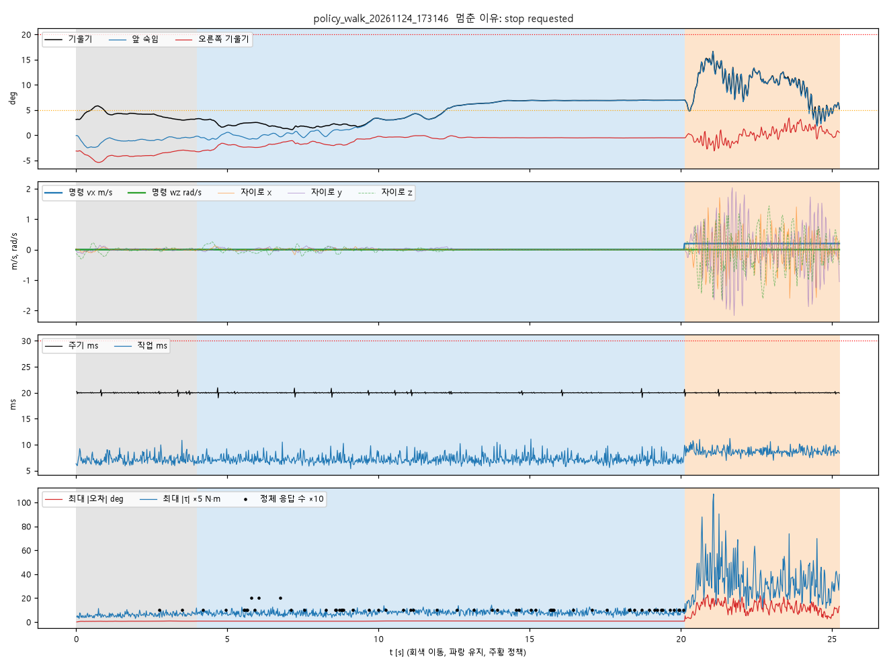
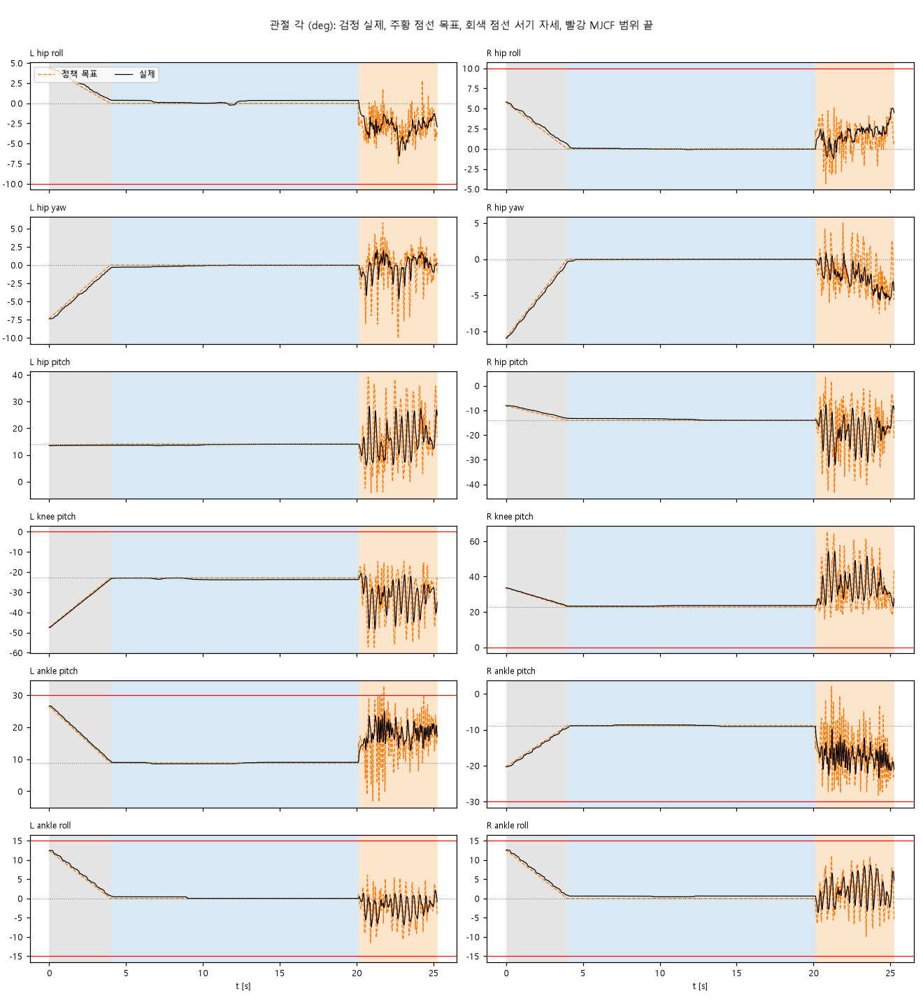
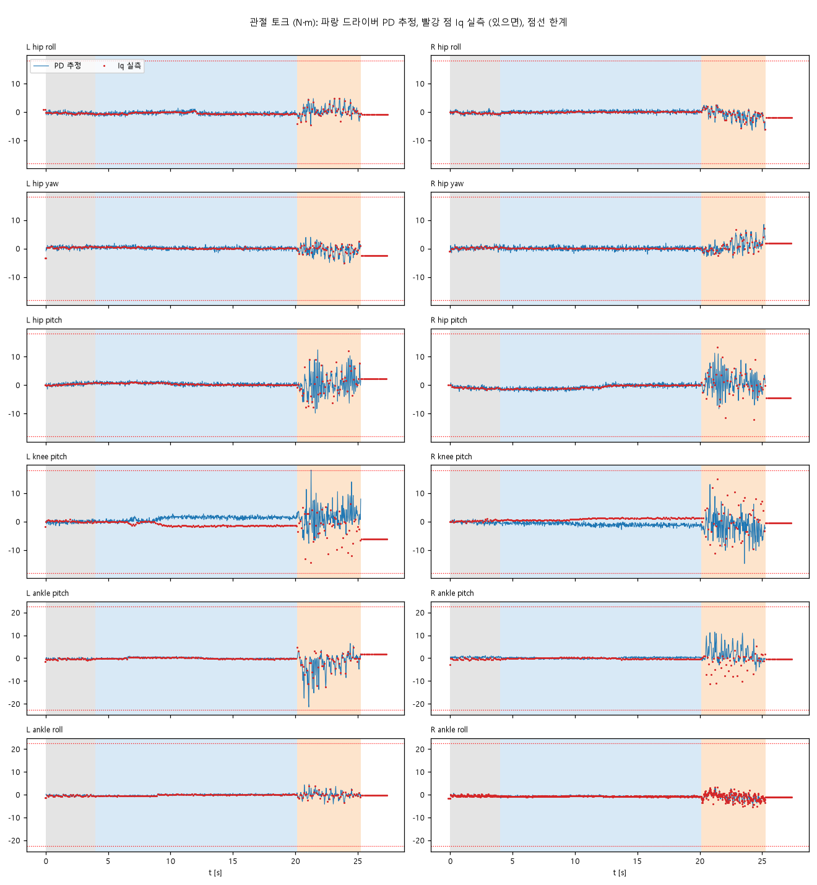
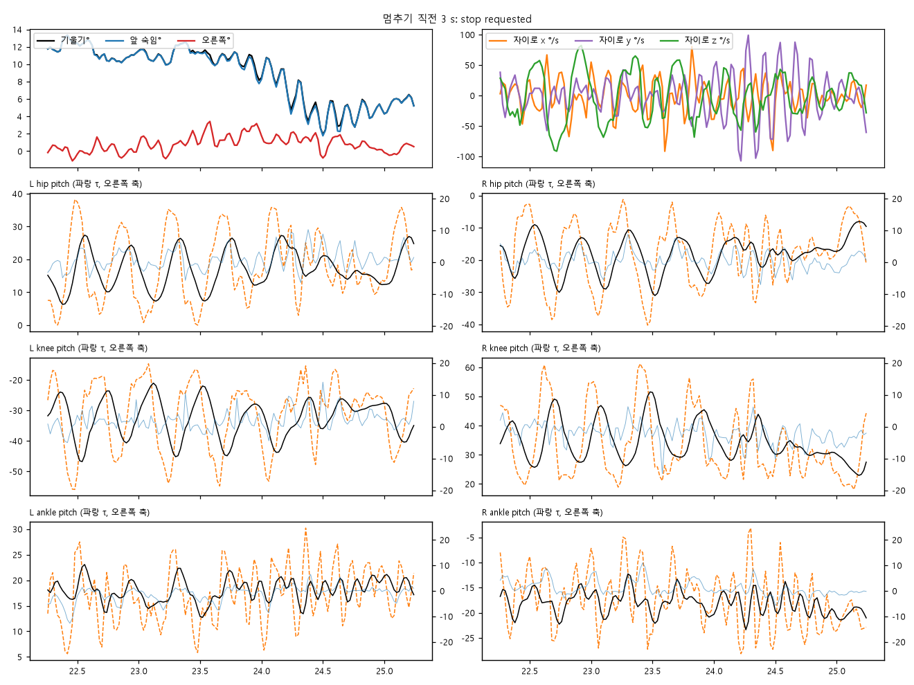
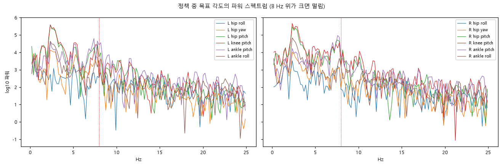

# 정책 보행 기록 분석: policy_walk_20261124_173146

## 한눈에

- ⚠ 정책 중 기울기 최대 16.7° (5° 넘은 시간 89 %). S3 통과 기준은 5° 안.
- ⚠ 정책 켜기 직전(발이 바닥에 닿은 서기 자세) IMU가 다리 기구학보다 앞 +7.6°, 오른쪽 -0.2° 기울어 있음 (학습 IMU 장착 기울기 ±2°). 수평계로 몸통 실제 기울기 확인 필요.
- ⚠ L hip pitch 토크가 학습 한계 6 N·m를 넘은 시간 11 % (최대 12.4 N·m; 학습 때는 6에서 잘림).
- ⚠ L knee pitch 토크가 학습 한계 6 N·m를 넘은 시간 11 % (최대 18.1 N·m; 학습 때는 6에서 잘림).
- ⚠ L ankle pitch 토크가 학습 한계 6 N·m를 넘은 시간 17 % (최대 21.4 N·m; 학습 때는 6에서 잘림).
- ⚠ R hip pitch 토크가 학습 한계 6 N·m를 넘은 시간 9 % (최대 11.3 N·m; 학습 때는 6에서 잘림).
- ⚠ R knee pitch 토크가 학습 한계 6 N·m를 넘은 시간 13 % (최대 14.8 N·m; 학습 때는 6에서 잘림).
- ⚠ R ankle pitch 토크가 학습 한계 6 N·m를 넘은 시간 12 % (최대 11.5 N·m; 학습 때는 6에서 잘림).
- ⚠ Iq 명령이 학습 한계 6 N·m에 해당하는 전류(6512 5.97 A, 발목 4.79 A)를 넘음: L hip pitch 11.7 A, L knee pitch 18.0 A, L ankle pitch 9.9 A, R hip yaw 7.3 A, R hip pitch 18.0 A, R knee pitch 18.0 A, R ankle pitch 8.8 A, R ankle roll 5.6 A. 드라이버 전류 한계는 18 A 그대로 (ODrive 0.5.1의 CAN 0x00F는 속도 한계만 바꿈).
- ℹ 운영자·GUI 쪽에서 멈춤: 멈춤: 모두 힘 풀기 (Esc / 빨간 버튼)
- ℹ 엔코더 정체 응답 61번 (정책 중 0.00 %). 5주기 연속이면 Radxa가 멈춤.
- ℹ 유지(매단 상태) 중 몸통 기울기 앞 +3.9°, 오른쪽 -1.0°. 하네스 때문일 수도 있음. 바닥에 똑바로 세웠을 때도 2°를 넘으면 장착 기울기(학습 ±2°) 확인.
- ℹ 정책 첫 목표가 서기 자세에서 최대 6.4° (L ankle pitch). 오프라인 점검(이상적 관측)에서는 4° 안.
- ✓ 주기 최대 21.0 ms (30 ms 넘은 적 없음).
- ✓ S2: 유지 중 모든 관절이 서기 목표 1° 안 (최대 0.63°).

## 개요

- 폴더: `logs\policy_walk_20261124_173146`
- 파일: real_walk.npz, status.csv, events.txt, meta.json, gui_frames.csv, gui_log.txt
- 시작: 2026-11-24T17:31:46.171, 시작 명령: [0.1, 0.0, 0.0], IMU 축: ['+y', '-x', '+z']
- 토크: 드라이버 전류 한계 18 A (CAN으로 못 바꿈). Radxa 목표 자르기: 없음
- 주기 1263개, 25.3 s: 이동 4.0 s → 유지 16.1 s → 정책 5.1 s
- Radxa 멈춘 이유 (npz): `stop requested`
- GUI 이벤트: `멈춤: 모두 힘 풀기 (Esc / 빨간 버튼)`
- meta.json ↔ npz: 관절 순서 같음, 부호 차이 0, 영점 차이 0.00e+00 turn

## 1. 타이밍·통신

Radxa 루프 (npz): 주기 = 이웃한 주기 시작 간격, 작업 = 한 주기에서 읽기+정책+전송에 든 시간

| 단계 | 주기 수 | 주기 p50 ms | p99 | 최대 | >25 ms | >30 ms | >30 연속 | 작업 p50 ms | p99 | 최대 |
|---|---|---|---|---|---|---|---|---|---|---|
| 이동 | 199 | 20.00 | 20.38 | 20.60 | 0 | 0 | 0 | 6.97 | 9.46 | 10.86 |
| 유지 | 806 | 20.00 | 20.37 | 20.98 | 0 | 0 | 0 | 6.98 | 9.78 | 11.09 |
| 정책 | 257 | 20.00 | 20.23 | 20.67 | 0 | 0 | 0 | 8.68 | 10.68 | 11.21 |


엔코더 정체 응답 (움직이는 중인데 값이 직전 주기와 완전히 같음 = 8 ms 안에 새 응답 못 받음, 지난 값 사용)

정체 응답이 있는 주기 58개, 그중 6개 넘는 관절이 한꺼번에 정체 (읽기를 통째로 놓침, 보통 Radxa 쪽 지연) 0개

| 관절 | node | 이동 | 유지 | 정책 | 연속 최대 |
|---|---|---|---|---|---|
| L hip roll | 1 | 0 | 4 | 0 | 1 |
| L hip yaw | 3 | 0 | 2 | 0 | 1 |
| L hip pitch | 5 | 1 | 7 | 0 | 2 |
| L knee pitch | 7 | 0 | 2 | 0 | 1 |
| L ankle pitch | 11 | 0 | 4 | 0 | 1 |
| L ankle roll | 13 | 0 | 2 | 0 | 1 |
| R hip roll | 2 | 0 | 7 | 0 | 1 |
| R hip yaw | 4 | 0 | 3 | 0 | 1 |
| R hip pitch | 6 | 0 | 6 | 0 | 1 |
| R knee pitch | 8 | 0 | 6 | 0 | 1 |
| R ankle pitch | 12 | 0 | 7 | 0 | 1 |
| R ankle roll | 14 | 1 | 9 | 0 | 1 |


GUI가 받은 상태 (status.csv, 10 Hz 표본): 엔코더 12개 읽기 시간, 정책이 쓴 IMU 값의 나이

| 단계 | 표본 | 읽기 p50 ms | p99 | 최대 | IMU 나이 p50 ms | p99 | 최대 | 놓침 연속 최대 |
|---|---|---|---|---|---|---|---|---|
| 이동 | 40 | 5.61 | 6.57 | 6.71 | 2.95 | 5.26 | 5.30 | 0 |
| 유지 | 159 | 5.67 | 6.66 | 6.97 | 2.90 | 6.68 | 7.10 | 0 |
| 정책 | 51 | 5.56 | 6.52 | 6.58 | 3.40 | 5.85 | 6.20 | 0 |

## 2. IMU

| 단계 | 기울기 평균° | p95 | 최대 | 앞 숙임 평균° | 오른쪽 기울기 평균° | 중력 평균 (x y z) | 자이로 평균 °/s (x y z) | |자이로| p99 °/s |
|---|---|---|---|---|---|---|---|---|
| 이동 | 4.0 | 5.5 | 5.8 | -1.0 | -3.9 | -0.017 0.068 -0.997 | -0.059 0.088 -1.017 | 5.4 7.5 17.0 |
| 유지 | 4.6 | 6.9 | 7.0 | 3.9 | -1.0 | 0.068 0.017 -0.996 | 0.180 0.452 -0.266 | 5.8 6.0 11.5 |
| 정책 | 9.7 | 14.6 | 16.7 | 9.6 | 0.1 | 0.167 -0.002 -0.984 | 0.684 0.104 -2.458 | 84.7 112.4 90.0 |


쿼터니언 크기 1.0000~1.0000. 앞으로 숙이면 중력 x > 0, 오른쪽으로 기울면 중력 y < 0 (절차서 4절). 이동·유지는 매단 상태라 몸통이 하네스에 따라 기울 수 있음.


자이로 ↔ 쿼터니언 변화 (같은 축이면 상관·기울기 > 0; 걸을 때는 표본 시각 차이로 0.7–0.9도 정상. 축 혼동·부호 오류 점검용)

| 축 | 쿼터니언 각속도 표준편차 rad/s | 상관 | 기울기 (자이로/쿼터니언) |
|---|---|---|---|
| x | 0.205 | 0.929 | 0.92 |
| y | 0.357 | 0.943 | 0.84 |
| z | 0.297 | 0.987 | 0.98 |


IMU ↔ 다리 기구학: 디딤발 발바닥이 바닥에 평평하다고 보고 관절 각(MJCF)으로 계산한 몸통 기울기와 IMU를 비교. 서기 자세는 hip+knee+ankle pitch 합이 0이라 발이 평평하면 몸통이 수직. 차이가 일정하면 IMU 장착(또는 가속도계) 기울기, 영점 오차 합, 발이 평평하지 않음(하네스가 몸통을 당김) 중 하나. 발이 바닥에 닿아 체중이 실렸을 때만 의미.

| 구간 | IMU 앞° | 기구학 앞° | 차이° | IMU 오른쪽° | 기구학 오른쪽° | 차이° |
|---|---|---|---|---|---|---|
| 유지 마지막 3 s (정책 켜기 직전) | 6.9 | -0.7 | 7.6 | -0.5 | -0.3 | -0.2 |
| 정책 | 9.6 | 2.8 | 6.8 | 0.1 | -0.3 | 0.5 |

## 3. 서기 자세 (S2)

시작 자세 (첫 주기, deg): L hip roll +4.3, L hip yaw -7.4, L hip pitch +13.5, L knee pitch -47.6, L ankle pitch +26.6, L ankle roll +12.4, R hip roll +5.8, R hip yaw -11.0, R hip pitch -8.1, R knee pitch +33.6, R ankle pitch -20.3, R ankle roll +12.6

유지 구간 4.5~20.1 s (781주기, 유지 시작 0.5 s 뒤부터). 목표−실제 = 서기 자세 − 엔코더 (드라이버 PD가 남긴 오차), τ = Kp·오차 − Kd·속도

| 관절 | 서기 목표° | 실제 평균° | 목표−실제 평균° | 표준편차° | PD 토크 평균 N·m | 좌우 합° (L+R) |
|---|---|---|---|---|---|---|
| L hip roll | 0.00 | 0.24 | -0.24 | 0.16 | -0.42 | 0.21 |
| L hip yaw | 0.00 | -0.10 | 0.10 | 0.09 | 0.19 | -0.15 |
| L hip pitch | 14.08 | 13.86 | 0.22 | 0.17 | 0.38 | 0.13 |
| L knee pitch | -22.92 | -23.55 | 0.63 | 0.33 | 1.13 | -0.08 |
| L ankle pitch | 8.84 | 8.85 | -0.01 | 0.20 | -0.03 | -0.04 |
| L ankle roll | 0.00 | 0.11 | -0.11 | 0.19 | -0.14 | 0.69 |
| R hip roll | 0.00 | -0.03 | 0.03 | 0.05 | 0.07 |  |
| R hip yaw | 0.00 | -0.05 | 0.05 | 0.01 | 0.07 |  |
| R hip pitch | -14.08 | -13.73 | -0.35 | 0.33 | -0.61 |  |
| R knee pitch | 22.92 | 23.47 | -0.55 | 0.19 | -0.95 |  |
| R ankle pitch | -8.84 | -8.89 | 0.05 | 0.18 | 0.07 |  |
| R ankle roll | 0.00 | 0.58 | -0.58 | 0.06 | -0.71 |  |


좌우 합: 오른쪽 관절은 왼쪽의 거울(부호 반대)이라 대칭이면 0. 최대 0.69°.

이동 끝 (서기 목표 도달 직후) 목표−실제°: L hip roll -0.4, L hip yaw +0.4, L hip pitch +0.5, L knee pitch +0.6, L ankle pitch -0.6, L ankle roll -0.7, R hip roll -0.6, R hip yaw +0.4, R hip pitch -0.8, R knee pitch -0.4, R ankle pitch +0.6, R ankle roll -0.8

## 4. 관절 (정책 중)

정책 중 (첫 주기 제외). 오차 = 직전 목표 − 지금 실제 (deg), τ = 드라이버 PD 토크 추정 (N·m, 드라이버 전류 한계 18 A로 자름; 학습 한계는 6 N·m). 시뮬 보행: 오차 p99 23°, 최대 약 50°, 12° 초과 최장 0.26 s, 관절 속도 최대 11 rad/s.

| 관절 | 범위° | MJCF 끝까지 여유° | |오차| p95 | p99 | 최대 | 12° 초과 최장 s | |τ| p95 | 6 N·m 넘음 % | 6 N·m 넘음 최장 s | |q̇| 최대 rad/s | 정체 응답 |
|---|---|---|---|---|---|---|---|---|---|---|---|
| L hip roll | -7~+0 | 3.5 | 2.8 | 3.4 | 4.9 | 0.00 | 3.80 | 0.0 | 0.00 | 1.4 | 0 |
| L hip yaw | -5~+2 | 29.1 | 5.0 | 6.7 | 8.5 | 0.00 | 3.84 | 0.0 | 0.00 | 1.6 | 0 |
| L hip pitch | +6~+28 | 62.5 | 15.3 | 18.4 | 20.6 | 0.08 | 7.88 | 11.3 | 0.06 | 4.1 | 0 |
| L knee pitch | -48~-21 | 20.7 | 15.4 | 17.6 | 19.5 | 0.10 | 8.03 | 10.5 | 0.06 | 4.0 | 0 |
| L ankle pitch | +9~+25 | 4.9 | 11.8 | 17.3 | 19.5 | 0.04 | 11.51 | 16.8 | 0.18 | 4.8 | 0 |
| L ankle roll | -7~+2 | 7.7 | 5.1 | 5.9 | 6.4 | 0.00 | 2.89 | 0.0 | 0.00 | 2.2 | 0 |
| R hip roll | -1~+5 | 4.9 | 3.7 | 4.6 | 4.9 | 0.00 | 4.33 | 0.8 | 0.02 | 1.0 | 0 |
| R hip yaw | -6~+1 | 32.8 | 4.6 | 5.5 | 6.3 | 0.00 | 5.47 | 2.7 | 0.10 | 1.2 | 0 |
| R hip pitch | -33~-8 | 63.9 | 13.9 | 18.5 | 20.7 | 0.06 | 7.25 | 9.0 | 0.06 | 3.7 | 0 |
| R knee pitch | +23~+54 | 22.9 | 19.3 | 21.2 | 22.8 | 0.16 | 8.22 | 12.9 | 0.06 | 4.8 | 0 |
| R ankle pitch | -23~-9 | 6.6 | 9.4 | 12.8 | 13.7 | 0.04 | 8.13 | 12.1 | 0.14 | 5.4 | 0 |
| R ankle roll | -4~+9 | 6.4 | 5.8 | 7.6 | 9.9 | 0.00 | 3.28 | 0.0 | 0.00 | 2.8 | 0 |


관절 속도 (ODrive vel_estimate) ↔ 위치 차분 상관: L hip roll 0.91, L hip yaw 0.97, L hip pitch 0.99, L knee pitch 0.99, L ankle pitch 0.97, L ankle roll 0.95, R hip roll 0.92, R hip yaw 0.95, R hip pitch 0.99, R knee pitch 0.99, R ankle pitch 0.98, R ankle roll 0.97

## 5. 정책 입력·출력

관측 조립 점검 (기록된 값끼리 비교)

| 항목 | 최대 차이 | 결과 |
|---|---|---|
| 명령 0–2 | 0.0e+00 | 같음 |
| 각속도 3–5 | 0.0e+00 | 같음 |
| 중력 6–8 | 3.0e-08 | 같음 |
| 관절 각 9–20 | 5.1e-08 | 같음 |
| 관절 속도 21–32 | 1.8e-07 | 같음 |
| 직전 행동 33–44 | 0.0e+00 | 같음 |
| 목표 = 서기 + 0.25·clip(행동) | 3.6e-08 | 같음 |
| 정책 재생 (PC numpy) vs Radxa 행동 | 4.8e-07 | 같음 |


정책 첫 주기 (t = 20.12 s): 중력 [0.121, 0.009, -0.993], 각속도 rad/s [0.003, 0.003, -0.002], 관절 − 서기 최대 0.8°, 명령 [0.2, 0.0, 0.0]

첫 목표 − 서기 자세 (deg): L hip roll -2.8, L hip yaw -0.8, L hip pitch -0.4, L knee pitch +2.6, L ankle pitch +6.4, L ankle roll +1.1, R hip roll +2.2, R hip yaw -0.2, R hip pitch +0.7, R knee pitch -1.4, R ankle pitch -6.4, R ankle roll -1.7


행동 (정책 출력, 배율 전) 257주기. 진동수 = 목표의 주 성분 (0.3–5 Hz), 8 Hz 넘는 비율 = 떨림 지표, Δa/a = 이웃 주기 차이의 표준편차 ÷ 행동 표준편차 (1 Hz 부드러운 움직임 ≈ 0.13, 번갈아 튀면 ≈ 2)

| 관절 | |a| p50 | p99 | 최대 | ±20 잘림 % | 목표−서기 최대° | 주 진동수 Hz | 8 Hz 넘는 비율 | Δa/a |
|---|---|---|---|---|---|---|---|---|
| L hip roll | 0.20 | 0.41 | 0.52 | 0.0 | 7.5 | 0.39 | 0.33 | 0.92 |
| L hip yaw | 0.10 | 0.60 | 0.70 | 0.0 | 10.1 | 2.33 | 0.05 | 0.64 |
| L hip pitch | 0.47 | 1.70 | 1.75 | 0.0 | 25.0 | 2.33 | 0.03 | 0.47 |
| L knee pitch | 0.44 | 2.34 | 2.40 | 0.0 | 34.4 | 2.33 | 0.03 | 0.47 |
| L ankle pitch | 0.54 | 1.49 | 1.67 | 0.0 | 24.0 | 2.33 | 0.18 | 0.80 |
| L ankle roll | 0.19 | 0.74 | 0.81 | 0.0 | 11.6 | 2.33 | 0.06 | 0.56 |
| R hip roll | 0.12 | 0.34 | 0.36 | 0.0 | 5.1 | 2.33 | 0.22 | 0.76 |
| R hip yaw | 0.20 | 0.47 | 0.53 | 0.0 | 7.6 | 2.33 | 0.08 | 0.62 |
| R hip pitch | 0.51 | 1.89 | 2.05 | 0.0 | 29.4 | 2.33 | 0.03 | 0.53 |
| R knee pitch | 0.43 | 2.83 | 2.96 | 0.0 | 42.4 | 2.33 | 0.04 | 0.48 |
| R ankle pitch | 0.55 | 1.29 | 1.35 | 0.0 | 19.3 | 2.33 | 0.09 | 0.85 |
| R ankle roll | 0.23 | 0.71 | 0.77 | 0.0 | 11.1 | 2.33 | 0.06 | 0.50 |


명령 구간 (속도 측정이 없어 vx는 영상으로 확인; 회전은 자이로 z로 비교 가능, 시뮬 0.8 → 0.85 rad/s)

| t s | 길이 s | 명령 vx vy wz | 자이로 z 평균 rad/s | 기울기 평균° | 최대° | 앞 숙임 평균° | 오른쪽 기울기 평균° |
|---|---|---|---|---|---|---|---|
| 20.1~25.3 | 5.1 | 0.20 0.00 0.00 | -0.043 | 9.7 | 16.7 | 9.6 | 0.1 |

## 6. 드라이버 (GUI가 받은 값)

시각 맞추기: 엔코더 응답 9566개가 npz 값과 정확히 일치 → t_npz = t_gui − 870.234 s (차이 p5–p95 -3~+14 ms)


heartbeat 처음 상태: IDLE (node 1,2,3,4,5,6,7,8,11,12,13,14)

heartbeat 상태 변화

| t s | 상태 | axis_error | 관절 |
|---|---|---|---|
| 0.02 | CLOSED_LOOP_CONTROL | 0 | 12개: R ankle pitch, L hip pitch, L knee pitch, L hip yaw, R hip pitch, R knee pitch, L ankle pitch, R ankle roll, R hip roll, L hip roll, R hip yaw, L ankle roll |
| 25.33 | IDLE | 0 | 12개: R ankle pitch, L knee pitch, L hip yaw, L hip pitch, R knee pitch, R hip pitch, L ankle pitch, R ankle roll, L hip roll, R hip roll, R hip yaw, L ankle roll |


Iq (정책 중 표본; 없으면 기록 전체). 6 N·m 전류 = 학습 토크 한계에 해당하는 전류, '넘음 %' = |Iq 명령|이 그 95 % 이상인 표본. τ(Iq) = 방향 × torque_sign × Iq × kt × 15 를 드라이버 PD 추정 τ와 비교 (기울기 ≈ 1, 상관 ≈ 1이면 PD 모델이 맞음)

| 관절 | node | 표본 Hz | |Iq| p95 A | |Iq| 최대 | |Iq 명령| 최대 | 6 N·m 전류 A | 넘음 % | τ(Iq)/τ(PD) 기울기 | 상관 |
|---|---|---|---|---|---|---|---|---|---|
| L hip roll | 1 | 10 | 4.40 | 4.83 | 5.20 | 5.97 | 0.0 | 0.94 | 0.84 |
| L hip yaw | 3 | 10 | 2.65 | 5.09 | 5.01 | 5.97 | 0.0 | 0.66 | 0.71 |
| L hip pitch | 5 | 10 | 8.48 | 11.93 | 11.69 | 5.97 | 25.5 | 0.54 | 0.44 |
| L knee pitch | 7 | 10 | 11.66 | 14.36 | 18.00 | 5.97 | 21.6 | -0.79 | -0.49 |
| L ankle pitch | 11 | 10 | 7.82 | 10.08 | 9.94 | 4.78 | 19.2 | 0.91 | 0.78 |
| L ankle roll | 13 | 10 | 2.59 | 3.09 | 3.10 | 4.78 | 0.0 | 0.73 | 0.63 |
| R hip roll | 2 | 10 | 3.80 | 6.12 | 6.08 | 5.97 | 2.0 | 0.87 | 0.86 |
| R hip yaw | 4 | 10 | 5.26 | 7.04 | 7.33 | 5.97 | 3.9 | 0.84 | 0.82 |
| R hip pitch | 6 | 10 | 10.53 | 13.23 | 18.00 | 5.97 | 21.2 | 0.30 | 0.18 |
| R knee pitch | 8 | 10 | 10.65 | 14.93 | 18.00 | 5.97 | 39.2 | -0.87 | -0.63 |
| R ankle pitch | 12 | 10 | 7.23 | 8.98 | 8.79 | 4.78 | 17.6 | -0.94 | -0.87 |
| R ankle roll | 14 | 50 | 3.02 | 4.30 | 5.60 | 4.78 | 0.4 | 0.91 | 0.72 |


버스 전압 (Vbus, 2 s마다 node별): 최소 21.69 V, 중앙 23.81 V, 최대 24.05 V, 표본 164개

## 7. 멈추기 직전

마지막 2 s (0.2 s 간격 + 마지막 주기). 멈춘 이유: `stop requested`. 안전 정지를 일으킨 주기는 기록되지 않음 (기록 전에 멈춤).

| t s | 단계 | 기울기° | 앞 숙임° | 오른쪽° | 최대 |오차|° | 최대 |τ| N·m | 포화 관절 수 | 작업 ms | 명령 |
|---|---|---|---|---|---|---|---|---|---|
| 23.26 | 정책 | 10.2 | 10.2 | -0.0 | L hip pitch 16 | R hip yaw 4.0 | 0 | 8.3 | 0.20 0.00 0.00 |
| 23.46 | 정책 | 11.3 | 11.2 | 1.7 | R hip pitch 12 | R ankle pitch 4.9 | 0 | 8.5 | 0.20 0.00 0.00 |
| 23.66 | 정책 | 10.8 | 10.8 | 1.3 | L knee pitch 14 | L ankle pitch 7.4 | 1 | 8.7 | 0.20 0.00 0.00 |
| 23.86 | 정책 | 9.7 | 9.4 | 2.6 | R ankle roll 7 | R ankle pitch 4.8 | 0 | 8.4 | 0.20 0.00 0.00 |
| 24.06 | 정책 | 10.6 | 10.6 | 0.9 | L knee pitch 15 | L ankle pitch 8.6 | 1 | 9.4 | 0.20 0.00 0.00 |
| 24.26 | 정책 | 5.6 | 5.1 | 2.2 | R knee pitch 14 | R knee pitch 9.9 | 3 | 7.5 | 0.20 0.00 0.00 |
| 24.46 | 정책 | 4.5 | 4.3 | 1.4 | L knee pitch 14 | R knee pitch 7.1 | 1 | 8.8 | 0.20 0.00 0.00 |
| 24.66 | 정책 | 3.9 | 3.6 | 1.3 | R knee pitch 4 | L knee pitch 3.7 | 0 | 8.0 | 0.20 0.00 0.00 |
| 24.86 | 정책 | 5.0 | 4.9 | 0.8 | R ankle pitch 5 | R knee pitch 3.2 | 0 | 8.3 | 0.20 0.00 0.00 |
| 25.06 | 정책 | 5.7 | 5.7 | -0.4 | L knee pitch 10 | R knee pitch 6.5 | 1 | 7.8 | 0.20 0.00 0.00 |
| 25.24 | 정책 | 5.2 | 5.2 | 0.5 | R knee pitch 13 | L knee pitch 8.0 | 1 | 8.4 | 0.20 0.00 0.00 |

## 8. 이벤트·GUI 기록

events.txt
```
17:31:46.174 [npz -0.17 s] 시작 요청 (앞으로 0.10 m/s, 토크 한계 6 N·m 적용): L hip roll 부호 -1 영점 0.5236, L hip yaw 부호 -1 영점 0.2441, L hip pitch 부호 -1 영점 0.8354, L knee pitch 부호 -1 영점 0.6002, L ankle pitch 부호 -1 영점 0.9838, L ankle roll 부호 -1 영점 0.2539, R hip roll 부호 -1 영점 0.0262, R hip yaw 부호 -1 영점 0.3778, R hip pitch 부호 -1 영점 0.8512, R knee pitch 부호 -1 영점 0.9853, R ankle pitch 부호 -1 영점 0.8108, R ankle roll 부호 -1 영점 0.9325
17:31:46.243 [npz -0.10 s] Radxa에서 시작: 서기 자세로 4 s 이동
17:31:50.416 [npz +4.07 s] 서기 자세 도달, 유지 중 (발이 바닥에 닿으면 '정책 켜기')
17:31:55.221 [npz +8.88 s] 앞으로 걷는 속도 0.20 m/s
17:32:06.461 [npz +20.11 s] 정책 켜기 (발이 바닥에 닿음)
17:32:06.563 [npz +20.22 s] 정책 보행 시작
17:32:11.588 [npz +25.24 s] 멈춤 요청: 모두 힘 풀기 (Esc / 빨간 버튼)
17:32:11.707 [npz +25.36 s] 멈춤: 모두 힘 풀기 (Esc / 빨간 버튼)
17:32:12.120 [npz +25.77 s] Radxa 기록 → logs/policy_walk_20261124_173146/real_walk.npz (962 KB)
```

gui_log.txt 중 경고·Radxa 줄
```
   870.133 [CAN] [Radxa] [bridge] 정책 보행: {'type': 'started', 'log': '/home/radxa/motor_bridge/logs/real_walk_20261124_173146.npz', 'torque_limit': True}
   895.479 [CAN] 모든 노드 IDLE 명령 (12개, 버스 2개)
   895.487 [CAN] [Radxa] [bridge] 모두 힘 풀기 (정책 멈춤: 모두 힘 풀기 (Esc / 빨간 버튼)): IDLE 프레임 48개
   895.575 [CAN] [Radxa] stopped: stop requested; log -> /home/radxa/motor_bridge/logs/real_walk_20261124_173146.npz
   895.598 [CAN] [Radxa] [bridge] 정책 보행: {'type': 'stopped', 'reason': '모두 힘 풀기 (Esc / 빨간 버튼)', 'log': '/home/radxa/motor_bridge/logs/real_walk_20261124_173146.npz', 'log_size': 985638}
```

## 그림






