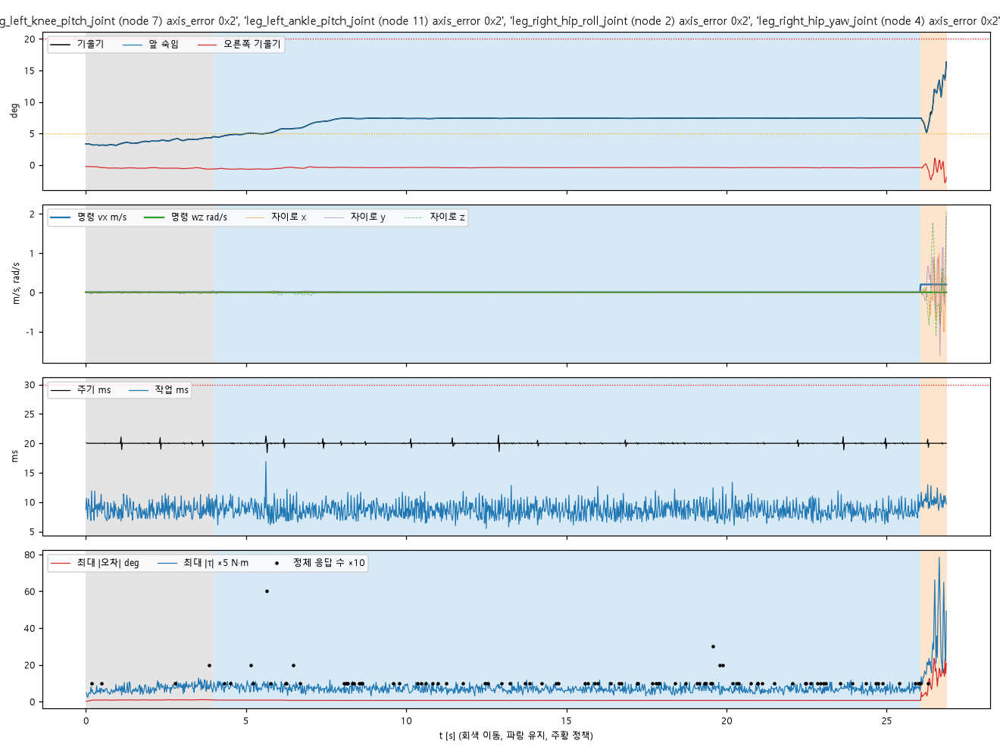
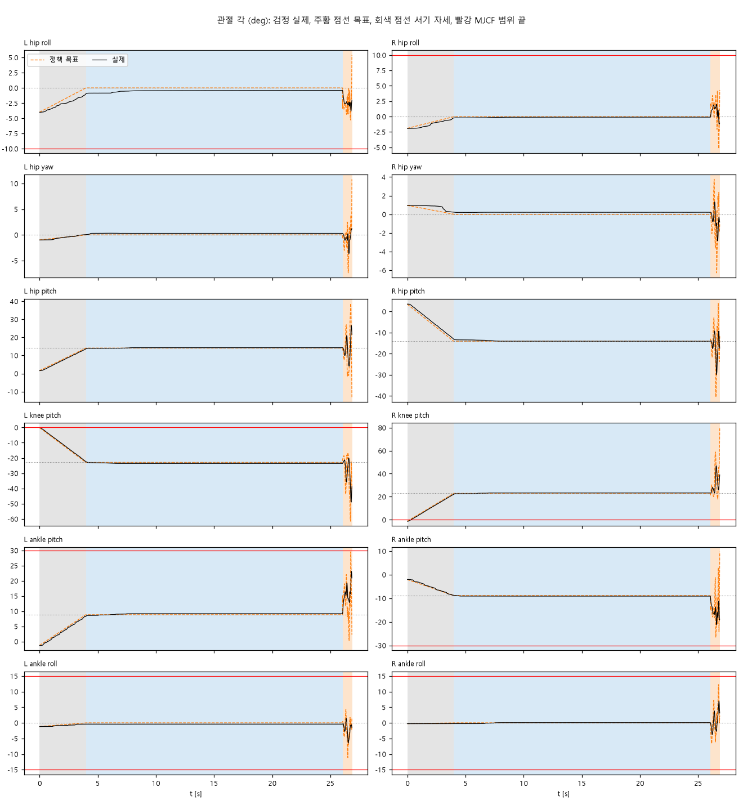
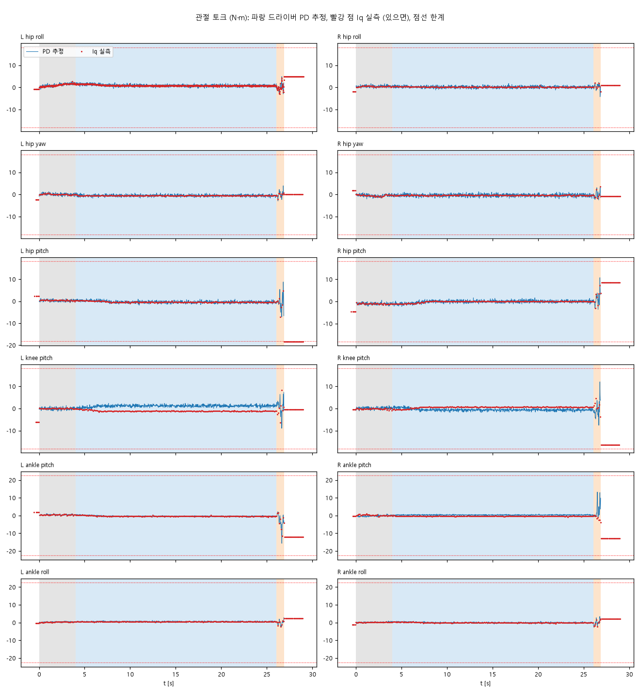
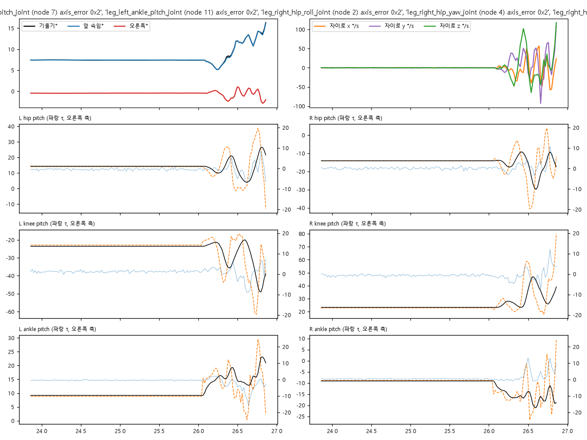

# 정책 보행 기록 분석: policy_walk_20261124_173437

## 한눈에

- ⚠ 드라이버 문제로 멈춤: driver errors ['leg_left_hip_yaw_joint (node 3) axis_error 0x2', 'leg_left_hip_pitch_joint (node 5) axis_error 0x2', 'leg_left_knee_pitch_joint (node 7) axis_error 0x2', 'leg_left_ankle_pitch_joint (node 11) axis_error 0x2', 'leg_right_hip_roll_joint (node 2) axis_error 0x2', 'leg_right_hip_yaw_joint (node 4) axis_error 0x2', 'leg_right_hip_pitch_joint (node 6) axis_error 0x2', 'leg_right_knee_pitch_joint (node 8) axis_error 0x2', 'leg_right_ankle_roll_joint (node 14) axis_error 0x2']
- ⚠ 정책 중 기울기 최대 16.3° (5° 넘은 시간 100 %). S3 통과 기준은 5° 안.
- ⚠ 정책 켜기 직전(발이 바닥에 닿은 서기 자세) IMU가 다리 기구학보다 앞 +7.5°, 오른쪽 -0.5° 기울어 있음 (학습 IMU 장착 기울기 ±2°). 수평계로 몸통 실제 기울기 확인 필요.
- ⚠ L hip pitch 토크가 학습 한계 6 N·m를 넘은 시간 10 % (최대 8.8 N·m; 학습 때는 6에서 잘림).
- ⚠ L knee pitch 토크가 학습 한계 6 N·m를 넘은 시간 18 % (최대 9.0 N·m; 학습 때는 6에서 잘림).
- ⚠ L ankle pitch 토크가 학습 한계 6 N·m를 넘은 시간 15 % (최대 15.7 N·m; 학습 때는 6에서 잘림).
- ⚠ R hip pitch 토크가 학습 한계 6 N·m를 넘은 시간 8 % (최대 10.8 N·m; 학습 때는 6에서 잘림).
- ⚠ R knee pitch 토크가 학습 한계 6 N·m를 넘은 시간 8 % (최대 12.1 N·m; 학습 때는 6에서 잘림).
- ⚠ R ankle pitch 토크가 학습 한계 6 N·m를 넘은 시간 18 % (최대 13.3 N·m; 학습 때는 6에서 잘림).
- ⚠ axis_error DC_BUS_UNDER_VOLTAGE (0x2): 12개 관절, t 26.88~26.97 s (L knee pitch, L hip pitch, L hip yaw, R ankle roll, R hip pitch, R knee pitch, R hip roll, L ankle pitch, L ankle roll, L hip roll, R hip yaw, R ankle pitch) → 여러 드라이버가 동시에 = 전원(버스 전압) 문제
- ⚠ Iq 명령이 학습 한계 6 N·m에 해당하는 전류(6512 5.97 A, 발목 4.79 A)를 넘음: L hip pitch 6.8 A, L knee pitch 8.6 A, L ankle pitch 9.5 A, R hip pitch 6.8 A. 드라이버 전류 한계는 18 A 그대로 (ODrive 0.5.1의 CAN 0x00F는 속도 한계만 바꿈).
- ℹ 엔코더 정체 응답 105번 (정책 중 0.41 %). 5주기 연속이면 Radxa가 멈춤.
- ℹ IMU 쿼터니언이 직전 주기와 같은 주기 1번 (연속 최대 1). imu_reader가 멈칫한 것.
- ℹ 엔코더 읽기가 8 ms 기다림 한도에 닿은 표본이 있습니다 (최대 8.7 ms).
- ℹ 유지(매단 상태) 중 몸통 기울기 앞 +7.1°, 오른쪽 -0.4°. 하네스 때문일 수도 있음. 바닥에 똑바로 세웠을 때도 2°를 넘으면 장착 기울기(학습 ±2°) 확인.
- ℹ 정책 첫 목표가 서기 자세에서 최대 6.5° (L ankle pitch). 오프라인 점검(이상적 관측)에서는 4° 안.
- ✓ 주기 최대 21.4 ms (30 ms 넘은 적 없음).
- ✓ S2: 유지 중 모든 관절이 서기 목표 1° 안 (최대 0.65°).

## 개요

- 폴더: `logs\policy_walk_20261124_173437`
- 파일: real_walk.npz, status.csv, events.txt, meta.json, gui_frames.csv, gui_log.txt
- 시작: 2026-11-24T17:34:37.544, 시작 명령: [0.1, 0.0, 0.0], IMU 축: ['+y', '-x', '+z']
- 토크: 드라이버 전류 한계 18 A (CAN으로 못 바꿈). Radxa 목표 자르기: 없음
- 주기 1344개, 26.9 s: 이동 4.0 s → 유지 22.1 s → 정책 0.8 s
- Radxa 멈춘 이유 (npz): `driver errors ['leg_left_hip_yaw_joint (node 3) axis_error 0x2', 'leg_left_hip_pitch_joint (node 5) axis_error 0x2', 'leg_left_knee_pitch_joint (node 7) axis_error 0x2', 'leg_left_ankle_pitch_joint (node 11) axis_error 0x2', 'leg_right_hip_roll_joint (node 2) axis_error 0x2', 'leg_right_hip_yaw_joint (node 4) axis_error 0x2', 'leg_right_hip_pitch_joint (node 6) axis_error 0x2', 'leg_right_knee_pitch_joint (node 8) axis_error 0x2', 'leg_right_ankle_roll_joint (node 14) axis_error 0x2']`
- GUI 이벤트: `멈춤: driver errors ['leg_left_hip_yaw_joint (node 3) axis_error 0x2', 'leg_left_hip_pitch_joint (node 5) axis_error 0x2', 'leg_left_knee_pitch_joint (node 7) axis_error 0x2', 'leg_left_ankle_pitch_joint (node 11) axis_error 0x2', 'leg_right_hip_roll_joint (node 2) axis_error 0x2', 'leg_right_hip_yaw_joint (node 4) axis_error 0x2', 'leg_right_hip_pitch_joint (node 6) axis_error 0x2', 'leg_right_knee_pitch_joint (node 8) axis_error 0x2', 'leg_right_ankle_roll_joint (node 14) axis_error 0x2']`
- meta.json ↔ npz: 관절 순서 같음, 부호 차이 0, 영점 차이 0.00e+00 turn

## 1. 타이밍·통신

Radxa 루프 (npz): 주기 = 이웃한 주기 시작 간격, 작업 = 한 주기에서 읽기+정책+전송에 든 시간

| 단계 | 주기 수 | 주기 p50 ms | p99 | 최대 | >25 ms | >30 ms | >30 연속 | 작업 p50 ms | p99 | 최대 |
|---|---|---|---|---|---|---|---|---|---|---|
| 이동 | 199 | 20.00 | 20.49 | 21.08 | 0 | 0 | 0 | 8.69 | 11.47 | 11.92 |
| 유지 | 1103 | 20.00 | 20.43 | 21.41 | 0 | 0 | 0 | 8.45 | 11.77 | 16.90 |
| 정책 | 41 | 20.00 | 20.46 | 20.69 | 0 | 0 | 0 | 10.14 | 12.89 | 12.97 |


엔코더 정체 응답 (움직이는 중인데 값이 직전 주기와 완전히 같음 = 8 ms 안에 새 응답 못 받음, 지난 값 사용)

정체 응답이 있는 주기 93개, 그중 6개 넘는 관절이 한꺼번에 정체 (읽기를 통째로 놓침, 보통 Radxa 쪽 지연) 0개

| 관절 | node | 이동 | 유지 | 정책 | 연속 최대 |
|---|---|---|---|---|---|
| L hip roll | 1 | 0 | 3 | 0 | 1 |
| L hip yaw | 3 | 0 | 6 | 0 | 1 |
| L hip pitch | 5 | 0 | 7 | 0 | 1 |
| L knee pitch | 7 | 0 | 8 | 0 | 1 |
| L ankle pitch | 11 | 0 | 7 | 0 | 1 |
| L ankle roll | 13 | 2 | 18 | 0 | 2 |
| R hip roll | 2 | 1 | 9 | 0 | 1 |
| R hip yaw | 4 | 0 | 3 | 0 | 1 |
| R hip pitch | 6 | 0 | 5 | 0 | 1 |
| R knee pitch | 8 | 0 | 10 | 1 | 1 |
| R ankle pitch | 12 | 0 | 9 | 0 | 2 |
| R ankle roll | 14 | 2 | 13 | 1 | 1 |


GUI가 받은 상태 (status.csv, 10 Hz 표본): 엔코더 12개 읽기 시간, 정책이 쓴 IMU 값의 나이

| 단계 | 표본 | 읽기 p50 ms | p99 | 최대 | IMU 나이 p50 ms | p99 | 최대 | 놓침 연속 최대 |
|---|---|---|---|---|---|---|---|---|
| 이동 | 40 | 6.12 | 7.71 | 7.87 | 3.25 | 7.01 | 7.60 | 0 |
| 유지 | 217 | 6.22 | 7.95 | 8.71 | 2.90 | 6.47 | 7.30 | 1 |
| 정책 | 9 | 6.43 | 7.41 | 7.41 | 2.60 | 5.63 | 5.70 | 0 |

## 2. IMU

| 단계 | 기울기 평균° | p95 | 최대 | 앞 숙임 평균° | 오른쪽 기울기 평균° | 중력 평균 (x y z) | 자이로 평균 °/s (x y z) | |자이로| p99 °/s |
|---|---|---|---|---|---|---|---|---|
| 이동 | 3.7 | 4.3 | 4.5 | 3.7 | -0.5 | 0.064 0.008 -0.998 | 0.012 0.052 -0.568 | 1.3 2.2 2.2 |
| 유지 | 7.1 | 7.4 | 7.5 | 7.1 | -0.4 | 0.123 0.008 -0.992 | 0.080 -0.020 -0.118 | 0.9 1.9 3.2 |
| 정책 | 9.9 | 14.3 | 16.3 | 9.8 | -0.7 | 0.171 0.012 -0.984 | -2.979 12.838 5.613 | 57.5 103.2 111.5 |


쿼터니언 크기 1.0000~1.0000. 앞으로 숙이면 중력 x > 0, 오른쪽으로 기울면 중력 y < 0 (절차서 4절). 이동·유지는 매단 상태라 몸통이 하네스에 따라 기울 수 있음.


자이로 ↔ 쿼터니언 변화 (같은 축이면 상관·기울기 > 0; 걸을 때는 표본 시각 차이로 0.7–0.9도 정상. 축 혼동·부호 오류 점검용)

| 축 | 쿼터니언 각속도 표준편차 rad/s | 상관 | 기울기 (자이로/쿼터니언) |
|---|---|---|---|
| x | 0.080 | 0.921 | 0.82 |
| y | 0.104 | 0.882 | 0.80 |
| z | 0.118 | 0.987 | 0.95 |


IMU ↔ 다리 기구학: 디딤발 발바닥이 바닥에 평평하다고 보고 관절 각(MJCF)으로 계산한 몸통 기울기와 IMU를 비교. 서기 자세는 hip+knee+ankle pitch 합이 0이라 발이 평평하면 몸통이 수직. 차이가 일정하면 IMU 장착(또는 가속도계) 기울기, 영점 오차 합, 발이 평평하지 않음(하네스가 몸통을 당김) 중 하나. 발이 바닥에 닿아 체중이 실렸을 때만 의미.

| 구간 | IMU 앞° | 기구학 앞° | 차이° | IMU 오른쪽° | 기구학 오른쪽° | 차이° |
|---|---|---|---|---|---|---|
| 유지 마지막 3 s (정책 켜기 직전) | 7.4 | -0.1 | 7.5 | -0.4 | 0.1 | -0.5 |
| 정책 | 9.8 | 2.3 | 7.5 | -0.7 | -0.3 | -0.4 |

## 3. 서기 자세 (S2)

시작 자세 (첫 주기, deg): L hip roll -4.0, L hip yaw -1.0, L hip pitch +1.6, L knee pitch -0.1, L ankle pitch -1.3, L ankle roll -1.2, R hip roll -1.9, R hip yaw +1.0, R hip pitch +3.5, R knee pitch -1.3, R ankle pitch -2.0, R ankle roll -0.3

유지 구간 4.5~26.0 s (1077주기, 유지 시작 0.5 s 뒤부터). 목표−실제 = 서기 자세 − 엔코더 (드라이버 PD가 남긴 오차), τ = Kp·오차 − Kd·속도

| 관절 | 서기 목표° | 실제 평균° | 목표−실제 평균° | 표준편차° | PD 토크 평균 N·m | 좌우 합° (L+R) |
|---|---|---|---|---|---|---|
| L hip roll | 0.00 | -0.48 | 0.48 | 0.12 | 0.86 | -0.59 |
| L hip yaw | 0.00 | 0.30 | -0.30 | 0.01 | -0.52 | 0.51 |
| L hip pitch | 14.08 | 14.27 | -0.19 | 0.12 | -0.32 | 0.24 |
| L knee pitch | -22.92 | -23.57 | 0.65 | 0.11 | 1.15 | -0.32 |
| L ankle pitch | 8.84 | 9.13 | -0.29 | 0.13 | -0.38 | 0.02 |
| L ankle roll | 0.00 | -0.42 | 0.42 | 0.00 | 0.52 | -0.40 |
| R hip roll | 0.00 | -0.11 | 0.11 | 0.03 | 0.17 |  |
| R hip yaw | 0.00 | 0.21 | -0.21 | 0.00 | -0.37 |  |
| R hip pitch | -14.08 | -14.02 | -0.06 | 0.19 | -0.07 |  |
| R knee pitch | 22.92 | 23.25 | -0.33 | 0.16 | -0.57 |  |
| R ankle pitch | -8.84 | -9.11 | 0.27 | 0.01 | 0.34 |  |
| R ankle roll | 0.00 | 0.02 | -0.02 | 0.09 | -0.03 |  |


좌우 합: 오른쪽 관절은 왼쪽의 거울(부호 반대)이라 대칭이면 0. 최대 0.59°.

이동 끝 (서기 목표 도달 직후) 목표−실제°: L hip roll +0.9, L hip yaw -0.1, L hip pitch +0.4, L knee pitch -0.4, L ankle pitch +0.5, L ankle roll +0.4, R hip roll +0.2, R hip yaw -0.2, R hip pitch -0.9, R knee pitch +0.8, R ankle pitch -0.0, R ankle roll +0.3

## 4. 관절 (정책 중)

정책 중 (첫 주기 제외). 오차 = 직전 목표 − 지금 실제 (deg), τ = 드라이버 PD 토크 추정 (N·m, 드라이버 전류 한계 18 A로 자름; 학습 한계는 6 N·m). 시뮬 보행: 오차 p99 23°, 최대 약 50°, 12° 초과 최장 0.26 s, 관절 속도 최대 11 rad/s.

| 관절 | 범위° | MJCF 끝까지 여유° | |오차| p95 | p99 | 최대 | 12° 초과 최장 s | |τ| p95 | 6 N·m 넘음 % | 6 N·m 넘음 최장 s | |q̇| 최대 rad/s | 정체 응답 |
|---|---|---|---|---|---|---|---|---|---|---|---|
| L hip roll | -4~-0 | 6.2 | 2.4 | 2.9 | 3.0 | 0.00 | 3.13 | 0.0 | 0.00 | 0.8 | 0 |
| L hip yaw | -4~+1 | 30.1 | 4.0 | 5.5 | 5.6 | 0.00 | 2.39 | 0.0 | 0.00 | 1.2 | 0 |
| L hip pitch | +4~+27 | 60.4 | 15.4 | 17.0 | 17.6 | 0.12 | 6.66 | 10.0 | 0.04 | 3.5 | 0 |
| L knee pitch | -49~-20 | 20.1 | 17.3 | 22.0 | 23.7 | 0.16 | 7.55 | 17.5 | 0.08 | 4.5 | 0 |
| L ankle pitch | +9~+23 | 6.9 | 9.9 | 11.5 | 12.5 | 0.02 | 11.49 | 15.0 | 0.10 | 3.3 | 0 |
| L ankle roll | -6~+1 | 8.5 | 3.9 | 5.0 | 5.2 | 0.00 | 2.24 | 0.0 | 0.00 | 1.3 | 0 |
| R hip roll | -1~+2 | 8.0 | 4.0 | 4.0 | 4.1 | 0.00 | 2.33 | 0.0 | 0.00 | 1.0 | 0 |
| R hip yaw | -3~+1 | 32.4 | 3.2 | 4.6 | 4.8 | 0.00 | 3.01 | 0.0 | 0.00 | 0.9 | 0 |
| R hip pitch | -30~-9 | 65.4 | 15.3 | 18.1 | 18.1 | 0.06 | 6.40 | 7.5 | 0.06 | 4.1 | 0 |
| R knee pitch | +23~+47 | 23.2 | 20.9 | 22.9 | 23.5 | 0.08 | 6.15 | 7.5 | 0.04 | 4.7 | 1 |
| R ankle pitch | -21~-9 | 8.8 | 11.2 | 14.2 | 15.3 | 0.02 | 10.01 | 17.5 | 0.06 | 4.5 | 0 |
| R ankle roll | -4~+7 | 8.0 | 4.4 | 5.8 | 5.8 | 0.00 | 2.71 | 0.0 | 0.00 | 1.7 | 1 |


관절 속도 (ODrive vel_estimate) ↔ 위치 차분 상관: L hip roll 0.88, L hip yaw 0.97, L hip pitch 0.99, L knee pitch 0.98, L ankle pitch 0.94, L ankle roll 0.95, R hip roll 0.96, R hip yaw 0.93, R hip pitch 0.99, R knee pitch 0.99, R ankle pitch 0.95, R ankle roll 0.96

## 5. 정책 입력·출력

관측 조립 점검 (기록된 값끼리 비교)

| 항목 | 최대 차이 | 결과 |
|---|---|---|
| 명령 0–2 | 0.0e+00 | 같음 |
| 각속도 3–5 | 0.0e+00 | 같음 |
| 중력 6–8 | 3.0e-08 | 같음 |
| 관절 각 9–20 | 2.9e-08 | 같음 |
| 관절 속도 21–32 | 1.5e-07 | 같음 |
| 직전 행동 33–44 | 0.0e+00 | 같음 |
| 목표 = 서기 + 0.25·clip(행동) | 3.6e-08 | 같음 |
| 정책 재생 (PC numpy) vs Radxa 행동 | 6.0e-07 | 같음 |


정책 첫 주기 (t = 26.06 s): 중력 [0.129, 0.008, -0.992], 각속도 rad/s [-0.005, 0.0, -0.001], 관절 − 서기 최대 0.7°, 명령 [0.2, 0.0, 0.0]

첫 목표 − 서기 자세 (deg): L hip roll -3.4, L hip yaw -0.6, L hip pitch -0.2, L knee pitch +2.2, L ankle pitch +6.5, L ankle roll +0.4, R hip roll +2.1, R hip yaw +0.1, R hip pitch +0.9, R knee pitch -1.4, R ankle pitch -6.1, R ankle roll -2.2


행동 (정책 출력, 배율 전) 41주기. 진동수 = 목표의 주 성분 (0.3–5 Hz), 8 Hz 넘는 비율 = 떨림 지표, Δa/a = 이웃 주기 차이의 표준편차 ÷ 행동 표준편차 (1 Hz 부드러운 움직임 ≈ 0.13, 번갈아 튀면 ≈ 2)

| 관절 | |a| p50 | p99 | 최대 | ±20 잘림 % | 목표−서기 최대° | 주 진동수 Hz | 8 Hz 넘는 비율 | Δa/a |
|---|---|---|---|---|---|---|---|---|
| L hip roll | 0.22 | 0.37 | 0.38 | 0.0 | 5.4 | – | – | 0.86 |
| L hip yaw | 0.09 | 0.66 | 0.76 | 0.0 | 10.8 | – | – | 0.67 |
| L hip pitch | 0.71 | 1.83 | 1.89 | 0.0 | 27.1 | – | – | 0.45 |
| L knee pitch | 0.37 | 2.68 | 2.70 | 0.0 | 38.6 | – | – | 0.44 |
| L ankle pitch | 0.45 | 1.37 | 1.45 | 0.0 | 20.7 | – | – | 0.69 |
| L ankle roll | 0.17 | 0.72 | 0.78 | 0.0 | 11.1 | – | – | 0.55 |
| R hip roll | 0.14 | 0.35 | 0.36 | 0.0 | 5.2 | – | – | 0.72 |
| R hip yaw | 0.12 | 0.41 | 0.44 | 0.0 | 6.3 | – | – | 0.67 |
| R hip pitch | 0.46 | 1.84 | 1.85 | 0.0 | 26.5 | – | – | 0.54 |
| R knee pitch | 0.35 | 3.42 | 3.99 | 0.0 | 57.1 | – | – | 0.40 |
| R ankle pitch | 0.53 | 1.27 | 1.29 | 0.0 | 18.5 | – | – | 0.87 |
| R ankle roll | 0.26 | 0.82 | 0.86 | 0.0 | 12.3 | – | – | 0.45 |


명령 구간 (속도 측정이 없어 vx는 영상으로 확인; 회전은 자이로 z로 비교 가능, 시뮬 0.8 → 0.85 rad/s)

| t s | 길이 s | 명령 vx vy wz | 자이로 z 평균 rad/s | 기울기 평균° | 최대° | 앞 숙임 평균° | 오른쪽 기울기 평균° |
|---|---|---|---|---|---|---|---|
| 26.1~26.9 | 0.8 | 0.20 0.00 0.00 | 0.098 | 9.9 | 16.3 | 9.8 | -0.7 |

## 6. 드라이버 (GUI가 받은 값)

시각 맞추기: 엔코더 응답 4988개가 npz 값과 정확히 일치 → t_npz = t_gui − 30.174 s (차이 p5–p95 -3~+11 ms)


heartbeat 처음 상태: IDLE (node 1,2,3,4,5,6,7,8,11,12,13,14)

heartbeat 상태 변화

| t s | 상태 | axis_error | 관절 |
|---|---|---|---|
| 0.07 | CLOSED_LOOP_CONTROL | 0 | 12개: R ankle pitch, L hip roll, R hip roll, L hip yaw, R hip yaw, L hip pitch, R hip pitch, L knee pitch, R knee pitch, L ankle pitch, L ankle roll, R ankle roll |
| 26.88 | IDLE | DC_BUS_UNDER_VOLTAGE (0x2) | 12개: L knee pitch, L hip yaw, L hip pitch, R hip pitch, R knee pitch, R ankle roll, R hip roll, L hip roll, R hip yaw, L ankle pitch, L ankle roll, R ankle pitch |


Iq (정책 중 표본; 없으면 기록 전체). 6 N·m 전류 = 학습 토크 한계에 해당하는 전류, '넘음 %' = |Iq 명령|이 그 95 % 이상인 표본. τ(Iq) = 방향 × torque_sign × Iq × kt × 15 를 드라이버 PD 추정 τ와 비교 (기울기 ≈ 1, 상관 ≈ 1이면 PD 모델이 맞음)

| 관절 | node | 표본 Hz | |Iq| p95 A | |Iq| 최대 | |Iq 명령| 최대 | 6 N·m 전류 A | 넘음 % | τ(Iq)/τ(PD) 기울기 | 상관 |
|---|---|---|---|---|---|---|---|---|---|
| L hip roll | 1 | 49 | 3.29 | 4.20 | 4.53 | 5.97 | 0.0 | 0.92 | 0.95 |
| L hip yaw | 3 | 10 | 1.68 | 2.13 | 1.71 | 5.97 | 0.0 | – | – |
| L hip pitch | 5 | 10 | 6.28 | 7.09 | 6.77 | 5.97 | 12.5 | – | – |
| L knee pitch | 7 | 10 | 7.59 | 8.32 | 8.56 | 5.97 | 25.0 | – | – |
| L ankle pitch | 11 | 10 | 7.91 | 9.10 | 9.48 | 4.78 | 22.2 | – | – |
| L ankle roll | 13 | 10 | 1.66 | 1.77 | 1.86 | 4.78 | 0.0 | – | – |
| R hip roll | 2 | 10 | 2.06 | 2.09 | 2.56 | 5.97 | 0.0 | – | – |
| R hip yaw | 4 | 10 | 3.15 | 3.62 | 3.65 | 5.97 | 0.0 | – | – |
| R hip pitch | 6 | 10 | 5.80 | 7.26 | 6.76 | 5.97 | 11.1 | – | – |
| R knee pitch | 8 | 10 | 4.24 | 4.51 | 4.44 | 5.97 | 0.0 | – | – |
| R ankle pitch | 12 | 10 | 2.76 | 3.14 | 2.97 | 4.78 | 0.0 | – | – |
| R ankle roll | 14 | 10 | 1.64 | 1.71 | 1.79 | 4.78 | 0.0 | – | – |


버스 전압 (Vbus, 2 s마다 node별): 최소 23.59 V, 중앙 23.86 V, 최대 24.05 V, 표본 179개

## 7. 멈추기 직전

마지막 2 s (0.2 s 간격 + 마지막 주기). 멈춘 이유: `driver errors ['leg_left_hip_yaw_joint (node 3) axis_error 0x2', 'leg_left_hip_pitch_joint (node 5) axis_error 0x2', 'leg_left_knee_pitch_joint (node 7) axis_error 0x2', 'leg_left_ankle_pitch_joint (node 11) axis_error 0x2', 'leg_right_hip_roll_joint (node 2) axis_error 0x2', 'leg_right_hip_yaw_joint (node 4) axis_error 0x2', 'leg_right_hip_pitch_joint (node 6) axis_error 0x2', 'leg_right_knee_pitch_joint (node 8) axis_error 0x2', 'leg_right_ankle_roll_joint (node 14) axis_error 0x2']`. 안전 정지를 일으킨 주기는 기록되지 않음 (기록 전에 멈춤).

| t s | 단계 | 기울기° | 앞 숙임° | 오른쪽° | 최대 |오차|° | 최대 |τ| N·m | 포화 관절 수 | 작업 ms | 명령 |
|---|---|---|---|---|---|---|---|---|---|
| 24.88 | 유지 | 7.4 | 7.4 | -0.4 | L knee pitch 1 | R hip yaw 1.1 | 0 | 10.7 | 0.00 0.00 0.00 |
| 25.08 | 유지 | 7.4 | 7.4 | -0.4 | L knee pitch 1 | L knee pitch 1.4 | 0 | 8.3 | 0.00 0.00 0.00 |
| 25.28 | 유지 | 7.4 | 7.4 | -0.4 | L knee pitch 1 | L knee pitch 1.4 | 0 | 8.4 | 0.00 0.00 0.00 |
| 25.48 | 유지 | 7.4 | 7.4 | -0.4 | L knee pitch 1 | L knee pitch 1.0 | 0 | 9.0 | 0.00 0.00 0.00 |
| 25.68 | 유지 | 7.4 | 7.4 | -0.4 | L knee pitch 1 | R hip pitch 1.4 | 0 | 9.4 | 0.00 0.00 0.00 |
| 25.88 | 유지 | 7.4 | 7.4 | -0.4 | L knee pitch 1 | R hip yaw 1.3 | 0 | 10.2 | 0.00 0.00 0.00 |
| 26.08 | 정책 | 7.4 | 7.4 | -0.4 | L ankle pitch 5 | L knee pitch 2.7 | 0 | 11.7 | 0.20 0.00 0.00 |
| 26.28 | 정책 | 5.8 | 5.8 | -0.6 | L knee pitch 6 | R knee pitch 4.0 | 0 | 13.0 | 0.20 0.00 0.00 |
| 26.48 | 정책 | 11.9 | 11.9 | 0.1 | R knee pitch 23 | R ankle pitch 9.4 | 1 | 10.9 | 0.20 0.00 0.00 |
| 26.68 | 정책 | 11.6 | 11.6 | -0.4 | L hip pitch 14 | L ankle pitch 8.2 | 1 | 11.5 | 0.20 0.00 0.00 |
| 26.86 | 정책 | 16.3 | 16.2 | -2.0 | R knee pitch 21 | R ankle pitch 9.9 | 3 | 9.6 | 0.20 0.00 0.00 |

## 8. 이벤트·GUI 기록

events.txt
```
17:34:37.546 [npz -0.54 s] 시작 요청 (앞으로 0.10 m/s, 토크 한계 6 N·m 적용): L hip roll 부호 -1 영점 0.5236, L hip yaw 부호 -1 영점 0.2441, L hip pitch 부호 -1 영점 0.8354, L knee pitch 부호 -1 영점 0.6002, L ankle pitch 부호 -1 영점 0.9838, L ankle roll 부호 -1 영점 0.2539, R hip roll 부호 -1 영점 0.0262, R hip yaw 부호 -1 영점 0.3778, R hip pitch 부호 -1 영점 0.8512, R knee pitch 부호 -1 영점 0.9853, R ankle pitch 부호 -1 영점 0.8108, R ankle roll 부호 -1 영점 0.9325
17:34:37.971 [npz -0.12 s] Radxa에서 시작: 서기 자세로 4 s 이동
17:34:42.134 [npz +4.05 s] 서기 자세 도달, 유지 중 (발이 바닥에 닿으면 '정책 켜기')
17:34:46.266 [npz +8.18 s] 앞으로 걷는 속도 0.20 m/s
17:35:04.135 [npz +26.05 s] 정책 켜기 (발이 바닥에 닿음)
17:35:04.178 [npz +26.08 s] 정책 보행 시작
17:35:05.091 [npz +27.00 s] 멈춤: driver errors ['leg_left_hip_yaw_joint (node 3) axis_error 0x2', 'leg_left_hip_pitch_joint (node 5) axis_error 0x2', 'leg_left_knee_pitch_joint (node 7) axis_error 0x2', 'leg_left_ankle_pitch_joint (node 11) axis_error 0x2', 'leg_right_hip_roll_joint (node 2) axis_error 0x2', 'leg_right_hip_yaw_joint (node 4) axis_error 0x2', 'leg_right_hip_pitch_joint (node 6) axis_error 0x2', 'leg_right_knee
17:35:05.540 [npz +27.45 s] Radxa 기록 → logs/policy_walk_20261124_173437/real_walk.npz (1025 KB)
```

gui_log.txt 중 경고·Radxa 줄
```
    30.049 [CAN] [Radxa] [bridge] 정책 보행: {'type': 'started', 'log': '/home/radxa/motor_bridge/logs/real_walk_20261124_173437.npz', 'torque_limit': True}
    57.159 [CAN] [Radxa] stopped: driver errors ['leg_left_hip_yaw_joint (node 3) axis_error 0x2', 'leg_left_hip_pitch_joint (node 5) axis_error 0x2', 'leg_left_knee_pitch_joint (node 7) axis_error 0x2', 'leg_left_ankle_pitch_joint (node 11) axis_error 0x2', 'leg_right_hip_roll_joint (node 2) axis_error 0x2', 'leg_right_hip_yaw_joint (node 4) axis_error 0x2', 'leg_right_hip_pitch_joint (node 6) axis_error 0x2', 'leg_right_knee_pitch_joint (node 8) axis_error 0x2', 'leg_right_ankle_roll_joint (node 14) axis_error 0x2']; log -> /home/radxa/motor_bridge/logs/real_walk_20261124_173437.npz
    57.178 [GUI] 정책 보행: 멈춤: driver errors ['leg_left_hip_yaw_joint (node 3) axis_error 0x2', 'leg_left_hip_pitch_joint (node 5) axis_error 0x2', 'leg_left_knee_pitch_joint (node 7) axis_error 0x2', 'leg_left_ankle_pitch_joint (node 11) axis_error 0x2', 'leg_right_hip_roll_joint (node 2) axis_error 0x2', 'leg_right_hip_yaw_joint (node 4) axis_error 0x2', 'leg_right_hip_pitch_joint (node 6) axis_error 0x2', 'leg_right_knee_pitch_joint (node 8) axis_error 0x2', 'leg_right_ankle_roll_joint (node 14) axis_error 0x2']
    57.185 [CAN] [Radxa] [bridge] 정책 보행: {'type': 'stopped', 'reason': "driver errors ['leg_left_hip_yaw_joint (node 3) axis_error 0x2', 'leg_left_hip_pitch_joint (node 5) axis_error 0x2', 'leg_left_knee_pitch_joint (node 7) axis_error 0x2', 'leg_left_ankle_pitch_joint (node 11) axis_error 0x2', 'leg_right_hip_roll_joint (node 2) axis_error 0x2', 'leg_right_hip_yaw_joint (node 4) axis_error 0x2', 'leg_right_hip_pitch_joint (node 6) axis_error 0x2', 'leg_right_knee_pitch_joint (node 8) axis_error 0x2', 'leg_right_ankle_roll_joint (node 14) axis_error 0x2']", 'log': '/home/radxa/motor_bridge/logs/real_walk_20261124_173437.npz', 'log_size': 1050394}
```

## 그림





