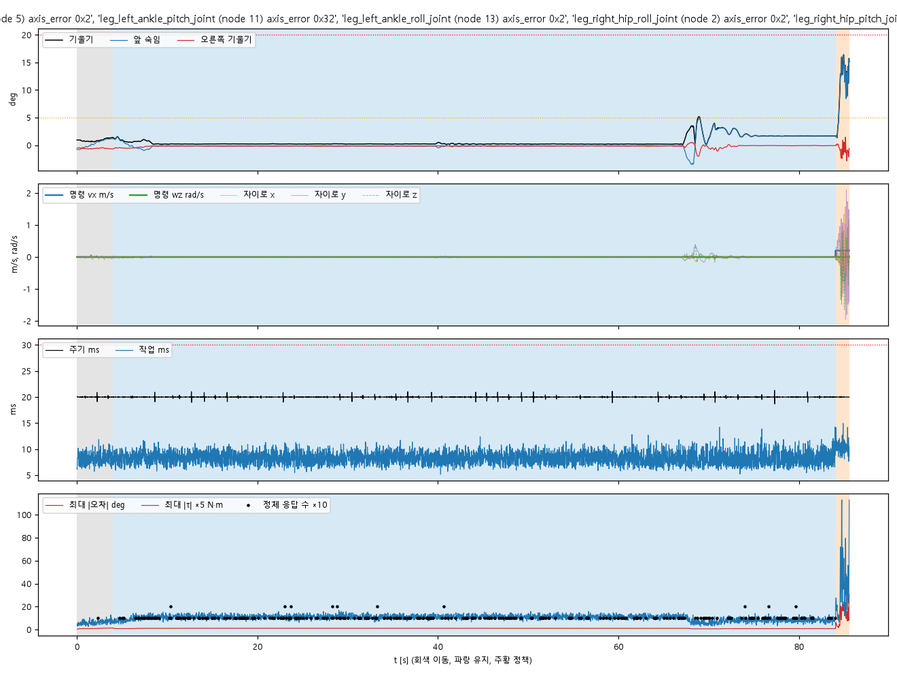
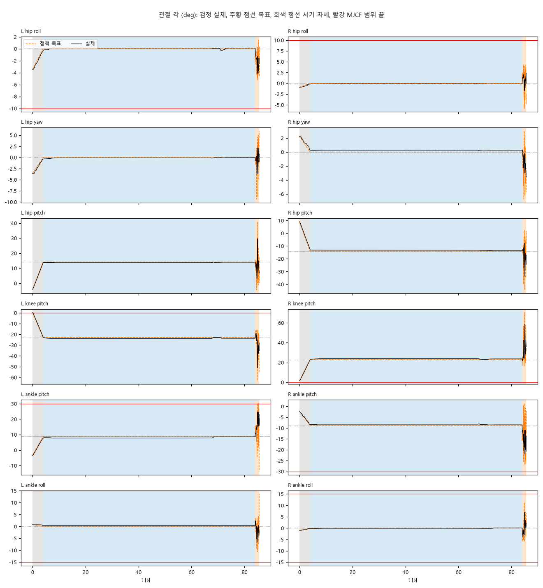
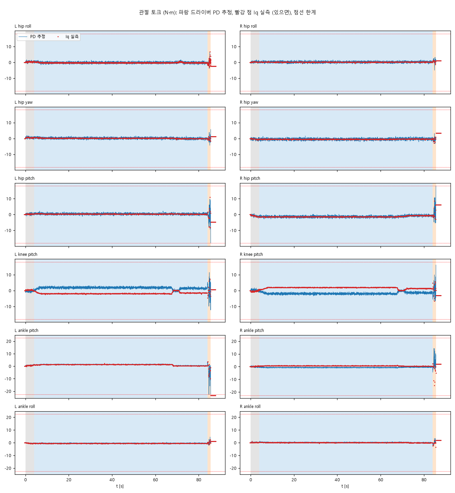
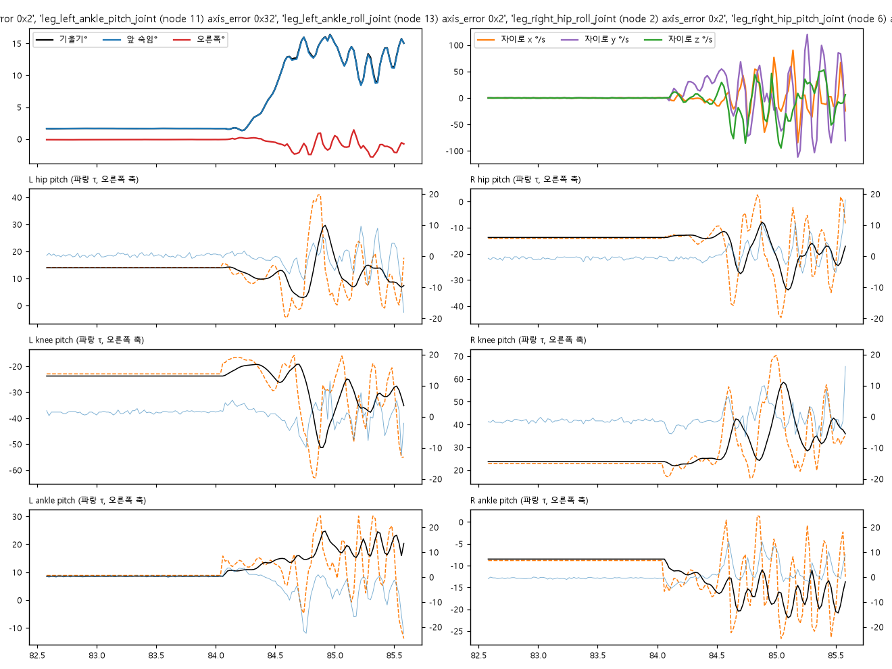

# 정책 보행 기록 분석: policy_walk_20261124_174247

## 한눈에

- ⚠ 드라이버 문제로 멈춤: driver errors ['leg_left_hip_yaw_joint (node 3) axis_error 0x2', 'leg_left_hip_pitch_joint (node 5) axis_error 0x2', 'leg_left_ankle_pitch_joint (node 11) axis_error 0x32', 'leg_left_ankle_roll_joint (node 13) axis_error 0x2', 'leg_right_hip_roll_joint (node 2) axis_error 0x2', 'leg_right_hip_pitch_joint (node 6) axis_error 0x2', 'leg_right_knee_pitch_joint (node 8) axis_error 0x2', 'leg_right_ankle_roll_joint (node 14) axis_error 0x2']
- ⚠ 엔코더 정체 응답 315번 (정책 중 0.00 %). 5주기 연속이면 Radxa가 멈춤.
- ⚠ 정책 중 기울기 최대 16.4° (5° 넘은 시간 77 %). S3 통과 기준은 5° 안.
- ⚠ 정책 켜기 직전(발이 바닥에 닿은 서기 자세) IMU가 다리 기구학보다 앞 +2.9°, 오른쪽 -0.4° 기울어 있음 (학습 IMU 장착 기울기 ±2°). 수평계로 몸통 실제 기울기 확인 필요.
- ⚠ S2: 서기 자세 목표와 1° 넘게 차이: R knee pitch -1.0° (마찰 0.36 N·m ≈ 0.2°, 다리 무게 포함).
- ⚠ L hip pitch 토크가 학습 한계 6 N·m를 넘은 시간 16 % (최대 18.1 N·m; 학습 때는 6에서 잘림).
- ⚠ L knee pitch 토크가 학습 한계 6 N·m를 넘은 시간 13 % (최대 12.3 N·m; 학습 때는 6에서 잘림).
- ⚠ L ankle pitch 추종 오차가 시뮬보다 큼: p99 25° (시뮬 23°), 최대 31° (50°), 12° 초과 최장 0.06 s (0.26 s).
- ⚠ L ankle pitch 토크가 학습 한계 6 N·m를 넘은 시간 33 % (최대 22.6 N·m; 학습 때는 6에서 잘림).
- ⚠ R hip pitch 토크가 학습 한계 6 N·m를 넘은 시간 11 % (최대 18.1 N·m; 학습 때는 6에서 잘림).
- ⚠ R knee pitch 토크가 학습 한계 6 N·m를 넘은 시간 13 % (최대 16.2 N·m; 학습 때는 6에서 잘림).
- ⚠ R ankle pitch 토크가 학습 한계 6 N·m를 넘은 시간 21 % (최대 14.4 N·m; 학습 때는 6에서 잘림).
- ⚠ axis_error DC_BUS_UNDER_VOLTAGE (0x2): 7개 관절, t 85.61 s (L hip yaw, L ankle roll, L hip pitch, R hip roll, R ankle roll, R knee pitch, R hip pitch) → 여러 드라이버가 동시에 = 전원(버스 전압) 문제
- ⚠ axis_error DC_BUS_UNDER_VOLTAGE | BRAKE_RESISTOR_DISARMED | MOTOR_DISARMED (0x32): 1개 관절, t 85.61 s (L ankle pitch)
- ⚠ node 11 motor.error DC_BUS_OVER_CURRENT (0x8000)
- ⚠ node 11 motor.error DC_BUS_OVER_CURRENT (0x8000)
- ⚠ node 11 motor.error DC_BUS_OVER_CURRENT (0x8000)
- ⚠ node 11 motor.error DC_BUS_OVER_CURRENT (0x8000)
- ⚠ Iq 명령이 학습 한계 6 N·m에 해당하는 전류(6512 5.97 A, 발목 4.79 A)를 넘음: L hip roll 7.5 A, L hip pitch 11.0 A, L knee pitch 7.5 A, L ankle pitch 7.8 A, R hip pitch 8.3 A, R ankle pitch 11.5 A. 드라이버 전류 한계는 18 A 그대로 (ODrive 0.5.1의 CAN 0x00F는 속도 한계만 바꿈).
- ℹ IMU 쿼터니언이 직전 주기와 같은 주기 10번 (연속 최대 1). imu_reader가 멈칫한 것.
- ℹ 엔코더 읽기가 8 ms 기다림 한도에 닿은 표본이 있습니다 (최대 8.6 ms).
- ℹ L ankle pitch 관절 속도 최대 11.7 rad/s (시뮬 보행 최대 11, 드라이버 과속 오류 25).
- ℹ 정책 첫 목표가 서기 자세에서 최대 7.1° (R ankle pitch). 오프라인 점검(이상적 관측)에서는 4° 안.
- ✓ 주기 최대 21.3 ms (30 ms 넘은 적 없음).

## 개요

- 폴더: `logs\policy_walk_20261124_174247`
- 파일: real_walk.npz, status.csv, events.txt, meta.json, gui_frames.csv, gui_log.txt
- 시작: 2026-11-24T17:42:47.099, 시작 명령: [0.1, 0.0, 0.0], IMU 축: ['+y', '-x', '+z']
- 토크: 드라이버 전류 한계 18 A (CAN으로 못 바꿈). Radxa 목표 자르기: 없음
- 주기 4280개, 85.6 s: 이동 4.0 s → 유지 80.1 s → 정책 1.5 s
- Radxa 멈춘 이유 (npz): `driver errors ['leg_left_hip_yaw_joint (node 3) axis_error 0x2', 'leg_left_hip_pitch_joint (node 5) axis_error 0x2', 'leg_left_ankle_pitch_joint (node 11) axis_error 0x32', 'leg_left_ankle_roll_joint (node 13) axis_error 0x2', 'leg_right_hip_roll_joint (node 2) axis_error 0x2', 'leg_right_hip_pitch_joint (node 6) axis_error 0x2', 'leg_right_knee_pitch_joint (node 8) axis_error 0x2', 'leg_right_ankle_roll_joint (node 14) axis_error 0x2']`
- GUI 이벤트: `멈춤: driver errors ['leg_left_hip_yaw_joint (node 3) axis_error 0x2', 'leg_left_hip_pitch_joint (node 5) axis_error 0x2', 'leg_left_ankle_pitch_joint (node 11) axis_error 0x32', 'leg_left_ankle_roll_joint (node 13) axis_error 0x2', 'leg_right_hip_roll_joint (node 2) axis_error 0x2', 'leg_right_hip_pitch_joint (node 6) axis_error 0x2', 'leg_right_knee_pitch_joint (node 8) axis_error 0x2', 'leg_right_ankle_roll_joint (node 14) axis_error 0x2']`
- meta.json ↔ npz: 관절 순서 같음, 부호 차이 0, 영점 차이 0.00e+00 turn

## 1. 타이밍·통신

Radxa 루프 (npz): 주기 = 이웃한 주기 시작 간격, 작업 = 한 주기에서 읽기+정책+전송에 든 시간

| 단계 | 주기 수 | 주기 p50 ms | p99 | 최대 | >25 ms | >30 ms | >30 연속 | 작업 p50 ms | p99 | 최대 |
|---|---|---|---|---|---|---|---|---|---|---|
| 이동 | 199 | 20.00 | 20.21 | 20.89 | 0 | 0 | 0 | 8.43 | 10.87 | 11.84 |
| 유지 | 4003 | 20.00 | 20.21 | 21.29 | 0 | 0 | 0 | 8.36 | 11.18 | 14.27 |
| 정책 | 77 | 20.00 | 20.08 | 20.09 | 0 | 0 | 0 | 10.24 | 14.39 | 14.95 |


엔코더 정체 응답 (움직이는 중인데 값이 직전 주기와 완전히 같음 = 8 ms 안에 새 응답 못 받음, 지난 값 사용)

정체 응답이 있는 주기 305개, 그중 6개 넘는 관절이 한꺼번에 정체 (읽기를 통째로 놓침, 보통 Radxa 쪽 지연) 0개

| 관절 | node | 이동 | 유지 | 정책 | 연속 최대 |
|---|---|---|---|---|---|
| L hip roll | 1 | 0 | 33 | 0 | 2 |
| L hip yaw | 3 | 0 | 36 | 0 | 1 |
| L hip pitch | 5 | 0 | 27 | 0 | 2 |
| L knee pitch | 7 | 0 | 24 | 0 | 2 |
| L ankle pitch | 11 | 0 | 31 | 0 | 2 |
| L ankle roll | 13 | 0 | 22 | 0 | 1 |
| R hip roll | 2 | 0 | 25 | 0 | 2 |
| R hip yaw | 4 | 0 | 24 | 0 | 1 |
| R hip pitch | 6 | 0 | 15 | 0 | 2 |
| R knee pitch | 8 | 0 | 26 | 0 | 1 |
| R ankle pitch | 12 | 0 | 28 | 0 | 1 |
| R ankle roll | 14 | 1 | 23 | 0 | 1 |


GUI가 받은 상태 (status.csv, 10 Hz 표본): 엔코더 12개 읽기 시간, 정책이 쓴 IMU 값의 나이

| 단계 | 표본 | 읽기 p50 ms | p99 | 최대 | IMU 나이 p50 ms | p99 | 최대 | 놓침 연속 최대 |
|---|---|---|---|---|---|---|---|---|
| 이동 | 40 | 6.05 | 6.81 | 6.82 | 2.75 | 6.27 | 6.50 | 0 |
| 유지 | 788 | 5.96 | 7.48 | 8.02 | 3.10 | 6.51 | 10.00 | 0 |
| 정책 | 17 | 6.01 | 8.38 | 8.62 | 2.80 | 5.57 | 5.70 | 0 |

## 2. IMU

| 단계 | 기울기 평균° | p95 | 최대 | 앞 숙임 평균° | 오른쪽 기울기 평균° | 중력 평균 (x y z) | 자이로 평균 °/s (x y z) | |자이로| p99 °/s |
|---|---|---|---|---|---|---|---|---|
| 이동 | 0.9 | 1.3 | 1.4 | 0.3 | -0.6 | 0.005 0.010 -1.000 | -0.057 0.447 -0.806 | 2.1 3.4 4.8 |
| 유지 | 0.6 | 2.4 | 5.2 | 0.2 | -0.2 | 0.004 0.003 -1.000 | -0.025 -0.008 0.029 | 2.6 7.6 4.3 |
| 정책 | 10.1 | 15.7 | 16.4 | 10.1 | -0.8 | 0.174 0.013 -0.981 | 0.492 7.235 -7.125 | 85.9 113.8 87.7 |


쿼터니언 크기 1.0000~1.0000. 앞으로 숙이면 중력 x > 0, 오른쪽으로 기울면 중력 y < 0 (절차서 4절). 이동·유지는 매단 상태라 몸통이 하네스에 따라 기울 수 있음.


자이로 ↔ 쿼터니언 변화 (같은 축이면 상관·기울기 > 0; 걸을 때는 표본 시각 차이로 0.7–0.9도 정상. 축 혼동·부호 오류 점검용)

| 축 | 쿼터니언 각속도 표준편차 rad/s | 상관 | 기울기 (자이로/쿼터니언) |
|---|---|---|---|
| x | 0.066 | 0.912 | 0.81 |
| y | 0.123 | 0.947 | 0.84 |
| z | 0.077 | 0.978 | 0.96 |


IMU ↔ 다리 기구학: 디딤발 발바닥이 바닥에 평평하다고 보고 관절 각(MJCF)으로 계산한 몸통 기울기와 IMU를 비교. 서기 자세는 hip+knee+ankle pitch 합이 0이라 발이 평평하면 몸통이 수직. 차이가 일정하면 IMU 장착(또는 가속도계) 기울기, 영점 오차 합, 발이 평평하지 않음(하네스가 몸통을 당김) 중 하나. 발이 바닥에 닿아 체중이 실렸을 때만 의미.

| 구간 | IMU 앞° | 기구학 앞° | 차이° | IMU 오른쪽° | 기구학 오른쪽° | 차이° |
|---|---|---|---|---|---|---|
| 유지 마지막 3 s (정책 켜기 직전) | 1.7 | -1.2 | 2.9 | -0.1 | 0.4 | -0.4 |
| 정책 | 10.1 | 1.4 | 8.7 | -0.8 | -0.6 | -0.2 |

## 3. 서기 자세 (S2)

시작 자세 (첫 주기, deg): L hip roll -3.5, L hip yaw -3.6, L hip pitch -4.1, L knee pitch +0.3, L ankle pitch -3.4, L ankle roll +0.7, R hip roll -0.9, R hip yaw +2.2, R hip pitch +9.0, R knee pitch +1.7, R ankle pitch -2.2, R ankle roll -1.0

유지 구간 4.5~84.0 s (3978주기, 유지 시작 0.5 s 뒤부터). 목표−실제 = 서기 자세 − 엔코더 (드라이버 PD가 남긴 오차), τ = Kp·오차 − Kd·속도

| 관절 | 서기 목표° | 실제 평균° | 목표−실제 평균° | 표준편차° | PD 토크 평균 N·m | 좌우 합° (L+R) |
|---|---|---|---|---|---|---|
| L hip roll | 0.00 | 0.10 | -0.10 | 0.06 | -0.18 | -0.02 |
| L hip yaw | 0.00 | -0.09 | 0.09 | 0.07 | 0.16 | 0.15 |
| L hip pitch | 14.08 | 13.88 | 0.20 | 0.04 | 0.36 | 0.52 |
| L knee pitch | -22.92 | -23.90 | 0.99 | 0.24 | 1.72 | 0.03 |
| L ankle pitch | 8.84 | 7.93 | 0.91 | 0.33 | 1.14 | -0.37 |
| L ankle roll | 0.00 | 0.43 | -0.43 | 0.01 | -0.54 | 0.35 |
| R hip roll | 0.00 | -0.12 | 0.12 | 0.01 | 0.21 |  |
| R hip yaw | 0.00 | 0.24 | -0.24 | 0.04 | -0.42 |  |
| R hip pitch | -14.08 | -13.36 | -0.73 | 0.15 | -1.27 |  |
| R knee pitch | 22.92 | 23.93 | -1.01 | 0.25 | -1.78 |  |
| R ankle pitch | -8.84 | -8.30 | -0.54 | 0.10 | -0.67 |  |
| R ankle roll | 0.00 | -0.08 | 0.08 | 0.06 | 0.09 |  |


좌우 합: 오른쪽 관절은 왼쪽의 거울(부호 반대)이라 대칭이면 0. 최대 0.52°.

이동 끝 (서기 목표 도달 직후) 목표−실제°: L hip roll +0.3, L hip yaw +0.3, L hip pitch +0.6, L knee pitch -0.4, L ankle pitch +1.1, L ankle roll -0.4, R hip roll +0.2, R hip yaw -0.3, R hip pitch -1.3, R knee pitch +0.2, R ankle pitch -0.4, R ankle roll +0.3

## 4. 관절 (정책 중)

정책 중 (첫 주기 제외). 오차 = 직전 목표 − 지금 실제 (deg), τ = 드라이버 PD 토크 추정 (N·m, 드라이버 전류 한계 18 A로 자름; 학습 한계는 6 N·m). 시뮬 보행: 오차 p99 23°, 최대 약 50°, 12° 초과 최장 0.26 s, 관절 속도 최대 11 rad/s.

| 관절 | 범위° | MJCF 끝까지 여유° | |오차| p95 | p99 | 최대 | 12° 초과 최장 s | |τ| p95 | 6 N·m 넘음 % | 6 N·m 넘음 최장 s | |q̇| 최대 rad/s | 정체 응답 |
|---|---|---|---|---|---|---|---|---|---|---|---|
| L hip roll | -4~+0 | 5.7 | 2.9 | 3.3 | 3.6 | 0.00 | 2.66 | 1.3 | 0.02 | 1.2 | 0 |
| L hip yaw | -4~+2 | 29.9 | 6.1 | 7.6 | 8.0 | 0.00 | 2.95 | 0.0 | 0.00 | 1.7 | 0 |
| L hip pitch | +3~+30 | 59.3 | 16.3 | 20.7 | 21.1 | 0.14 | 9.08 | 15.8 | 0.04 | 4.3 | 0 |
| L knee pitch | -51~-19 | 19.2 | 18.7 | 20.5 | 22.1 | 0.16 | 8.72 | 13.2 | 0.06 | 4.7 | 0 |
| L ankle pitch | +9~+25 | 5.3 | 17.2 | 24.9 | 30.9 | 0.06 | 15.79 | 32.9 | 0.12 | 11.7 | 0 |
| L ankle roll | -7~+2 | 8.5 | 4.5 | 5.6 | 6.5 | 0.00 | 2.52 | 0.0 | 0.00 | 2.4 | 0 |
| R hip roll | -2~+2 | 7.6 | 4.1 | 5.2 | 6.0 | 0.00 | 2.47 | 0.0 | 0.00 | 1.3 | 0 |
| R hip yaw | -4~+0 | 33.5 | 3.2 | 4.7 | 5.0 | 0.00 | 2.40 | 0.0 | 0.00 | 1.0 | 0 |
| R hip pitch | -34~-8 | 64.1 | 18.5 | 22.5 | 23.8 | 0.06 | 8.75 | 10.5 | 0.06 | 4.3 | 0 |
| R knee pitch | +22~+59 | 21.9 | 20.2 | 21.9 | 23.8 | 0.16 | 7.34 | 13.2 | 0.08 | 4.8 | 0 |
| R ankle pitch | -22~-9 | 8.0 | 12.3 | 13.8 | 13.8 | 0.04 | 10.94 | 21.1 | 0.18 | 4.8 | 0 |
| R ankle roll | -4~+7 | 8.0 | 4.2 | 4.8 | 5.0 | 0.00 | 2.47 | 0.0 | 0.00 | 1.8 | 0 |


관절 속도 (ODrive vel_estimate) ↔ 위치 차분 상관: L hip roll 0.91, L hip yaw 0.97, L hip pitch 0.98, L knee pitch 0.99, L ankle pitch 0.90, L ankle roll 0.93, R hip roll 0.95, R hip yaw 0.93, R hip pitch 0.97, R knee pitch 0.99, R ankle pitch 0.97, R ankle roll 0.93

## 5. 정책 입력·출력

관측 조립 점검 (기록된 값끼리 비교)

| 항목 | 최대 차이 | 결과 |
|---|---|---|
| 명령 0–2 | 0.0e+00 | 같음 |
| 각속도 3–5 | 0.0e+00 | 같음 |
| 중력 6–8 | 2.9e-08 | 같음 |
| 관절 각 9–20 | 5.0e-08 | 같음 |
| 관절 속도 21–32 | 4.5e-07 | 같음 |
| 직전 행동 33–44 | 0.0e+00 | 같음 |
| 목표 = 서기 + 0.25·clip(행동) | 3.6e-08 | 같음 |
| 정책 재생 (PC numpy) vs Radxa 행동 | 9.5e-07 | 같음 |


정책 첫 주기 (t = 84.06 s): 중력 [0.029, 0.001, -1.0], 각속도 rad/s [0.003, 0.003, 0.003], 관절 − 서기 최대 0.8°, 명령 [0.2, 0.0, 0.0]

첫 목표 − 서기 자세 (deg): L hip roll -1.8, L hip yaw -0.6, L hip pitch +1.4, L knee pitch +4.2, L ankle pitch +7.0, L ankle roll +2.9, R hip roll +2.0, R hip yaw -0.2, R hip pitch +0.2, R knee pitch -4.7, R ankle pitch -7.1, R ankle roll -1.8


행동 (정책 출력, 배율 전) 77주기. 진동수 = 목표의 주 성분 (0.3–5 Hz), 8 Hz 넘는 비율 = 떨림 지표, Δa/a = 이웃 주기 차이의 표준편차 ÷ 행동 표준편차 (1 Hz 부드러운 움직임 ≈ 0.13, 번갈아 튀면 ≈ 2)

| 관절 | |a| p50 | p99 | 최대 | ±20 잘림 % | 목표−서기 최대° | 주 진동수 Hz | 8 Hz 넘는 비율 | Δa/a |
|---|---|---|---|---|---|---|---|---|
| L hip roll | 0.16 | 0.37 | 0.37 | 0.0 | 5.3 | – | – | 1.10 |
| L hip yaw | 0.10 | 0.62 | 0.65 | 0.0 | 9.4 | – | – | 0.65 |
| L hip pitch | 0.42 | 1.87 | 1.87 | 0.0 | 26.8 | – | – | 0.49 |
| L knee pitch | 0.43 | 2.79 | 2.80 | 0.0 | 40.2 | – | – | 0.42 |
| L ankle pitch | 0.37 | 1.52 | 1.58 | 0.0 | 22.6 | – | – | 0.69 |
| L ankle roll | 0.15 | 0.79 | 0.95 | 0.0 | 13.6 | – | – | 0.71 |
| R hip roll | 0.15 | 0.35 | 0.41 | 0.0 | 5.8 | – | – | 0.69 |
| R hip yaw | 0.14 | 0.45 | 0.47 | 0.0 | 6.7 | – | – | 0.78 |
| R hip pitch | 0.34 | 2.05 | 2.12 | 0.0 | 30.3 | – | – | 0.58 |
| R knee pitch | 0.42 | 3.28 | 3.31 | 0.0 | 47.5 | – | – | 0.42 |
| R ankle pitch | 0.40 | 1.23 | 1.25 | 0.0 | 17.9 | – | – | 0.87 |
| R ankle roll | 0.24 | 0.71 | 0.79 | 0.0 | 11.3 | – | – | 0.49 |


명령 구간 (속도 측정이 없어 vx는 영상으로 확인; 회전은 자이로 z로 비교 가능, 시뮬 0.8 → 0.85 rad/s)

| t s | 길이 s | 명령 vx vy wz | 자이로 z 평균 rad/s | 기울기 평균° | 최대° | 앞 숙임 평균° | 오른쪽 기울기 평균° |
|---|---|---|---|---|---|---|---|
| 84.1~85.6 | 1.5 | 0.20 0.00 0.00 | -0.124 | 10.1 | 16.4 | 10.1 | -0.8 |

## 6. 드라이버 (GUI가 받은 값)

시각 맞추기: 엔코더 응답 7463개가 npz 값과 정확히 일치 → t_npz = t_gui − 115.276 s (차이 p5–p95 -4~+15 ms)


heartbeat 처음 상태: IDLE (node 1,2,3,4,5,6,7,8,11,12,13,14)

heartbeat 상태 변화

| t s | 상태 | axis_error | 관절 |
|---|---|---|---|
| 0.01 | CLOSED_LOOP_CONTROL | 0 | 12개: R ankle pitch, R hip roll, L hip yaw, R knee pitch, L ankle pitch, R ankle roll, L hip roll, L knee pitch, R hip pitch, L hip pitch, L ankle roll, R hip yaw |
| 85.61 | IDLE | DC_BUS_UNDER_VOLTAGE | BRAKE_RESISTOR_DISARMED | MOTOR_DISARMED (0x32) | 1개: L ankle pitch |
| 85.61 | IDLE | DC_BUS_UNDER_VOLTAGE (0x2) | 7개: L hip yaw, R hip roll, L hip pitch, L ankle roll, R knee pitch, R ankle roll, R hip pitch |
| 85.70 | IDLE | 0 | 4개: R ankle pitch, L knee pitch, L hip roll, R hip yaw |


Iq (정책 중 표본; 없으면 기록 전체). 6 N·m 전류 = 학습 토크 한계에 해당하는 전류, '넘음 %' = |Iq 명령|이 그 95 % 이상인 표본. τ(Iq) = 방향 × torque_sign × Iq × kt × 15 를 드라이버 PD 추정 τ와 비교 (기울기 ≈ 1, 상관 ≈ 1이면 PD 모델이 맞음)

| 관절 | node | 표본 Hz | |Iq| p95 A | |Iq| 최대 | |Iq 명령| 최대 | 6 N·m 전류 A | 넘음 % | τ(Iq)/τ(PD) 기울기 | 상관 |
|---|---|---|---|---|---|---|---|---|---|
| L hip roll | 1 | 50 | 3.15 | 6.68 | 7.51 | 5.97 | 2.6 | 0.90 | 0.84 |
| L hip yaw | 3 | 10 | 1.45 | 1.63 | 1.58 | 5.97 | 0.0 | 0.52 | 0.71 |
| L hip pitch | 5 | 10 | 9.00 | 10.94 | 10.99 | 5.97 | 26.7 | 0.91 | 0.83 |
| L knee pitch | 7 | 10 | 6.21 | 7.06 | 7.46 | 5.97 | 12.5 | -0.89 | -0.85 |
| L ankle pitch | 11 | 10 | 6.92 | 7.88 | 7.77 | 4.78 | 26.7 | 1.00 | 0.97 |
| L ankle roll | 13 | 10 | 1.43 | 1.86 | 1.87 | 4.78 | 0.0 | 0.61 | 0.58 |
| R hip roll | 2 | 10 | 1.23 | 1.25 | 1.69 | 5.97 | 0.0 | 0.73 | 0.64 |
| R hip yaw | 4 | 10 | 2.41 | 2.85 | 3.51 | 5.97 | 0.0 | 0.97 | 0.63 |
| R hip pitch | 6 | 10 | 6.70 | 8.43 | 8.29 | 5.97 | 13.3 | 0.90 | 0.98 |
| R knee pitch | 8 | 10 | 5.75 | 6.54 | 5.45 | 5.97 | 0.0 | -0.88 | -0.92 |
| R ankle pitch | 12 | 10 | 10.20 | 11.73 | 11.47 | 4.78 | 18.8 | -0.92 | -0.92 |
| R ankle roll | 14 | 10 | 2.17 | 2.84 | 4.03 | 4.78 | 0.0 | 0.95 | 0.77 |


버스 전압 (Vbus, 2 s마다 node별): 최소 23.33 V, 중앙 23.86 V, 최대 24.11 V, 표본 531개

## 7. 멈추기 직전

마지막 2 s (0.2 s 간격 + 마지막 주기). 멈춘 이유: `driver errors ['leg_left_hip_yaw_joint (node 3) axis_error 0x2', 'leg_left_hip_pitch_joint (node 5) axis_error 0x2', 'leg_left_ankle_pitch_joint (node 11) axis_error 0x32', 'leg_left_ankle_roll_joint (node 13) axis_error 0x2', 'leg_right_hip_roll_joint (node 2) axis_error 0x2', 'leg_right_hip_pitch_joint (node 6) axis_error 0x2', 'leg_right_knee_pitch_joint (node 8) axis_error 0x2', 'leg_right_ankle_roll_joint (node 14) axis_error 0x2']`. 안전 정지를 일으킨 주기는 기록되지 않음 (기록 전에 멈춤).

| t s | 단계 | 기울기° | 앞 숙임° | 오른쪽° | 최대 |오차|° | 최대 |τ| N·m | 포화 관절 수 | 작업 ms | 명령 |
|---|---|---|---|---|---|---|---|---|---|
| 83.58 | 유지 | 1.7 | 1.7 | -0.1 | L knee pitch 1 | L knee pitch 1.7 | 0 | 9.8 | 0.00 0.00 0.00 |
| 83.78 | 유지 | 1.7 | 1.7 | -0.1 | L knee pitch 1 | R knee pitch 2.3 | 0 | 7.0 | 0.00 0.00 0.00 |
| 83.98 | 유지 | 1.6 | 1.6 | -0.1 | L knee pitch 1 | L knee pitch 1.7 | 0 | 6.6 | 0.00 0.00 0.00 |
| 84.18 | 정책 | 1.7 | 1.7 | 0.1 | L knee pitch 4 | L knee pitch 3.3 | 0 | 9.7 | 0.20 0.00 0.00 |
| 84.38 | 정책 | 4.1 | 4.1 | 0.0 | L ankle pitch 3 | R hip yaw 2.2 | 0 | 8.6 | 0.20 0.00 0.00 |
| 84.58 | 정책 | 12.3 | 12.3 | -1.1 | R knee pitch 15 | R ankle pitch 9.6 | 2 | 8.3 | 0.20 0.00 0.00 |
| 84.78 | 정책 | 13.8 | 13.6 | -2.4 | L knee pitch 17 | L ankle pitch 13.5 | 1 | 8.4 | 0.20 0.00 0.00 |
| 84.98 | 정책 | 15.8 | 15.8 | -0.3 | R knee pitch 24 | R ankle pitch 12.4 | 2 | 11.1 | 0.20 0.00 0.00 |
| 85.18 | 정책 | 12.0 | 12.0 | 0.4 | R knee pitch 17 | L ankle pitch 15.8 | 1 | 9.8 | 0.20 0.00 0.00 |
| 85.38 | 정책 | 11.7 | 11.7 | -0.9 | L ankle pitch 7 | R knee pitch 6.3 | 1 | 9.7 | 0.20 0.00 0.00 |
| 85.58 | 정책 | 15.1 | 15.0 | -0.8 | L ankle pitch 31 | L ankle pitch 22.6 | 5 | 8.6 | 0.20 0.00 0.00 |
| 85.58 | 정책 | 15.1 | 15.0 | -0.8 | L ankle pitch 31 | L ankle pitch 22.6 | 5 | 8.6 | 0.20 0.00 0.00 |

## 8. 이벤트·GUI 기록

events.txt
```
17:42:47.103 [npz -0.54 s] 시작 요청 (앞으로 0.10 m/s, 토크 한계 6 N·m 적용): L hip roll 부호 -1 영점 0.5236, L hip yaw 부호 -1 영점 1.2441, L hip pitch 부호 -1 영점 0.8354, L knee pitch 부호 -1 영점 -1.3998, L ankle pitch 부호 -1 영점 1.9838, L ankle roll 부호 -1 영점 0.2539, R hip roll 부호 -1 영점 1.0262, R hip yaw 부호 -1 영점 1.3778, R hip pitch 부호 -1 영점 -0.1488, R knee pitch 부호 -1 영점 2.9853, R ankle pitch 부호 -1 영점 -1.1892, R ankle roll 부호 -1 영점 -0.0675
17:42:47.514 [npz -0.13 s] Radxa에서 시작: 서기 자세로 4 s 이동
17:42:51.690 [npz +4.05 s] 서기 자세 도달, 유지 중 (발이 바닥에 닿으면 '정책 켜기')
17:43:30.698 [npz +43.06 s] 앞으로 걷는 속도 0.20 m/s
17:44:11.679 [npz +84.04 s] 정책 켜기 (발이 바닥에 닿음)
17:44:11.747 [npz +84.11 s] 정책 보행 시작
17:44:13.528 [npz +85.89 s] 멈춤: driver errors ['leg_left_hip_yaw_joint (node 3) axis_error 0x2', 'leg_left_hip_pitch_joint (node 5) axis_error 0x2', 'leg_left_ankle_pitch_joint (node 11) axis_error 0x32', 'leg_left_ankle_roll_joint (node 13) axis_error 0x2', 'leg_right_hip_roll_joint (node 2) axis_error 0x2', 'leg_right_hip_pitch_joint (node 6) axis_error 0x2', 'leg_right_knee_pitch_joint (node 8) axis_error 0x2', 'leg_right
17:44:14.010 [npz +86.37 s] Radxa 기록 → logs/policy_walk_20261124_174247/real_walk.npz (3250 KB)
```

gui_log.txt 중 경고·Radxa 줄
```
   115.151 [CAN] [Radxa] [bridge] 정책 보행: {'type': 'started', 'log': '/home/radxa/motor_bridge/logs/real_walk_20261124_174247.npz', 'torque_limit': True}
   201.095 [CAN] [Radxa] stopped: driver errors ['leg_left_hip_yaw_joint (node 3) axis_error 0x2', 'leg_left_hip_pitch_joint (node 5) axis_error 0x2', 'leg_left_ankle_pitch_joint (node 11) axis_error 0x32', 'leg_left_ankle_roll_joint (node 13) axis_error 0x2', 'leg_right_hip_roll_joint (node 2) axis_error 0x2', 'leg_right_hip_pitch_joint (node 6) axis_error 0x2', 'leg_right_knee_pitch_joint (node 8) axis_error 0x2', 'leg_right_ankle_roll_joint (node 14) axis_error 0x2']; log -> /home/radxa/motor_bridge/logs/real_walk_20261124_174247.npz
   201.164 [GUI] 정책 보행: 멈춤: driver errors ['leg_left_hip_yaw_joint (node 3) axis_error 0x2', 'leg_left_hip_pitch_joint (node 5) axis_error 0x2', 'leg_left_ankle_pitch_joint (node 11) axis_error 0x32', 'leg_left_ankle_roll_joint (node 13) axis_error 0x2', 'leg_right_hip_roll_joint (node 2) axis_error 0x2', 'leg_right_hip_pitch_joint (node 6) axis_error 0x2', 'leg_right_knee_pitch_joint (node 8) axis_error 0x2', 'leg_right_ankle_roll_joint (node 14) axis_error 0x2']
   201.164 [CAN] [Radxa] [bridge] 정책 보행: {'type': 'stopped', 'reason': "driver errors ['leg_left_hip_yaw_joint (node 3) axis_error 0x2', 'leg_left_hip_pitch_joint (node 5) axis_error 0x2', 'leg_left_ankle_pitch_joint (node 11) axis_error 0x32', 'leg_left_ankle_roll_joint (node 13) axis_error 0x2', 'leg_right_hip_roll_joint (node 2) axis_error 0x2', 'leg_right_hip_pitch_joint (node 6) axis_error 0x2', 'leg_right_knee_pitch_joint (node 8) axis_error 0x2', 'leg_right_ankle_roll_joint (node 14) axis_error 0x2']", 'log': '/home/radxa/motor_bridge/logs/real_walk_20261124_174247.npz', 'log_size': 3328534}
```

## 그림





