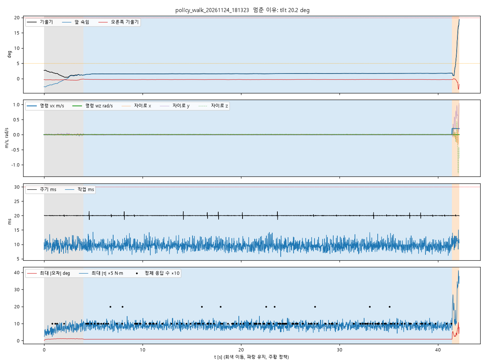
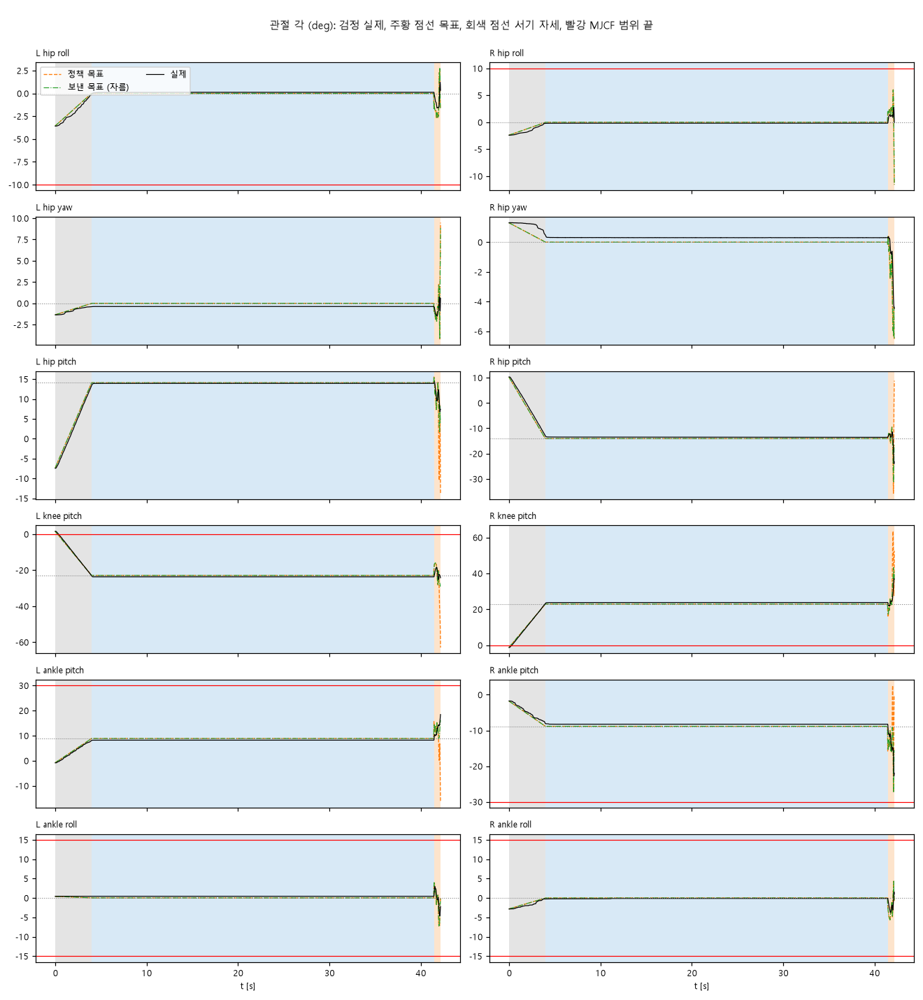
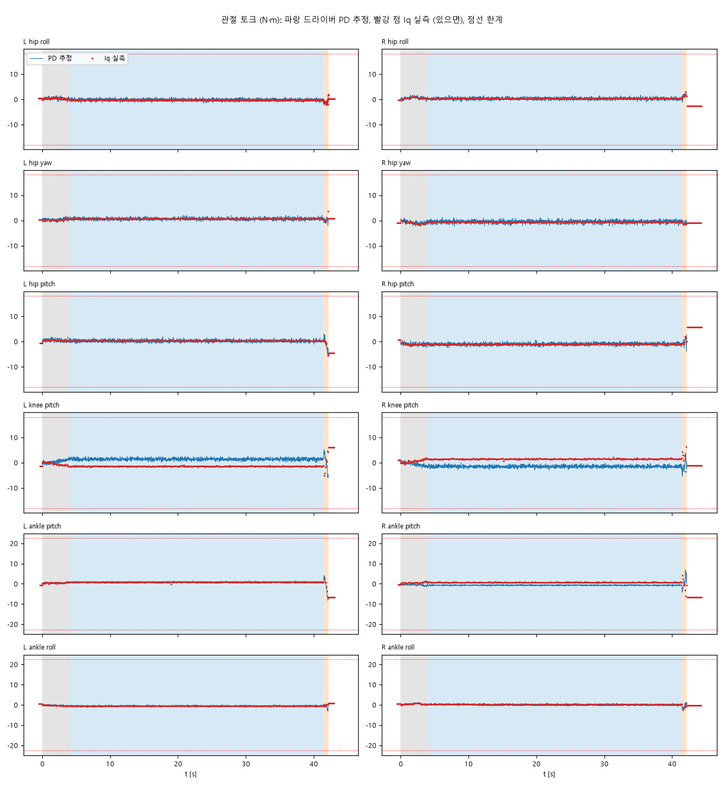
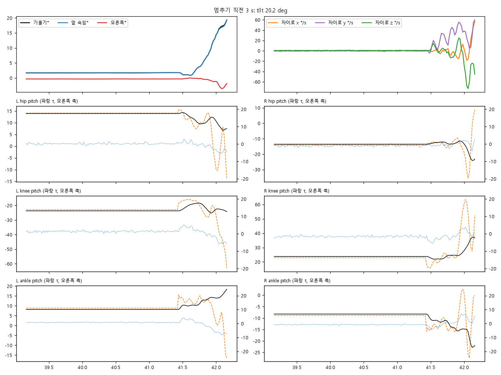

# 정책 보행 기록 분석: policy_walk_20261124_181323

## 한눈에

- ⚠ 몸통 기울기 20° 초과로 Radxa가 멈춤 (tilt 20.2 deg). '멈추기 직전' 절에서 어느 쪽으로 넘어갔는지 확인.
- ⚠ 엔코더 정체 응답 159번 (정책 중 0.00 %). 5주기 연속이면 Radxa가 멈춤.
- ⚠ 정책 중 기울기 최대 19.3° (5° 넘은 시간 49 %). S3 통과 기준은 5° 안.
- ⚠ 정책 켜기 직전(발이 바닥에 닿은 서기 자세) IMU가 다리 기구학보다 앞 +3.3°, 오른쪽 -0.4° 기울어 있음 (학습 IMU 장착 기울기 ±2°). 수평계로 몸통 실제 기울기 확인 필요.
- ⚠ L ankle pitch 토크가 학습 한계 6 N·m를 넘은 시간 28 % (최대 8.2 N·m; 학습 때는 6에서 잘림).
- ⚠ R ankle pitch 토크가 학습 한계 6 N·m를 넘은 시간 11 % (최대 6.9 N·m; 학습 때는 6에서 잘림).
- ⚠ Iq 명령이 학습 한계 6 N·m에 해당하는 전류(6512 5.97 A, 발목 4.79 A)를 넘음: L ankle pitch 5.7 A. 드라이버 전류 한계는 18 A 그대로 (ODrive 0.5.1의 CAN 0x00F는 속도 한계만 바꿈).
- ℹ 엔코더 읽기가 8 ms 기다림 한도에 닿은 표본이 있습니다 (최대 8.6 ms).
- ℹ Radxa가 목표를 자른 비율 (정책 중): R knee pitch 39 %, L knee pitch 33 %, L ankle pitch 31 %, L hip pitch 31 %
- ℹ 정책 첫 목표가 서기 자세에서 최대 6.9° (R ankle pitch). 오프라인 점검(이상적 관측)에서는 4° 안.
- ✓ 주기 최대 21.5 ms (30 ms 넘은 적 없음).
- ✓ S2: 유지 중 모든 관절이 서기 목표 1° 안 (최대 0.84°).

## 개요

- 폴더: `logs\policy_walk_20261124_181323`
- 파일: real_walk.npz, real_walk_io.npz, status.csv, events.txt, meta.json, gui_frames.csv, gui_log.txt
- 시작: 2026-11-24T18:13:23.203, 시작 명령: [0.2, 0.0, 0.0], IMU 축: ['+y', '-x', '+z']
- 토크: 드라이버 전류 한계 18 A (CAN으로 못 바꿈). Radxa 목표 자르기: radxa_target 6.0 N·m (보낸 목표 2110행 중 1번째부터 npz 2109주기와 맞춤)
- 주기 2109개, 42.2 s: 이동 4.0 s → 유지 37.4 s → 정책 0.7 s
- Radxa 멈춘 이유 (npz): `tilt 20.2 deg`
- GUI 이벤트: `멈춤: tilt 20.2 deg`
- meta.json ↔ npz: 관절 순서 같음, 부호 차이 0, 영점 차이 0.00e+00 turn

## 1. 타이밍·통신

Radxa 루프 (npz): 주기 = 이웃한 주기 시작 간격, 작업 = 한 주기에서 읽기+정책+전송에 든 시간

| 단계 | 주기 수 | 주기 p50 ms | p99 | 최대 | >25 ms | >30 ms | >30 연속 | 작업 p50 ms | p99 | 최대 |
|---|---|---|---|---|---|---|---|---|---|---|
| 이동 | 199 | 20.00 | 20.10 | 20.32 | 0 | 0 | 0 | 9.54 | 13.12 | 13.48 |
| 유지 | 1872 | 20.00 | 20.18 | 21.48 | 0 | 0 | 0 | 9.49 | 13.17 | 14.28 |
| 정책 | 37 | 19.99 | 20.24 | 20.33 | 0 | 0 | 0 | 10.98 | 14.66 | 15.06 |


엔코더 정체 응답 (움직이는 중인데 값이 직전 주기와 완전히 같음 = 8 ms 안에 새 응답 못 받음, 지난 값 사용)

정체 응답이 있는 주기 150개, 그중 6개 넘는 관절이 한꺼번에 정체 (읽기를 통째로 놓침, 보통 Radxa 쪽 지연) 0개

| 관절 | node | 이동 | 유지 | 정책 | 연속 최대 |
|---|---|---|---|---|---|
| L hip roll | 1 | 0 | 14 | 0 | 1 |
| L hip yaw | 3 | 0 | 16 | 0 | 2 |
| L hip pitch | 5 | 0 | 5 | 0 | 1 |
| L knee pitch | 7 | 0 | 14 | 0 | 1 |
| L ankle pitch | 11 | 0 | 14 | 0 | 1 |
| L ankle roll | 13 | 3 | 13 | 0 | 1 |
| R hip roll | 2 | 0 | 11 | 0 | 1 |
| R hip yaw | 4 | 1 | 10 | 0 | 1 |
| R hip pitch | 6 | 0 | 15 | 0 | 1 |
| R knee pitch | 8 | 0 | 8 | 0 | 1 |
| R ankle pitch | 12 | 0 | 10 | 0 | 1 |
| R ankle roll | 14 | 0 | 25 | 0 | 1 |


GUI가 받은 상태 (status.csv, 10 Hz 표본): 엔코더 12개 읽기 시간, 정책이 쓴 IMU 값의 나이

| 단계 | 표본 | 읽기 p50 ms | p99 | 최대 | IMU 나이 p50 ms | p99 | 최대 | 놓침 연속 최대 |
|---|---|---|---|---|---|---|---|---|
| 이동 | 40 | 5.96 | 8.28 | 8.35 | 3.00 | 6.32 | 6.40 | 0 |
| 유지 | 368 | 6.28 | 8.23 | 8.61 | 3.10 | 6.60 | 8.20 | 1 |
| 정책 | 9 | 6.44 | 8.29 | 8.31 | 2.20 | 5.16 | 5.20 | 0 |

## 2. IMU

| 단계 | 기울기 평균° | p95 | 최대 | 앞 숙임 평균° | 오른쪽 기울기 평균° | 중력 평균 (x y z) | 자이로 평균 °/s (x y z) | |자이로| p99 °/s |
|---|---|---|---|---|---|---|---|---|
| 이동 | 1.4 | 2.7 | 2.8 | -0.5 | -0.4 | -0.009 0.007 -1.000 | -0.051 0.382 -0.162 | 1.2 3.0 2.1 |
| 유지 | 1.6 | 1.7 | 1.8 | 1.6 | -0.3 | 0.028 0.005 -1.000 | -0.014 -0.482 0.613 | 0.7 1.2 1.1 |
| 정책 | 7.4 | 17.7 | 19.3 | 7.4 | -0.9 | 0.127 0.015 -0.986 | 1.934 25.957 -9.310 | 53.4 58.3 71.4 |


쿼터니언 크기 1.0000~1.0000. 앞으로 숙이면 중력 x > 0, 오른쪽으로 기울면 중력 y < 0 (절차서 4절). 이동·유지는 매단 상태라 몸통이 하네스에 따라 기울 수 있음.


자이로 ↔ 쿼터니언 변화 (같은 축이면 상관·기울기 > 0; 걸을 때는 표본 시각 차이로 0.7–0.9도 정상. 축 혼동·부호 오류 점검용)

| 축 | 쿼터니언 각속도 표준편차 rad/s | 상관 | 기울기 (자이로/쿼터니언) |
|---|---|---|---|
| x | 0.030 | 0.928 | 0.96 |
| y | 0.078 | 0.942 | 0.85 |
| z | 0.059 | 0.978 | 0.93 |


IMU ↔ 다리 기구학: 디딤발 발바닥이 바닥에 평평하다고 보고 관절 각(MJCF)으로 계산한 몸통 기울기와 IMU를 비교. 서기 자세는 hip+knee+ankle pitch 합이 0이라 발이 평평하면 몸통이 수직. 차이가 일정하면 IMU 장착(또는 가속도계) 기울기, 영점 오차 합, 발이 평평하지 않음(하네스가 몸통을 당김) 중 하나. 발이 바닥에 닿아 체중이 실렸을 때만 의미.

| 구간 | IMU 앞° | 기구학 앞° | 차이° | IMU 오른쪽° | 기구학 오른쪽° | 차이° |
|---|---|---|---|---|---|---|
| 유지 마지막 3 s (정책 켜기 직전) | 1.7 | -1.6 | 3.3 | -0.3 | 0.1 | -0.4 |
| 정책 | 7.4 | 2.1 | 5.3 | -0.9 | -0.2 | -0.7 |

## 3. 서기 자세 (S2)

시작 자세 (첫 주기, deg): L hip roll -3.6, L hip yaw -1.4, L hip pitch -7.4, L knee pitch +1.6, L ankle pitch -0.9, L ankle roll +0.4, R hip roll -2.4, R hip yaw +1.3, R hip pitch +10.3, R knee pitch -1.3, R ankle pitch -1.7, R ankle roll -2.8

유지 구간 4.5~41.4 s (1846주기, 유지 시작 0.5 s 뒤부터). 목표−실제 = 서기 자세 − 엔코더 (드라이버 PD가 남긴 오차), τ = Kp·오차 − Kd·속도

| 관절 | 서기 목표° | 실제 평균° | 목표−실제 평균° | 표준편차° | PD 토크 평균 N·m | 좌우 합° (L+R) |
|---|---|---|---|---|---|---|
| L hip roll | 0.00 | 0.11 | -0.11 | 0.01 | -0.22 | -0.06 |
| L hip yaw | 0.00 | -0.38 | 0.38 | 0.00 | 0.65 | -0.07 |
| L hip pitch | 14.08 | 13.92 | 0.16 | 0.00 | 0.26 | 0.40 |
| L knee pitch | -22.92 | -23.72 | 0.80 | 0.00 | 1.39 | 0.05 |
| L ankle pitch | 8.84 | 8.19 | 0.65 | 0.00 | 0.81 | -0.06 |
| L ankle roll | 0.00 | 0.43 | -0.43 | 0.00 | -0.54 | 0.29 |
| R hip roll | 0.00 | -0.18 | 0.18 | 0.00 | 0.30 |  |
| R hip yaw | 0.00 | 0.31 | -0.31 | 0.00 | -0.52 |  |
| R hip pitch | -14.08 | -13.52 | -0.56 | 0.04 | -1.00 |  |
| R knee pitch | 22.92 | 23.76 | -0.84 | 0.01 | -1.51 |  |
| R ankle pitch | -8.84 | -8.25 | -0.59 | 0.00 | -0.73 |  |
| R ankle roll | 0.00 | -0.14 | 0.14 | 0.04 | 0.18 |  |


좌우 합: 오른쪽 관절은 왼쪽의 거울(부호 반대)이라 대칭이면 0. 최대 0.40°.

이동 끝 (서기 목표 도달 직후) 목표−실제°: L hip roll +0.1, L hip yaw +0.4, L hip pitch +0.6, L knee pitch +0.4, L ankle pitch +0.8, L ankle roll -0.4, R hip roll +0.2, R hip yaw -0.5, R hip pitch -1.0, R knee pitch -0.5, R ankle pitch -0.7, R ankle roll +0.3

## 4. 관절 (정책 중)

정책 중 (첫 주기 제외). 오차 = 직전 목표 − 지금 실제 (deg), τ = 드라이버 PD 토크 추정 (N·m, 드라이버 전류 한계 18 A로 자름; 학습 한계는 6 N·m). 시뮬 보행: 오차 p99 23°, 최대 약 50°, 12° 초과 최장 0.26 s, 관절 속도 최대 11 rad/s.

목표 자르기 기록이 있어 오차·τ는 드라이버로 보낸(자른) 목표로 계산. '6 N·m 넘음'은 자른 뒤에도 주기 사이에 남은 초과 (20 ms 사이 관절이 움직여서). 잘린 양 = 정책 목표 − 보낸 목표.

| 관절 | 범위° | MJCF 끝까지 여유° | |오차| p95 | p99 | 최대 | 12° 초과 최장 s | |τ| p95 | 6 N·m 넘음 % | 6 N·m 넘음 최장 s | |q̇| 최대 rad/s | 정체 응답 | 목표 잘림 % | 잘린 양 최대° |
|---|---|---|---|---|---|---|---|---|---|---|---|---|---|
| L hip roll | -2~+1 | 8.4 | 1.9 | 2.4 | 2.6 | 0.00 | 2.05 | 0.0 | 0.00 | 0.7 | 0 | 0.0 | 0.0 |
| L hip yaw | -1~+1 | 32.3 | 3.8 | 4.6 | 5.0 | 0.00 | 1.31 | 0.0 | 0.00 | 1.1 | 0 | 8.3 | 1.2 |
| L hip pitch | +7~+14 | 63.1 | 6.2 | 6.2 | 6.2 | 0.00 | 4.89 | 0.0 | 0.00 | 0.8 | 0 | 30.6 | 17.6 |
| L knee pitch | -25~-18 | 18.4 | 5.0 | 5.4 | 5.4 | 0.00 | 5.79 | 0.0 | 0.00 | 1.0 | 0 | 33.3 | 33.9 |
| L ankle pitch | +8~+18 | 11.6 | 4.9 | 5.3 | 5.3 | 0.00 | 7.63 | 27.8 | 0.20 | 1.2 | 0 | 30.6 | 32.6 |
| L ankle roll | -5~+3 | 10.4 | 3.3 | 4.0 | 4.2 | 0.00 | 2.62 | 0.0 | 0.00 | 1.3 | 0 | 0.0 | 0.0 |
| R hip roll | -0~+3 | 7.2 | 4.5 | 7.0 | 7.8 | 0.00 | 2.77 | 0.0 | 0.00 | 1.9 | 0 | 0.0 | 0.0 |
| R hip yaw | -4~+0 | 33.4 | 3.0 | 3.3 | 3.4 | 0.00 | 1.85 | 0.0 | 0.00 | 0.5 | 0 | 0.0 | 0.0 |
| R hip pitch | -24~-11 | 67.7 | 8.6 | 10.1 | 10.7 | 0.00 | 2.64 | 0.0 | 0.00 | 2.3 | 0 | 16.7 | 25.0 |
| R knee pitch | +22~+37 | 21.9 | 7.6 | 8.5 | 8.9 | 0.00 | 4.87 | 0.0 | 0.00 | 1.9 | 0 | 38.9 | 25.6 |
| R ankle pitch | -23~-8 | 7.2 | 5.9 | 6.7 | 7.2 | 0.00 | 6.31 | 11.1 | 0.08 | 2.8 | 0 | 27.8 | 15.5 |
| R ankle roll | -4~+2 | 11.2 | 2.7 | 3.0 | 3.1 | 0.00 | 2.57 | 0.0 | 0.00 | 1.1 | 0 | 0.0 | 0.0 |


관절 속도 (ODrive vel_estimate) ↔ 위치 차분 상관: L hip roll 0.97, L hip yaw 0.97, L hip pitch 0.98, L knee pitch 0.99, L ankle pitch 0.95, L ankle roll 0.97, R hip roll 0.98, R hip yaw 0.94, R hip pitch 0.99, R knee pitch 0.98, R ankle pitch 0.97, R ankle roll 0.95

## 5. 정책 입력·출력

관측 조립 점검 (기록된 값끼리 비교)

| 항목 | 최대 차이 | 결과 |
|---|---|---|
| 명령 0–2 | 0.0e+00 | 같음 |
| 각속도 3–5 | 0.0e+00 | 같음 |
| 중력 6–8 | 2.8e-08 | 같음 |
| 관절 각 9–20 | 3.4e-08 | 같음 |
| 관절 속도 21–32 | 1.1e-07 | 같음 |
| 직전 행동 33–44 | 0.0e+00 | 같음 |
| 목표 = 서기 + 0.25·clip(행동) | 3.6e-08 | 같음 |
| 정책 재생 (PC numpy) vs Radxa 행동 | 3.6e-07 | 같음 |


정책 첫 주기 (t = 41.44 s): 중력 [0.03, 0.005, -1.0], 각속도 rad/s [-0.0, -0.003, 0.009], 관절 − 서기 최대 0.8°, 명령 [0.2, 0.0, 0.0]

첫 목표 − 서기 자세 (deg): L hip roll -1.8, L hip yaw -0.9, L hip pitch +1.5, L knee pitch +4.5, L ankle pitch +6.8, L ankle roll +3.2, R hip roll +2.0, R hip yaw -0.2, R hip pitch +0.5, R knee pitch -5.1, R ankle pitch -6.9, R ankle roll -1.8


행동 (정책 출력, 배율 전) 37주기. 진동수 = 목표의 주 성분 (0.3–5 Hz), 8 Hz 넘는 비율 = 떨림 지표, Δa/a = 이웃 주기 차이의 표준편차 ÷ 행동 표준편차 (1 Hz 부드러운 움직임 ≈ 0.13, 번갈아 튀면 ≈ 2)

| 관절 | |a| p50 | p99 | 최대 | ±20 잘림 % | 목표−서기 최대° | 주 진동수 Hz | 8 Hz 넘는 비율 | Δa/a |
|---|---|---|---|---|---|---|---|---|
| L hip roll | 0.13 | 0.19 | 0.19 | 0.0 | 2.7 | – | – | 0.44 |
| L hip yaw | 0.09 | 0.56 | 0.66 | 0.0 | 9.5 | – | – | 0.56 |
| L hip pitch | 0.30 | 1.86 | 1.94 | 0.0 | 27.8 | – | – | 0.41 |
| L knee pitch | 0.42 | 2.55 | 2.80 | 0.0 | 40.1 | – | – | 0.21 |
| L ankle pitch | 0.30 | 1.71 | 1.76 | 0.0 | 25.2 | – | – | 0.33 |
| L ankle roll | 0.12 | 0.51 | 0.51 | 0.0 | 7.4 | – | – | 0.33 |
| R hip roll | 0.15 | 0.72 | 0.81 | 0.0 | 11.6 | – | – | 0.43 |
| R hip yaw | 0.14 | 0.45 | 0.46 | 0.0 | 6.5 | – | – | 0.28 |
| R hip pitch | 0.13 | 1.57 | 1.60 | 0.0 | 22.9 | – | – | 0.53 |
| R knee pitch | 0.25 | 2.78 | 2.83 | 0.0 | 40.6 | – | – | 0.37 |
| R ankle pitch | 0.40 | 1.26 | 1.29 | 0.0 | 18.5 | – | – | 0.62 |
| R ankle roll | 0.23 | 0.40 | 0.40 | 0.0 | 5.7 | – | – | 0.44 |


명령 구간 (속도 측정이 없어 vx는 영상으로 확인; 회전은 자이로 z로 비교 가능, 시뮬 0.8 → 0.85 rad/s)

| t s | 길이 s | 명령 vx vy wz | 자이로 z 평균 rad/s | 기울기 평균° | 최대° | 앞 숙임 평균° | 오른쪽 기울기 평균° |
|---|---|---|---|---|---|---|---|
| 41.4~42.2 | 0.7 | 0.20 0.00 0.00 | -0.162 | 7.4 | 19.3 | 7.4 | -0.9 |

## 6. 드라이버 (GUI가 받은 값)

시각 맞추기: 엔코더 응답 3896개가 npz 값과 정확히 일치 → t_npz = t_gui − 141.188 s (차이 p5–p95 -3~+13 ms)


heartbeat 처음 상태: IDLE (node 1,2,3,4,5,6,7,8,11,12,13,14)

heartbeat 상태 변화

| t s | 상태 | axis_error | 관절 |
|---|---|---|---|
| 0.09 | CLOSED_LOOP_CONTROL | 0 | 12개: L hip roll, R hip roll, L hip yaw, R hip yaw, L hip pitch, R hip pitch, L knee pitch, R knee pitch, L ankle pitch, R ankle pitch, L ankle roll, R ankle roll |
| 42.28 | IDLE | 0 | 12개: R ankle pitch, L hip roll, R hip roll, L hip yaw, R hip yaw, L hip pitch, R hip pitch, L knee pitch, R knee pitch, L ankle pitch, R ankle roll, L ankle roll |


Iq (정책 중 표본; 없으면 기록 전체). 6 N·m 전류 = 학습 토크 한계에 해당하는 전류, '넘음 %' = |Iq 명령|이 그 95 % 이상인 표본. τ(Iq) = 방향 × torque_sign × Iq × kt × 15 를 드라이버 PD 추정 τ와 비교 (기울기 ≈ 1, 상관 ≈ 1이면 PD 모델이 맞음)

| 관절 | node | 표본 Hz | |Iq| p95 A | |Iq| 최대 | |Iq 명령| 최대 | 6 N·m 전류 A | 넘음 % | τ(Iq)/τ(PD) 기울기 | 상관 |
|---|---|---|---|---|---|---|---|---|---|
| L hip roll | 1 | 49 | 1.98 | 2.07 | 2.55 | 5.97 | 0.0 | 0.96 | 0.92 |
| L hip yaw | 3 | 10 | 2.74 | 3.68 | 6.45 | 5.97 | 14.3 | – | – |
| L hip pitch | 5 | 10 | 5.33 | 5.58 | 6.09 | 5.97 | 12.5 | – | – |
| L knee pitch | 7 | 10 | 4.96 | 5.12 | 5.04 | 5.97 | 0.0 | – | – |
| L ankle pitch | 11 | 10 | 5.44 | 5.62 | 5.72 | 4.78 | 25.0 | – | – |
| L ankle roll | 13 | 10 | 1.49 | 1.87 | 2.08 | 4.78 | 0.0 | – | – |
| R hip roll | 2 | 10 | 2.75 | 3.13 | 3.55 | 5.97 | 0.0 | – | – |
| R hip yaw | 4 | 10 | 1.58 | 1.60 | 2.58 | 5.97 | 0.0 | – | – |
| R hip pitch | 6 | 10 | 1.77 | 1.89 | 2.14 | 5.97 | 0.0 | – | – |
| R knee pitch | 8 | 10 | 5.69 | 6.25 | 5.87 | 5.97 | 14.3 | – | – |
| R ankle pitch | 12 | 10 | 4.45 | 4.91 | 5.20 | 4.78 | 14.3 | – | – |
| R ankle roll | 14 | 10 | 1.80 | 1.95 | 2.04 | 4.78 | 0.0 | – | – |


버스 전압 (Vbus, 2 s마다 node별): 최소 23.59 V, 중앙 23.88 V, 최대 24.06 V, 표본 265개

## 7. 멈추기 직전

마지막 2 s (0.2 s 간격 + 마지막 주기). 멈춘 이유: `tilt 20.2 deg`. 안전 정지를 일으킨 주기는 기록되지 않음 (기록 전에 멈춤).

| t s | 단계 | 기울기° | 앞 숙임° | 오른쪽° | 최대 |오차|° | 최대 |τ| N·m | 포화 관절 수 | 작업 ms | 명령 |
|---|---|---|---|---|---|---|---|---|---|
| 40.16 | 유지 | 1.7 | 1.7 | -0.3 | R knee pitch 1 | R knee pitch 1.5 | 0 | 7.8 | 0.00 0.00 0.00 |
| 40.36 | 유지 | 1.7 | 1.7 | -0.3 | R knee pitch 1 | R knee pitch 2.0 | 0 | 9.5 | 0.00 0.00 0.00 |
| 40.56 | 유지 | 1.7 | 1.7 | -0.3 | R knee pitch 1 | L knee pitch 1.4 | 0 | 7.7 | 0.00 0.00 0.00 |
| 40.76 | 유지 | 1.7 | 1.7 | -0.3 | R knee pitch 1 | R knee pitch 1.7 | 0 | 9.3 | 0.00 0.00 0.00 |
| 40.96 | 유지 | 1.7 | 1.7 | -0.3 | R knee pitch 1 | L knee pitch 1.6 | 0 | 8.1 | 0.00 0.00 0.00 |
| 41.16 | 유지 | 1.8 | 1.7 | -0.3 | R knee pitch 1 | R knee pitch 1.9 | 0 | 7.0 | 0.00 0.00 0.00 |
| 41.36 | 유지 | 1.8 | 1.8 | -0.3 | R knee pitch 1 | R knee pitch 1.7 | 0 | 8.6 | 0.00 0.00 0.00 |
| 41.56 | 정책 | 1.1 | 1.1 | -0.2 | L knee pitch 4 | L knee pitch 3.7 | 0 | 10.2 | 0.20 0.00 0.00 |
| 41.76 | 정책 | 3.8 | 3.8 | -0.2 | L ankle pitch 3 | R knee pitch 1.8 | 0 | 10.4 | 0.20 0.00 0.00 |
| 41.96 | 정책 | 12.4 | 12.4 | -1.2 | R ankle pitch 6 | R ankle pitch 6.9 | 1 | 11.2 | 0.20 0.00 0.00 |
| 42.16 | 정책 | 19.3 | 19.3 | -1.9 | R hip roll 8 | L ankle pitch 7.5 | 1 | 10.4 | 0.20 0.00 0.00 |
| 42.16 | 정책 | 19.3 | 19.3 | -1.9 | R hip roll 8 | L ankle pitch 7.5 | 1 | 10.4 | 0.20 0.00 0.00 |

## 8. 이벤트·GUI 기록

events.txt
```
18:13:23.206 [npz -0.52 s] 시작 요청 (앞으로 0.20 m/s, 토크 한계 6 N·m 켬 (Radxa 목표 자르기)): L hip roll 부호 -1 영점 -0.4764, L hip yaw 부호 -1 영점 0.2441, L hip pitch 부호 -1 영점 0.8354, L knee pitch 부호 -1 영점 -0.3998, L ankle pitch 부호 -1 영점 1.9838, L ankle roll 부호 -1 영점 0.2539, R hip roll 부호 -1 영점 0.0262, R hip yaw 부호 -1 영점 0.3778, R hip pitch 부호 -1 영점 0.8512, R knee pitch 부호 -1 영점 -0.0147, R ankle pitch 부호 -1 영점 0.8108, R ankle roll 부호 -1 영점 -0.
18:13:23.623 [npz -0.10 s] Radxa에서 시작: 서기 자세로 4 s 이동
18:13:27.797 [npz +4.07 s] 서기 자세 도달, 유지 중 (발이 바닥에 닿으면 '정책 켜기')
18:14:05.154 [npz +41.43 s] 정책 켜기 (발이 바닥에 닿음)
18:14:05.225 [npz +41.50 s] 정책 보행 시작
18:14:06.096 [npz +42.37 s] 목표를 자른 주기 17 / 2110
18:14:06.097 [npz +42.37 s] 멈춤: tilt 20.2 deg
18:14:06.954 [npz +43.23 s] Radxa 기록 → logs/policy_walk_20261124_181323/real_walk.npz (1603 KB) + real_walk_io.npz
```

gui_log.txt 중 경고·Radxa 줄
```
   141.083 [CAN] [Radxa] [bridge] 정책 보행: {'type': 'started', 'log': '/home/radxa/motor_bridge/logs/real_walk_20261124_181323.npz', 'torque_clamp': True}
   183.481 [CAN] [Radxa] stopped: tilt 20.2 deg; log -> /home/radxa/motor_bridge/logs/real_walk_20261124_181323.npz
   183.555 [CAN] [Radxa] [bridge] 정책 보행: {'type': 'stopped', 'reason': 'tilt 20.2 deg', 'log': '/home/radxa/motor_bridge/logs/real_walk_20261124_181323.npz', 'log_size': 1642130, 'io_log': '/home/radxa/motor_bridge/logs/real_walk_20261124_181323_io.npz', 'clamp_cycles': 17, 'sent': 2110}
   184.249 [CAN] ⚠ Radxa: 버스 2 (ttyACM1) 수신 중단: 장치가 닫힘
   184.249 [CAN] [Radxa] [bridge] 버스 2 (ttyACM1) 수신 중단: 장치가 닫힘
   184.252 [CAN] ⚠ Radxa: 버스 2 송신 실패: [Errno 5] Input/output error
   184.487 [CAN] ⚠ Radxa: 버스 2 송신 실패: [Errno 5] Input/output error
   184.736 [CAN] ⚠ Radxa: 버스 2 송신 실패: [Errno 5] Input/output error
```

## 그림





