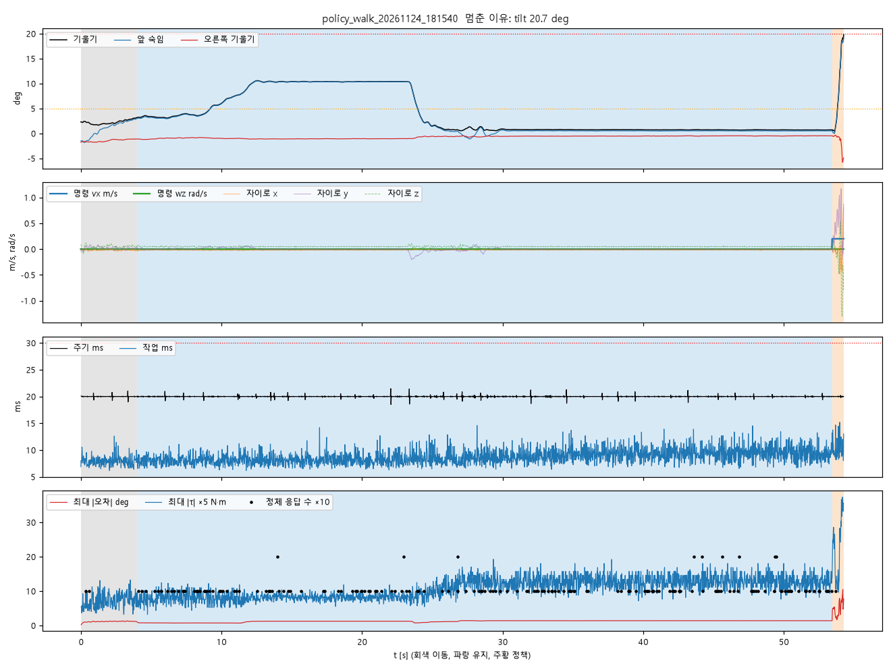
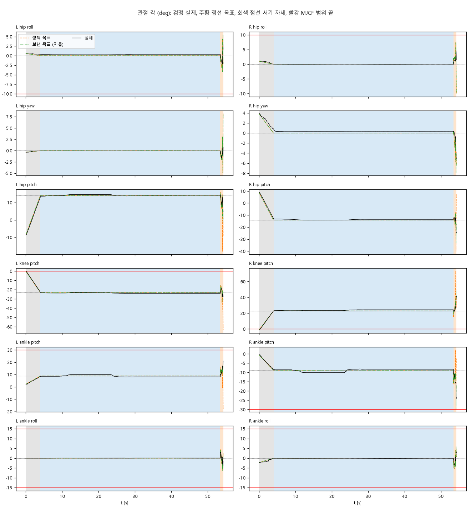
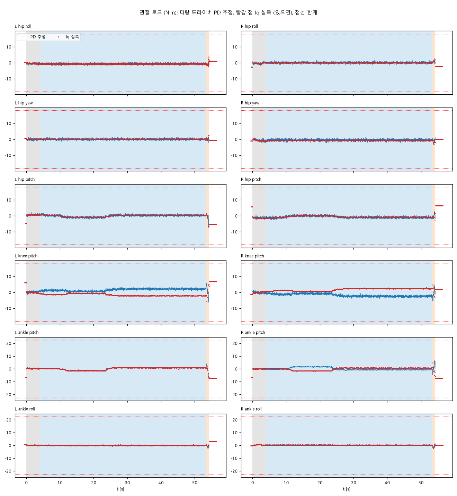
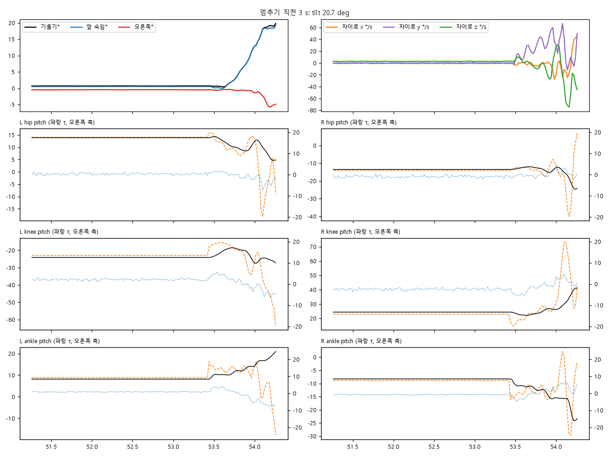

# 정책 보행 기록 분석: policy_walk_20261124_181540

## 한눈에

- ⚠ 몸통 기울기 20° 초과로 Radxa가 멈춤 (tilt 20.7 deg). '멈추기 직전' 절에서 어느 쪽으로 넘어갔는지 확인.
- ⚠ 정책 중 기울기 최대 19.8° (5° 넘은 시간 55 %). S3 통과 기준은 5° 안.
- ⚠ 정책 켜기 직전(발이 바닥에 닿은 서기 자세) IMU가 다리 기구학보다 앞 +2.6°, 오른쪽 -0.2° 기울어 있음 (학습 IMU 장착 기울기 ±2°). 수평계로 몸통 실제 기울기 확인 필요.
- ⚠ S2: 서기 자세 목표와 1° 넘게 차이: R knee pitch -1.0° (마찰 0.36 N·m ≈ 0.2°, 다리 무게 포함).
- ⚠ L ankle pitch 토크가 학습 한계 6 N·m를 넘은 시간 20 % (최대 7.5 N·m; 학습 때는 6에서 잘림).
- ⚠ R ankle pitch 토크가 학습 한계 6 N·m를 넘은 시간 7 % (최대 6.6 N·m; 학습 때는 6에서 잘림).
- ⚠ Iq 명령이 학습 한계 6 N·m에 해당하는 전류(6512 5.97 A, 발목 4.79 A)를 넘음: L hip pitch 7.1 A, L ankle pitch 5.5 A, R hip pitch 6.7 A. 드라이버 전류 한계는 18 A 그대로 (ODrive 0.5.1의 CAN 0x00F는 속도 한계만 바꿈).
- ℹ 엔코더 정체 응답 177번 (정책 중 0.20 %). 5주기 연속이면 Radxa가 멈춤.
- ℹ 엔코더 읽기가 8 ms 기다림 한도에 닿은 표본이 있습니다 (최대 8.4 ms).
- ℹ 유지(매단 상태) 중 몸통 기울기 앞 +3.5°, 오른쪽 -0.7°. 하네스 때문일 수도 있음. 바닥에 똑바로 세웠을 때도 2°를 넘으면 장착 기울기(학습 ±2°) 확인.
- ℹ Radxa가 목표를 자른 비율 (정책 중): L knee pitch 46 %, R knee pitch 41 %, L ankle pitch 32 %, R ankle pitch 27 %
- ℹ 정책 첫 목표가 서기 자세에서 최대 7.4° (L ankle pitch). 오프라인 점검(이상적 관측)에서는 4° 안.
- ✓ 주기 최대 21.5 ms (30 ms 넘은 적 없음).

## 개요

- 폴더: `logs\policy_walk_20261124_181540`
- 파일: real_walk.npz, real_walk_io.npz, status.csv, events.txt, meta.json, gui_frames.csv, gui_log.txt
- 시작: 2026-11-24T18:15:40.646, 시작 명령: [0.1, 0.0, 0.0], IMU 축: ['+y', '-x', '+z']
- 토크: 드라이버 전류 한계 18 A (CAN으로 못 바꿈). Radxa 목표 자르기: radxa_target 6.0 N·m (보낸 목표를 t_send·t_read 시각으로 맞춤 (2714/2714주기))
- 주기 2714개, 54.3 s: 이동 4.0 s → 유지 49.4 s → 정책 0.8 s
- Radxa 멈춘 이유 (npz): `tilt 20.7 deg`
- GUI 이벤트: `멈춤: tilt 20.7 deg`
- meta.json ↔ npz: 관절 순서 같음, 부호 차이 0, 영점 차이 0.00e+00 turn

## 1. 타이밍·통신

Radxa 루프 (npz): 주기 = 이웃한 주기 시작 간격, 작업 = 한 주기에서 읽기+정책+전송에 든 시간

| 단계 | 주기 수 | 주기 p50 ms | p99 | 최대 | >25 ms | >30 ms | >30 연속 | 작업 p50 ms | p99 | 최대 |
|---|---|---|---|---|---|---|---|---|---|---|
| 이동 | 199 | 20.00 | 20.66 | 21.04 | 0 | 0 | 0 | 7.97 | 10.80 | 12.61 |
| 유지 | 2472 | 20.00 | 20.49 | 21.48 | 0 | 0 | 0 | 8.57 | 12.42 | 14.60 |
| 정책 | 42 | 20.00 | 20.16 | 20.22 | 0 | 0 | 0 | 9.74 | 14.99 | 15.19 |


엔코더 정체 응답 (움직이는 중인데 값이 직전 주기와 완전히 같음 = 8 ms 안에 새 응답 못 받음, 지난 값 사용)

정체 응답이 있는 주기 168개, 그중 6개 넘는 관절이 한꺼번에 정체 (읽기를 통째로 놓침, 보통 Radxa 쪽 지연) 0개

| 관절 | node | 이동 | 유지 | 정책 | 연속 최대 |
|---|---|---|---|---|---|
| L hip roll | 1 | 0 | 9 | 0 | 1 |
| L hip yaw | 3 | 0 | 16 | 0 | 1 |
| L hip pitch | 5 | 0 | 17 | 0 | 1 |
| L knee pitch | 7 | 0 | 13 | 0 | 1 |
| L ankle pitch | 11 | 0 | 8 | 0 | 1 |
| L ankle roll | 13 | 1 | 24 | 0 | 2 |
| R hip roll | 2 | 1 | 13 | 0 | 1 |
| R hip yaw | 4 | 0 | 10 | 0 | 1 |
| R hip pitch | 6 | 0 | 11 | 0 | 1 |
| R knee pitch | 8 | 0 | 11 | 0 | 1 |
| R ankle pitch | 12 | 0 | 17 | 0 | 1 |
| R ankle roll | 14 | 0 | 25 | 1 | 1 |


GUI가 받은 상태 (status.csv, 10 Hz 표본): 엔코더 12개 읽기 시간, 정책이 쓴 IMU 값의 나이

| 단계 | 표본 | 읽기 p50 ms | p99 | 최대 | IMU 나이 p50 ms | p99 | 최대 | 놓침 연속 최대 |
|---|---|---|---|---|---|---|---|---|
| 이동 | 40 | 5.38 | 6.07 | 6.16 | 2.75 | 5.28 | 5.40 | 0 |
| 유지 | 486 | 5.71 | 7.83 | 8.45 | 2.90 | 6.03 | 7.20 | 0 |
| 정책 | 11 | 5.19 | 7.52 | 7.60 | 3.30 | 3.89 | 3.90 | 0 |

## 2. IMU

| 단계 | 기울기 평균° | p95 | 최대 | 앞 숙임 평균° | 오른쪽 기울기 평균° | 중력 평균 (x y z) | 자이로 평균 °/s (x y z) | |자이로| p99 °/s |
|---|---|---|---|---|---|---|---|---|
| 이동 | 2.3 | 3.1 | 3.2 | 1.0 | -1.4 | 0.017 0.025 -0.999 | -0.989 1.140 2.586 | 2.3 4.7 6.1 |
| 유지 | 3.7 | 10.4 | 10.6 | 3.5 | -0.7 | 0.062 0.013 -0.995 | -0.907 -0.037 2.748 | 1.7 7.3 4.4 |
| 정책 | 8.1 | 19.1 | 19.8 | 7.9 | -1.5 | 0.136 0.026 -0.982 | -1.120 23.460 -10.176 | 44.6 64.1 73.7 |


쿼터니언 크기 1.0000~1.0000. 앞으로 숙이면 중력 x > 0, 오른쪽으로 기울면 중력 y < 0 (절차서 4절). 이동·유지는 매단 상태라 몸통이 하네스에 따라 기울 수 있음.


자이로 ↔ 쿼터니언 변화 (같은 축이면 상관·기울기 > 0; 걸을 때는 표본 시각 차이로 0.7–0.9도 정상. 축 혼동·부호 오류 점검용)

| 축 | 쿼터니언 각속도 표준편차 rad/s | 상관 | 기울기 (자이로/쿼터니언) |
|---|---|---|---|
| x | 0.028 | 움직임 작음 | – |
| y | 0.076 | 0.954 | 0.85 |
| z | 0.061 | 0.989 | 0.97 |


IMU ↔ 다리 기구학: 디딤발 발바닥이 바닥에 평평하다고 보고 관절 각(MJCF)으로 계산한 몸통 기울기와 IMU를 비교. 서기 자세는 hip+knee+ankle pitch 합이 0이라 발이 평평하면 몸통이 수직. 차이가 일정하면 IMU 장착(또는 가속도계) 기울기, 영점 오차 합, 발이 평평하지 않음(하네스가 몸통을 당김) 중 하나. 발이 바닥에 닿아 체중이 실렸을 때만 의미.

| 구간 | IMU 앞° | 기구학 앞° | 차이° | IMU 오른쪽° | 기구학 오른쪽° | 차이° |
|---|---|---|---|---|---|---|
| 유지 마지막 3 s (정책 켜기 직전) | 0.5 | -2.1 | 2.6 | -0.5 | -0.3 | -0.2 |
| 정책 | 7.9 | 1.2 | 6.6 | -1.5 | -0.2 | -1.4 |

## 3. 서기 자세 (S2)

시작 자세 (첫 주기, deg): L hip roll +0.7, L hip yaw -0.3, L hip pitch -8.7, L knee pitch -0.1, L ankle pitch +2.2, L ankle roll -0.0, R hip roll +1.0, R hip yaw +3.9, R hip pitch +8.8, R knee pitch -1.4, R ankle pitch -0.4, R ankle roll -2.3

유지 구간 4.5~53.4 s (2446주기, 유지 시작 0.5 s 뒤부터). 목표−실제 = 서기 자세 − 엔코더 (드라이버 PD가 남긴 오차), τ = Kp·오차 − Kd·속도

| 관절 | 서기 목표° | 실제 평균° | 목표−실제 평균° | 표준편차° | PD 토크 평균 N·m | 좌우 합° (L+R) |
|---|---|---|---|---|---|---|
| L hip roll | 0.00 | 0.38 | -0.38 | 0.01 | -0.69 | 0.36 |
| L hip yaw | 0.00 | -0.06 | 0.06 | 0.00 | 0.10 | 0.23 |
| L hip pitch | 14.08 | 14.09 | -0.01 | 0.32 | -0.02 | 0.40 |
| L knee pitch | -22.92 | -23.81 | 0.89 | 0.36 | 1.57 | 0.12 |
| L ankle pitch | 8.84 | 8.70 | 0.14 | 0.76 | 0.18 | -0.09 |
| L ankle roll | 0.00 | 0.03 | -0.03 | 0.01 | -0.03 | -0.15 |
| R hip roll | 0.00 | -0.01 | 0.01 | 0.01 | 0.01 |  |
| R hip yaw | 0.00 | 0.29 | -0.29 | 0.01 | -0.50 |  |
| R hip pitch | -14.08 | -13.70 | -0.39 | 0.27 | -0.68 |  |
| R knee pitch | 22.92 | 23.93 | -1.01 | 0.45 | -1.79 |  |
| R ankle pitch | -8.84 | -8.78 | -0.05 | 0.78 | -0.07 |  |
| R ankle roll | 0.00 | -0.17 | 0.17 | 0.06 | 0.22 |  |


좌우 합: 오른쪽 관절은 왼쪽의 거울(부호 반대)이라 대칭이면 0. 최대 0.40°.

이동 끝 (서기 목표 도달 직후) 목표−실제°: L hip roll -0.4, L hip yaw +0.1, L hip pitch +0.9, L knee pitch -0.1, L ankle pitch +0.4, L ankle roll +0.0, R hip roll -0.0, R hip yaw -0.8, R hip pitch -1.1, R knee pitch +0.1, R ankle pitch -0.5, R ankle roll +0.3

## 4. 관절 (정책 중)

정책 중 (첫 주기 제외). 오차 = 직전 목표 − 지금 실제 (deg), τ = 드라이버 PD 토크 추정 (N·m, 드라이버 전류 한계 18 A로 자름; 학습 한계는 6 N·m). 시뮬 보행: 오차 p99 23°, 최대 약 50°, 12° 초과 최장 0.26 s, 관절 속도 최대 11 rad/s.

목표 자르기 기록이 있어 오차·τ는 드라이버로 보낸(자른) 목표로 계산. '6 N·m 넘음'은 자른 뒤에도 주기 사이에 남은 초과 (20 ms 사이 관절이 움직여서). 잘린 양 = 정책 목표 − 보낸 목표.

| 관절 | 범위° | MJCF 끝까지 여유° | |오차| p95 | p99 | 최대 | 12° 초과 최장 s | |τ| p95 | 6 N·m 넘음 % | 6 N·m 넘음 최장 s | |q̇| 최대 rad/s | 정체 응답 | 목표 잘림 % | 잘린 양 최대° |
|---|---|---|---|---|---|---|---|---|---|---|---|---|---|
| L hip roll | -2~+3 | 7.8 | 3.1 | 4.4 | 4.5 | 0.00 | 2.54 | 0.0 | 0.00 | 1.1 | 0 | 0.0 | 0.0 |
| L hip yaw | -2~+1 | 32.2 | 4.0 | 5.3 | 5.8 | 0.00 | 1.47 | 0.0 | 0.00 | 1.4 | 0 | 4.9 | 1.8 |
| L hip pitch | +5~+14 | 60.9 | 7.0 | 7.3 | 7.4 | 0.00 | 5.27 | 2.4 | 0.02 | 1.1 | 0 | 24.4 | 21.4 |
| L knee pitch | -27~-19 | 18.5 | 7.2 | 7.9 | 7.9 | 0.00 | 5.71 | 4.9 | 0.02 | 1.6 | 0 | 46.3 | 30.7 |
| L ankle pitch | +8~+21 | 9.1 | 4.7 | 4.9 | 4.9 | 0.00 | 7.19 | 19.5 | 0.16 | 1.1 | 0 | 31.7 | 35.9 |
| L ankle roll | -4~+3 | 11.0 | 2.9 | 3.4 | 3.6 | 0.00 | 1.94 | 0.0 | 0.00 | 1.3 | 0 | 0.0 | 0.0 |
| R hip roll | -0~+5 | 5.4 | 4.5 | 6.8 | 7.8 | 0.00 | 1.87 | 0.0 | 0.00 | 1.9 | 0 | 2.4 | 0.6 |
| R hip yaw | -5~+0 | 33.4 | 3.0 | 3.4 | 3.5 | 0.00 | 2.83 | 0.0 | 0.00 | 0.7 | 0 | 0.0 | 0.0 |
| R hip pitch | -25~-12 | 68.3 | 7.4 | 9.9 | 10.5 | 0.00 | 2.47 | 0.0 | 0.00 | 2.2 | 0 | 19.5 | 24.4 |
| R knee pitch | +22~+41 | 22.1 | 8.1 | 9.7 | 10.0 | 0.00 | 5.24 | 0.0 | 0.00 | 2.1 | 0 | 41.5 | 35.5 |
| R ankle pitch | -24~-8 | 5.8 | 6.0 | 7.5 | 7.9 | 0.00 | 6.07 | 7.3 | 0.02 | 2.9 | 0 | 26.8 | 15.0 |
| R ankle roll | -4~+3 | 11.4 | 3.2 | 3.5 | 3.6 | 0.00 | 2.40 | 0.0 | 0.00 | 1.3 | 1 | 0.0 | 0.0 |


관절 속도 (ODrive vel_estimate) ↔ 위치 차분 상관: L hip roll 0.97, L hip yaw 0.99, L hip pitch 0.98, L knee pitch 0.99, L ankle pitch 0.95, L ankle roll 0.95, R hip roll 0.99, R hip yaw 0.92, R hip pitch 0.99, R knee pitch 0.99, R ankle pitch 0.97, R ankle roll 0.96

## 5. 정책 입력·출력

관측 조립 점검 (기록된 값끼리 비교)

| 항목 | 최대 차이 | 결과 |
|---|---|---|
| 명령 0–2 | 0.0e+00 | 같음 |
| 각속도 3–5 | 0.0e+00 | 같음 |
| 중력 6–8 | 3.0e-08 | 같음 |
| 관절 각 9–20 | 3.5e-08 | 같음 |
| 관절 속도 21–32 | 1.1e-07 | 같음 |
| 직전 행동 33–44 | 0.0e+00 | 같음 |
| 목표 = 서기 + 0.25·clip(행동) | 3.6e-08 | 같음 |
| 정책 재생 (PC numpy) vs Radxa 행동 | 7.2e-07 | 같음 |


정책 첫 주기 (t = 53.44 s): 중력 [0.009, 0.009, -1.0], 각속도 rad/s [-0.015, 0.002, 0.053], 관절 − 서기 최대 1.4°, 명령 [0.2, 0.0, 0.0]

첫 목표 − 서기 자세 (deg): L hip roll -1.3, L hip yaw -0.7, L hip pitch +1.7, L knee pitch +5.0, L ankle pitch +7.4, L ankle roll +3.5, R hip roll +2.1, R hip yaw -0.3, R hip pitch +0.1, R knee pitch -5.5, R ankle pitch -7.4, R ankle roll -1.8


행동 (정책 출력, 배율 전) 42주기. 진동수 = 목표의 주 성분 (0.3–5 Hz), 8 Hz 넘는 비율 = 떨림 지표, Δa/a = 이웃 주기 차이의 표준편차 ÷ 행동 표준편차 (1 Hz 부드러운 움직임 ≈ 0.13, 번갈아 튀면 ≈ 2)

| 관절 | |a| p50 | p99 | 최대 | ±20 잘림 % | 목표−서기 최대° | 주 진동수 Hz | 8 Hz 넘는 비율 | Δa/a |
|---|---|---|---|---|---|---|---|---|
| L hip roll | 0.17 | 0.38 | 0.38 | 0.0 | 5.5 | – | – | 0.44 |
| L hip yaw | 0.08 | 0.52 | 0.57 | 0.0 | 8.2 | – | – | 0.58 |
| L hip pitch | 0.33 | 2.17 | 2.25 | 0.0 | 32.2 | – | – | 0.40 |
| L knee pitch | 0.46 | 2.57 | 2.84 | 0.0 | 40.7 | – | – | 0.21 |
| L ankle pitch | 0.30 | 1.66 | 1.86 | 0.0 | 26.6 | – | – | 0.37 |
| L ankle roll | 0.16 | 0.43 | 0.45 | 0.0 | 6.4 | – | – | 0.40 |
| R hip roll | 0.14 | 0.63 | 0.70 | 0.0 | 10.1 | – | – | 0.44 |
| R hip yaw | 0.12 | 0.52 | 0.55 | 0.0 | 7.9 | – | – | 0.31 |
| R hip pitch | 0.14 | 1.71 | 1.82 | 0.0 | 26.0 | – | – | 0.56 |
| R knee pitch | 0.34 | 3.50 | 3.51 | 0.0 | 50.2 | – | – | 0.32 |
| R ankle pitch | 0.34 | 1.44 | 1.45 | 0.0 | 20.8 | – | – | 0.65 |
| R ankle roll | 0.24 | 0.40 | 0.41 | 0.0 | 5.8 | – | – | 0.42 |


명령 구간 (속도 측정이 없어 vx는 영상으로 확인; 회전은 자이로 z로 비교 가능, 시뮬 0.8 → 0.85 rad/s)

| t s | 길이 s | 명령 vx vy wz | 자이로 z 평균 rad/s | 기울기 평균° | 최대° | 앞 숙임 평균° | 오른쪽 기울기 평균° |
|---|---|---|---|---|---|---|---|
| 53.4~54.3 | 0.8 | 0.20 0.00 0.00 | -0.178 | 8.1 | 19.8 | 7.9 | -1.5 |

## 6. 드라이버 (GUI가 받은 값)

시각 맞추기: 엔코더 응답 6983개가 npz 값과 정확히 일치 → t_npz = t_gui − 42.985 s (차이 p5–p95 -3~+17 ms)


heartbeat 처음 상태: IDLE (node 1,2,3,4,5,6,7,8,11,12,13,14)

heartbeat 상태 변화

| t s | 상태 | axis_error | 관절 |
|---|---|---|---|
| 0.09 | CLOSED_LOOP_CONTROL | 0 | 12개: L hip roll, R hip roll, L hip yaw, L hip pitch, R hip pitch, L knee pitch, R knee pitch, L ankle pitch, R ankle pitch, R ankle roll, R hip yaw, L ankle roll |
| 54.29 | IDLE | 0 | 12개: L hip roll, L ankle roll, R ankle pitch, L hip yaw, R hip pitch, L knee pitch, L hip pitch, L ankle pitch, R hip roll, R hip yaw, R knee pitch, R ankle roll |


Iq (정책 중 표본; 없으면 기록 전체). 6 N·m 전류 = 학습 토크 한계에 해당하는 전류, '넘음 %' = |Iq 명령|이 그 95 % 이상인 표본. τ(Iq) = 방향 × torque_sign × Iq × kt × 15 를 드라이버 PD 추정 τ와 비교 (기울기 ≈ 1, 상관 ≈ 1이면 PD 모델이 맞음)

| 관절 | node | 표본 Hz | |Iq| p95 A | |Iq| 최대 | |Iq 명령| 최대 | 6 N·m 전류 A | 넘음 % | τ(Iq)/τ(PD) 기울기 | 상관 |
|---|---|---|---|---|---|---|---|---|---|
| L hip roll | 1 | 50 | 2.10 | 3.59 | 4.77 | 5.97 | 0.0 | 0.70 | 0.66 |
| L hip yaw | 3 | 10 | 2.08 | 2.60 | 5.66 | 5.97 | 0.0 | – | – |
| L hip pitch | 5 | 10 | 6.48 | 6.56 | 7.07 | 5.97 | 25.0 | – | – |
| L knee pitch | 7 | 10 | 5.19 | 5.37 | 5.75 | 5.97 | 12.5 | – | – |
| L ankle pitch | 11 | 10 | 5.64 | 5.78 | 5.48 | 4.78 | 33.3 | – | – |
| L ankle roll | 13 | 10 | 1.24 | 1.50 | 1.71 | 4.78 | 0.0 | – | – |
| R hip roll | 2 | 9 | 1.78 | 2.10 | 2.05 | 5.97 | 0.0 | – | – |
| R hip yaw | 4 | 10 | 2.86 | 3.15 | 3.26 | 5.97 | 0.0 | – | – |
| R hip pitch | 6 | 10 | 2.46 | 2.61 | 6.75 | 5.97 | 11.1 | – | – |
| R knee pitch | 8 | 10 | 4.32 | 4.78 | 4.40 | 5.97 | 0.0 | – | – |
| R ankle pitch | 12 | 9 | 4.40 | 4.62 | 4.79 | 4.78 | 25.0 | – | – |
| R ankle roll | 14 | 9 | 1.79 | 1.96 | 2.01 | 4.78 | 0.0 | – | – |


버스 전압 (Vbus, 2 s마다 node별): 최소 23.50 V, 중앙 23.86 V, 최대 24.06 V, 표본 342개

## 7. 멈추기 직전

마지막 2 s (0.2 s 간격 + 마지막 주기). 멈춘 이유: `tilt 20.7 deg`. 안전 정지를 일으킨 주기는 기록되지 않음 (기록 전에 멈춤).

| t s | 단계 | 기울기° | 앞 숙임° | 오른쪽° | 최대 |오차|° | 최대 |τ| N·m | 포화 관절 수 | 작업 ms | 명령 |
|---|---|---|---|---|---|---|---|---|---|
| 52.26 | 유지 | 0.7 | 0.5 | -0.5 | R knee pitch 1 | R knee pitch 2.9 | 0 | 8.2 | 0.00 0.00 0.00 |
| 52.46 | 유지 | 0.7 | 0.5 | -0.5 | R knee pitch 1 | R knee pitch 2.2 | 0 | 9.1 | 0.00 0.00 0.00 |
| 52.66 | 유지 | 0.7 | 0.5 | -0.5 | R knee pitch 1 | R knee pitch 2.7 | 0 | 6.8 | 0.00 0.00 0.00 |
| 52.86 | 유지 | 0.7 | 0.5 | -0.5 | R knee pitch 1 | R knee pitch 2.7 | 0 | 8.2 | 0.00 0.00 0.00 |
| 53.06 | 유지 | 0.7 | 0.5 | -0.5 | R knee pitch 1 | L knee pitch 2.3 | 0 | 8.6 | 0.00 0.00 0.00 |
| 53.26 | 유지 | 0.7 | 0.5 | -0.5 | R knee pitch 1 | R knee pitch 2.5 | 0 | 8.5 | 0.00 0.00 0.00 |
| 53.46 | 정책 | 0.7 | 0.5 | -0.5 | R ankle pitch 5 | R knee pitch 4.0 | 0 | 9.4 | 0.20 0.00 0.00 |
| 53.66 | 정책 | 1.0 | 0.9 | -0.4 | L knee pitch 3 | L knee pitch 2.8 | 0 | 9.4 | 0.20 0.00 0.00 |
| 53.86 | 정책 | 6.3 | 6.3 | -0.6 | R knee pitch 3 | R hip yaw 3.2 | 0 | 9.8 | 0.20 0.00 0.00 |
| 54.06 | 정책 | 15.2 | 15.1 | -1.3 | R knee pitch 6 | R ankle pitch 6.1 | 1 | 11.0 | 0.20 0.00 0.00 |
| 54.26 | 정책 | 19.8 | 19.3 | -4.9 | R hip roll 8 | L ankle pitch 7.1 | 1 | 13.0 | 0.20 0.00 0.00 |
| 54.26 | 정책 | 19.8 | 19.3 | -4.9 | R hip roll 8 | L ankle pitch 7.1 | 1 | 13.0 | 0.20 0.00 0.00 |

## 8. 이벤트·GUI 기록

events.txt
```
18:15:40.649 [npz -0.57 s] 시작 요청 (앞으로 0.10 m/s, 토크 한계 6 N·m 켬 (Radxa 목표 자르기)): L hip roll 부호 -1 영점 -0.4764, L hip yaw 부호 -1 영점 0.2441, L hip pitch 부호 -1 영점 0.8354, L knee pitch 부호 -1 영점 -0.3998, L ankle pitch 부호 -1 영점 1.9838, L ankle roll 부호 -1 영점 0.2539, R hip roll 부호 -1 영점 0.0262, R hip yaw 부호 -1 영점 0.3778, R hip pitch 부호 -1 영점 0.8512, R knee pitch 부호 -1 영점 -0.0147, R ankle pitch 부호 -1 영점 0.8108, R ankle roll 부호 -1 영점 -0.
18:15:41.094 [npz -0.12 s] Radxa에서 시작: 서기 자세로 4 s 이동
18:15:45.268 [npz +4.05 s] 서기 자세 도달, 유지 중 (발이 바닥에 닿으면 '정책 켜기')
18:15:53.670 [npz +12.45 s] 앞으로 걷는 속도 0.20 m/s
18:16:34.644 [npz +53.43 s] 정책 켜기 (발이 바닥에 닿음)
18:16:34.689 [npz +53.46 s] 정책 보행 시작
18:16:35.737 [npz +54.52 s] 목표를 자른 주기 25 / 2715
18:16:35.737 [npz +54.52 s] 멈춤: tilt 20.7 deg
18:16:36.654 [npz +55.44 s] Radxa 기록 → logs/policy_walk_20261124_181540/real_walk.npz (2062 KB) + real_walk_io.npz
```

gui_log.txt 중 경고·Radxa 줄
```
    42.861 [CAN] [Radxa] [bridge] 정책 보행: {'type': 'started', 'log': '/home/radxa/motor_bridge/logs/real_walk_20261124_181540.npz', 'torque_clamp': True}
    97.400 [CAN] [Radxa] stopped: tilt 20.7 deg; log -> /home/radxa/motor_bridge/logs/real_walk_20261124_181540.npz
    97.504 [CAN] [Radxa] [bridge] 정책 보행: {'type': 'stopped', 'reason': 'tilt 20.7 deg', 'log': '/home/radxa/motor_bridge/logs/real_walk_20261124_181540.npz', 'log_size': 2111610, 'io_log': '/home/radxa/motor_bridge/logs/real_walk_20261124_181540_io.npz', 'clamp_cycles': 25, 'sent': 2715}
```

## 그림





