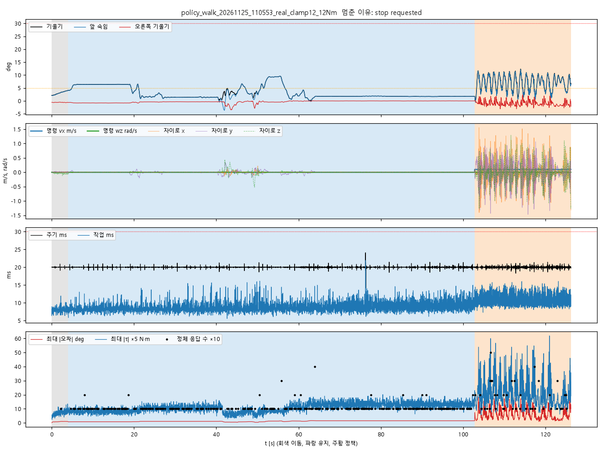
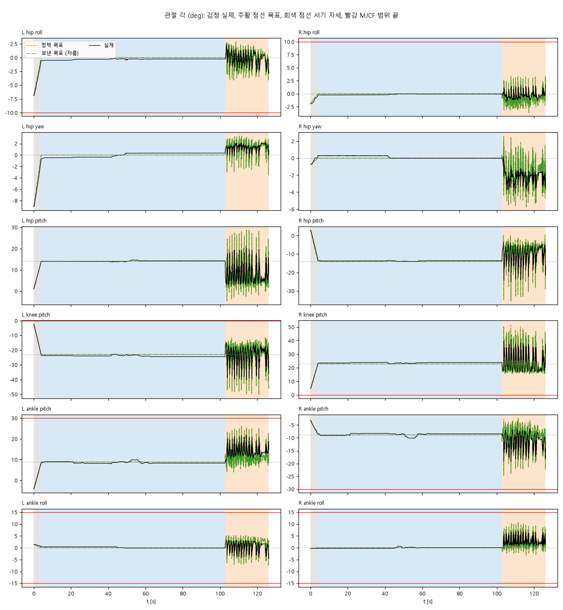
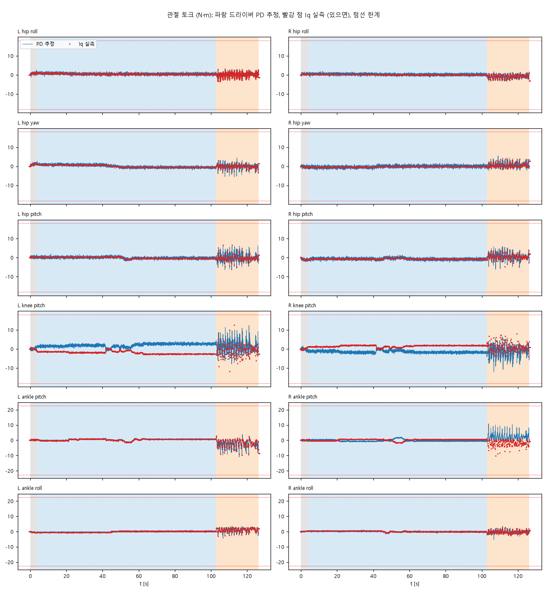
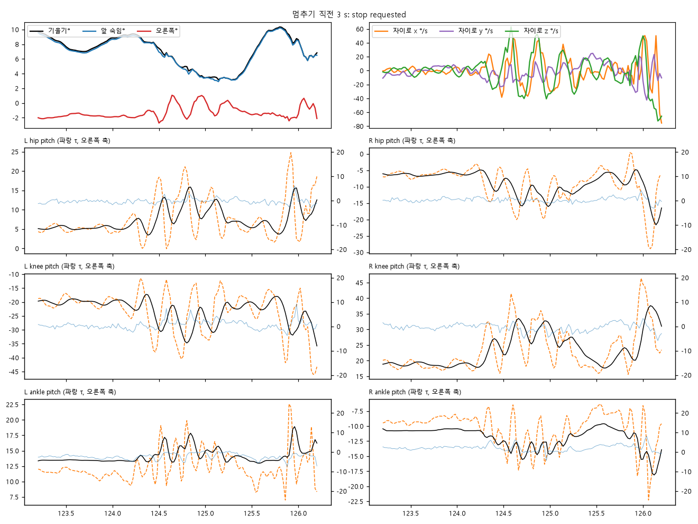
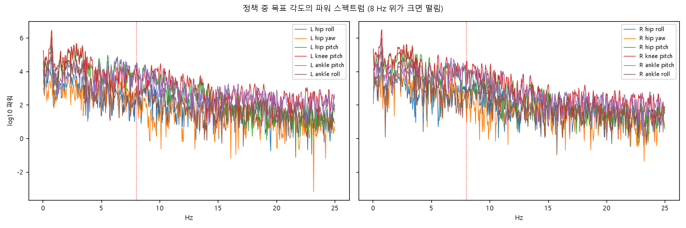

# 정책 보행 기록 분석: policy_walk_20261125_110553_real_clamp12_12Nm

## 한눈에

- ⚠ 정책 중 기울기 최대 12.3° (5° 넘은 시간 70 %). S3 통과 기준은 5° 안.
- ⚠ 정책 켜기 직전(발이 바닥에 닿은 서기 자세) IMU가 다리 기구학보다 앞 +3.7°, 오른쪽 -0.1° 기울어 있음 (학습 IMU 장착 기울기 ±2°). 수평계로 몸통 실제 기울기 확인 필요.
- ⚠ S2: 서기 자세 목표와 1° 넘게 차이: L knee pitch +1.1° (마찰 0.36 N·m ≈ 0.2°, 다리 무게 포함).
- ⚠ Iq 명령이 학습 한계 12 N·m에 해당하는 전류(6512 11.94 A, 발목 9.57 A)를 넘음: L knee pitch 13.7 A. 드라이버 전류 한계는 18 A 그대로 (ODrive 0.5.1의 CAN 0x00F는 속도 한계만 바꿈); 목표 자르기는 정책 주기마다 한 번이라 주기 사이에는 넘을 수 있음 (학습도 같음).
- ℹ 운영자·GUI 쪽에서 멈춤: 멈춤: 모두 힘 풀기 (Esc / 빨간 버튼)
- ℹ 엔코더 정체 응답 418번 (정책 중 0.53 %). 5주기 연속이면 Radxa가 멈춤.
- ℹ IMU 쿼터니언이 직전 주기와 같은 주기 16번 (연속 최대 1). imu_reader가 멈칫한 것.
- ℹ 엔코더 읽기가 8 ms 기다림 한도에 닿은 표본이 있습니다 (최대 9.3 ms).
- ℹ 유지(매단 상태) 중 몸통 기울기 앞 +2.9°, 오른쪽 -0.3°. 하네스 때문일 수도 있음. 바닥에 똑바로 세웠을 때도 2°를 넘으면 장착 기울기(학습 ±2°) 확인.
- ℹ 추종 오차 정지 기준(30°·0.5 s, 같은 주기 |보낸 목표 − 엔코더|): 최대 21.9° (R knee pitch), 30° 넘은 최장 0.00 s.
- ℹ Radxa가 목표를 자른 비율 (정책 중): R knee pitch 10 %, L knee pitch 8 %, L hip pitch 2 %, R hip pitch 2 %
- ✓ 주기 최대 24.1 ms (30 ms 넘은 적 없음).

## 개요

- 폴더: `logs\policy_walk_20261125_110553_real_clamp12_12Nm`
- 파일: real_walk.npz, real_walk_io.npz, status.csv, events.txt, meta.json, gui_frames.csv, gui_log.txt
- 시작: 2026-11-25T11:05:53.398, 시작 명령: [0.1, 0.0, 0.0], IMU 축: ['+y', '-x', '+z']
- 정책: real_clamp12 (학습에 넣은 자르기 12 N·m), 정지 기준: {'tilt_deg': 30.0, 'track_deg': 30.0, 'track_s': 0.5, 'vbus_v': 21.5, 'lean_ok_deg': 2.0}
- 토크: 드라이버 전류 한계 18 A (CAN으로 못 바꿈). Radxa 목표 자르기: radxa_target 12.0 N·m (보낸 목표를 t_send·t_read 시각으로 맞춤 (6311/6311주기))
- 주기 6311개, 126.2 s: 이동 4.0 s → 유지 98.8 s → 정책 23.4 s
- Radxa 멈춘 이유 (npz): `stop requested`
- GUI 이벤트: `멈춤: 모두 힘 풀기 (Esc / 빨간 버튼)`
- meta.json ↔ npz: 관절 순서 같음, 부호 차이 0, 영점 차이 0.00e+00 turn

## 1. 타이밍·통신

Radxa 루프 (npz): 주기 = 이웃한 주기 시작 간격, 작업 = 한 주기에서 읽기+정책+전송에 든 시간

| 단계 | 주기 수 | 주기 p50 ms | p99 | 최대 | >25 ms | >30 ms | >30 연속 | 작업 p50 ms | p99 | 최대 |
|---|---|---|---|---|---|---|---|---|---|---|
| 이동 | 199 | 20.00 | 20.29 | 20.92 | 0 | 0 | 0 | 8.04 | 10.12 | 11.95 |
| 유지 | 4940 | 20.00 | 20.56 | 24.09 | 0 | 0 | 0 | 8.36 | 13.50 | 21.91 |
| 정책 | 1171 | 20.00 | 20.87 | 21.46 | 0 | 0 | 0 | 9.95 | 14.93 | 16.06 |


엔코더 정체 응답 (움직이는 중인데 값이 직전 주기와 완전히 같음 = 8 ms 안에 새 응답 못 받음, 지난 값 사용)

정체 응답이 있는 주기 370개, 그중 6개 넘는 관절이 한꺼번에 정체 (읽기를 통째로 놓침, 보통 Radxa 쪽 지연) 0개

| 관절 | node | 이동 | 유지 | 정책 | 연속 최대 |
|---|---|---|---|---|---|
| L hip roll | 1 | 0 | 20 | 0 | 1 |
| L hip yaw | 3 | 0 | 39 | 1 | 1 |
| L hip pitch | 5 | 0 | 24 | 0 | 1 |
| L knee pitch | 7 | 0 | 25 | 2 | 1 |
| L ankle pitch | 11 | 0 | 27 | 12 | 1 |
| L ankle roll | 13 | 0 | 46 | 29 | 2 |
| R hip roll | 2 | 0 | 27 | 0 | 1 |
| R hip yaw | 4 | 0 | 23 | 0 | 1 |
| R hip pitch | 6 | 0 | 18 | 1 | 1 |
| R knee pitch | 8 | 0 | 32 | 3 | 1 |
| R ankle pitch | 12 | 0 | 31 | 7 | 1 |
| R ankle roll | 14 | 1 | 30 | 20 | 1 |


GUI가 받은 상태 (status.csv, 10 Hz 표본): 엔코더 12개 읽기 시간, 정책이 쓴 IMU 값의 나이

| 단계 | 표본 | 읽기 p50 ms | p99 | 최대 | IMU 나이 p50 ms | p99 | 최대 | 놓침 연속 최대 |
|---|---|---|---|---|---|---|---|---|
| 이동 | 40 | 5.42 | 6.16 | 6.26 | 2.80 | 5.68 | 5.80 | 0 |
| 유지 | 971 | 5.71 | 8.02 | 9.35 | 3.00 | 6.53 | 8.40 | 1 |
| 정책 | 234 | 5.89 | 8.37 | 8.90 | 3.05 | 7.00 | 8.20 | 1 |

## 2. IMU

| 단계 | 기울기 평균° | p95 | 최대 | 앞 숙임 평균° | 오른쪽 기울기 평균° | 중력 평균 (x y z) | 자이로 평균 °/s (x y z) | |자이로| p99 °/s |
|---|---|---|---|---|---|---|---|---|
| 이동 | 3.1 | 4.0 | 4.1 | 3.0 | -0.6 | 0.053 0.010 -0.998 | 0.100 0.526 -2.148 | 1.2 2.0 5.8 |
| 유지 | 3.0 | 6.5 | 9.6 | 2.9 | -0.3 | 0.051 0.006 -0.998 | 0.004 -0.024 0.038 | 4.8 8.8 12.6 |
| 정책 | 6.9 | 10.8 | 12.3 | 6.7 | -0.9 | 0.117 0.016 -0.992 | -0.060 -0.046 -1.079 | 68.3 64.8 56.4 |


쿼터니언 크기 1.0000~1.0000. 앞으로 숙이면 중력 x > 0, 오른쪽으로 기울면 중력 y < 0 (절차서 4절). 이동·유지는 매단 상태라 몸통이 하네스에 따라 기울 수 있음.


자이로 ↔ 쿼터니언 변화 (같은 축이면 상관·기울기 > 0; 걸을 때는 표본 시각 차이로 0.7–0.9도 정상. 축 혼동·부호 오류 점검용)

| 축 | 쿼터니언 각속도 표준편차 rad/s | 상관 | 기울기 (자이로/쿼터니언) |
|---|---|---|---|
| x | 0.153 | 0.922 | 0.90 |
| y | 0.173 | 0.907 | 0.83 |
| z | 0.150 | 0.979 | 0.94 |


IMU ↔ 다리 기구학: 디딤발 발바닥이 바닥에 평평하다고 보고 관절 각(MJCF)으로 계산한 몸통 기울기와 IMU를 비교. 서기 자세는 hip+knee+ankle pitch 합이 0이라 발이 평평하면 몸통이 수직. 차이가 일정하면 IMU 장착(또는 가속도계) 기울기, 영점 오차 합, 발이 평평하지 않음(하네스가 몸통을 당김) 중 하나. 발이 바닥에 닿아 체중이 실렸을 때만 의미.

| 구간 | IMU 앞° | 기구학 앞° | 차이° | IMU 오른쪽° | 기구학 오른쪽° | 차이° |
|---|---|---|---|---|---|---|
| 유지 마지막 3 s (정책 켜기 직전) | 1.7 | -2.0 | 3.7 | -0.0 | 0.1 | -0.1 |
| 정책 | 6.7 | -1.6 | 8.4 | -0.9 | 1.8 | -2.7 |

## 3. 서기 자세 (S2)

시작 자세 (첫 주기, deg): L hip roll -6.9, L hip yaw -9.1, L hip pitch +1.1, L knee pitch -2.3, L ankle pitch -4.2, L ankle roll +1.4, R hip roll -1.9, R hip yaw -0.8, R hip pitch +3.0, R knee pitch +4.7, R ankle pitch -3.2, R ankle roll -0.3

유지 구간 4.5~102.8 s (4915주기, 유지 시작 0.5 s 뒤부터). 목표−실제 = 서기 자세 − 엔코더 (드라이버 PD가 남긴 오차), τ = Kp·오차 − Kd·속도

| 관절 | 서기 목표° | 실제 평균° | 목표−실제 평균° | 표준편차° | PD 토크 평균 N·m | 좌우 합° (L+R) |
|---|---|---|---|---|---|---|
| L hip roll | 0.00 | -0.30 | 0.30 | 0.09 | 0.53 | -0.44 |
| L hip yaw | 0.00 | 0.02 | -0.02 | 0.36 | -0.03 | 0.13 |
| L hip pitch | 14.08 | 14.13 | -0.05 | 0.18 | -0.09 | 0.45 |
| L knee pitch | -22.92 | -24.04 | 1.13 | 0.40 | 1.97 | -0.24 |
| L ankle pitch | 8.84 | 8.53 | 0.30 | 0.41 | 0.38 | -0.07 |
| L ankle roll | 0.00 | 0.09 | -0.09 | 0.28 | -0.11 | 0.02 |
| R hip roll | 0.00 | -0.14 | 0.14 | 0.08 | 0.25 |  |
| R hip yaw | 0.00 | 0.11 | -0.11 | 0.14 | -0.18 |  |
| R hip pitch | -14.08 | -13.69 | -0.39 | 0.13 | -0.70 |  |
| R knee pitch | 22.92 | 23.80 | -0.88 | 0.26 | -1.55 |  |
| R ankle pitch | -8.84 | -8.60 | -0.23 | 0.44 | -0.30 |  |
| R ankle roll | 0.00 | -0.07 | 0.07 | 0.19 | 0.08 |  |


좌우 합: 오른쪽 관절은 왼쪽의 거울(부호 반대)이라 대칭이면 0. 최대 0.45°.

이동 끝 (서기 목표 도달 직후) 목표−실제°: L hip roll +0.6, L hip yaw +0.9, L hip pitch +0.3, L knee pitch +0.4, L ankle pitch +0.5, L ankle roll -0.4, R hip roll +0.3, R hip yaw -0.3, R hip pitch -0.8, R knee pitch -0.3, R ankle pitch -0.4, R ankle roll +0.3

## 4. 관절 (정책 중)

정책 real_clamp12, 정책 중 (첫 주기 제외). 오차 = 직전 목표 − 지금 실제 (deg), τ = 드라이버 PD 토크 추정 (N·m, 드라이버 전류 한계 18 A로 자름; 학습 한계는 12 N·m). 시뮬 보행: 오차 p99 19°, 최대 약 27°, 12° 초과 최장 0.28 s, 관절 속도 최대 11 rad/s.

목표 자르기 기록이 있어 오차·τ는 드라이버로 보낸(자른) 목표로 계산. '12 N·m 넘음'은 자른 뒤에도 주기 사이에 남은 초과 (20 ms 사이 관절이 움직여서). 잘린 양 = 정책 목표 − 보낸 목표.

| 관절 | 범위° | MJCF 끝까지 여유° | |오차| p95 | p99 | 최대 | 12° 초과 최장 s | |τ| p95 | 12 N·m 넘음 % | 12 N·m 넘음 최장 s | |q̇| 최대 rad/s | 정체 응답 | 목표 잘림 % | 잘린 양 최대° |
|---|---|---|---|---|---|---|---|---|---|---|---|---|---|
| L hip roll | -3~+2 | 7.1 | 2.2 | 3.4 | 4.2 | 0.00 | 2.23 | 0.0 | 0.00 | 0.8 | 0 | 0.0 | 0.0 |
| L hip yaw | -1~+2 | 33.2 | 2.1 | 2.9 | 4.2 | 0.00 | 2.34 | 0.0 | 0.00 | 0.8 | 1 | 0.0 | 0.0 |
| L hip pitch | +3~+20 | 59.1 | 9.2 | 10.9 | 12.4 | 0.02 | 3.66 | 0.0 | 0.00 | 2.8 | 0 | 2.4 | 4.9 |
| L knee pitch | -40~-15 | 15.3 | 11.4 | 13.1 | 15.1 | 0.08 | 5.73 | 0.1 | 0.02 | 2.8 | 2 | 8.3 | 7.0 |
| L ankle pitch | +8~+22 | 8.2 | 6.0 | 7.9 | 9.7 | 0.00 | 5.89 | 0.0 | 0.00 | 3.1 | 12 | 0.2 | 1.5 |
| L ankle roll | -5~+3 | 10.3 | 2.6 | 3.5 | 4.4 | 0.00 | 2.65 | 0.0 | 0.00 | 1.6 | 29 | 0.0 | 0.0 |
| R hip roll | -1~+2 | 8.2 | 2.0 | 3.1 | 3.9 | 0.00 | 2.59 | 0.0 | 0.00 | 0.9 | 0 | 0.0 | 0.0 |
| R hip yaw | -4~+0 | 33.5 | 2.4 | 3.1 | 4.4 | 0.00 | 2.88 | 0.0 | 0.00 | 0.9 | 0 | 0.0 | 0.0 |
| R hip pitch | -25~-4 | 59.8 | 8.8 | 12.1 | 15.6 | 0.06 | 3.15 | 0.0 | 0.00 | 3.5 | 1 | 1.9 | 5.1 |
| R knee pitch | +17~+41 | 16.9 | 12.0 | 15.6 | 18.2 | 0.08 | 5.05 | 0.1 | 0.02 | 3.5 | 3 | 9.7 | 10.6 |
| R ankle pitch | -19~-6 | 10.6 | 5.3 | 7.6 | 10.8 | 0.00 | 4.71 | 0.0 | 0.00 | 3.9 | 7 | 0.3 | 2.4 |
| R ankle roll | -0~+7 | 7.8 | 3.2 | 4.4 | 5.5 | 0.00 | 1.84 | 0.0 | 0.00 | 1.9 | 20 | 0.0 | 0.0 |


관절 속도 (ODrive vel_estimate) ↔ 위치 차분 상관: L hip roll 0.92, L hip yaw 0.91, L hip pitch 0.99, L knee pitch 0.99, L ankle pitch 0.95, L ankle roll 0.95, R hip roll 0.92, R hip yaw 0.91, R hip pitch 0.99, R knee pitch 0.99, R ankle pitch 0.96, R ankle roll 0.96

## 5. 정책 입력·출력

관측 조립 점검 (기록된 값끼리 비교)

| 항목 | 최대 차이 | 결과 |
|---|---|---|
| 명령 0–2 | 0.0e+00 | 같음 |
| 각속도 3–5 | 0.0e+00 | 같음 |
| 중력 6–8 | 3.0e-08 | 같음 |
| 관절 각 9–20 | 3.6e-08 | 같음 |
| 관절 속도 21–32 | 1.1e-07 | 같음 |
| 직전 행동 33–44 | 0.0e+00 | 같음 |
| 목표 = 서기 + 0.25·clip(행동) | 3.6e-08 | 같음 |
| 정책 재생 (PC numpy) vs Radxa 행동 | 6.0e-07 | 같음 |


정책 첫 주기 (t = 102.80 s): 중력 [0.03, 0.0, -1.0], 각속도 rad/s [0.004, 0.003, 0.002], 관절 − 서기 최대 1.5°, 명령 [0.1, 0.0, 0.0]

첫 목표 − 서기 자세 (deg): L hip roll -0.1, L hip yaw +0.3, L hip pitch -3.7, L knee pitch +6.7, L ankle pitch +4.1, L ankle roll +1.3, R hip roll -0.5, R hip yaw +0.4, R hip pitch +1.7, R knee pitch -4.4, R ankle pitch -2.5, R ankle roll -0.9


행동 (정책 출력, 배율 전) 1171주기. 진동수 = 목표의 주 성분 (0.3–5 Hz), 8 Hz 넘는 비율 = 떨림 지표, Δa/a = 이웃 주기 차이의 표준편차 ÷ 행동 표준편차 (1 Hz 부드러운 움직임 ≈ 0.13, 번갈아 튀면 ≈ 2)

| 관절 | |a| p50 | p99 | 최대 | ±20 잘림 % | 목표−서기 최대° | 주 진동수 Hz | 8 Hz 넘는 비율 | Δa/a |
|---|---|---|---|---|---|---|---|---|
| L hip roll | 0.06 | 0.26 | 0.29 | 0.0 | 4.1 | 0.77 | 0.10 | 0.52 |
| L hip yaw | 0.11 | 0.21 | 0.25 | 0.0 | 3.5 | 4.82 | 0.06 | 0.63 |
| L hip pitch | 0.59 | 1.09 | 1.30 | 0.0 | 18.6 | 0.77 | 0.05 | 0.47 |
| L knee pitch | 0.33 | 1.68 | 1.92 | 0.0 | 27.5 | 0.77 | 0.04 | 0.40 |
| L ankle pitch | 0.19 | 1.07 | 1.21 | 0.0 | 17.3 | 0.77 | 0.14 | 0.66 |
| L ankle roll | 0.21 | 0.43 | 0.54 | 0.0 | 7.7 | 0.77 | 0.02 | 0.30 |
| R hip roll | 0.07 | 0.22 | 0.26 | 0.0 | 3.7 | 0.77 | 0.14 | 0.58 |
| R hip yaw | 0.13 | 0.36 | 0.40 | 0.0 | 5.7 | 2.86 | 0.05 | 0.55 |
| R hip pitch | 0.45 | 1.21 | 1.49 | 0.0 | 21.3 | 0.77 | 0.03 | 0.41 |
| R knee pitch | 0.36 | 1.69 | 2.04 | 0.0 | 29.3 | 0.77 | 0.05 | 0.39 |
| R ankle pitch | 0.16 | 0.77 | 1.11 | 0.0 | 15.8 | 0.77 | 0.10 | 0.59 |
| R ankle roll | 0.13 | 0.63 | 0.75 | 0.0 | 10.8 | 0.77 | 0.04 | 0.41 |


정책 구간 1개 (주파수 분석은 가장 긴 구간 102.8~126.2 s)

| # | 시작 t s | 길이 s | 명령 | 켤 때 앞 숙임° | 앞 숙임 평균° (0.5 s 뒤) | 최대 기울기° | 첫 목표−서기 최대° | 끝 |
|---|---|---|---|---|---|---|---|---|
| 1 | 102.8 | 23.4 | 0.10 0.00 0.00 | 1.7 | 6.9 | 12.3 | 6.7 | 기록 끝 (stop requested) |


명령 구간 (속도 측정이 없어 vx는 영상으로 확인; 회전은 자이로 z로 비교 가능, 시뮬 0.8 → 0.85 rad/s)

| t s | 길이 s | 명령 vx vy wz | 자이로 z 평균 rad/s | 기울기 평균° | 최대° | 앞 숙임 평균° | 오른쪽 기울기 평균° |
|---|---|---|---|---|---|---|---|
| 102.8~126.2 | 23.4 | 0.10 0.00 0.00 | -0.019 | 6.9 | 12.3 | 6.7 | -0.9 |

## 6. 드라이버 (GUI가 받은 값)

시각 맞추기: 엔코더 응답 24835개가 npz 값과 정확히 일치 → t_npz = t_gui − 91.393 s (차이 p5–p95 -3~+12 ms)


heartbeat 처음 상태: IDLE (node 1,2,3,4,5,6,7,8,11,12,13,14)

heartbeat 상태 변화

| t s | 상태 | axis_error | 관절 |
|---|---|---|---|
| 0.06 | CLOSED_LOOP_CONTROL | 0 | 12개: R ankle pitch, L hip yaw, L hip pitch, R hip pitch, L knee pitch, R knee pitch, L ankle pitch, R ankle roll, L hip roll, L ankle roll, R hip roll, R hip yaw |
| 126.26 | IDLE | 0 | 12개: L hip roll, L hip yaw, L hip pitch, L knee pitch, L ankle pitch, R hip roll, R hip pitch, R knee pitch, R ankle pitch, R ankle roll, R hip yaw, L ankle roll |


Iq (정책 중 표본; 없으면 기록 전체). 12 N·m 전류 = 학습 토크 한계에 해당하는 전류, '넘음 %' = |Iq 명령|이 그 95 % 이상인 표본. τ(Iq) = 방향 × torque_sign × Iq × kt × 15 를 드라이버 PD 추정 τ와 비교 (기울기 ≈ 1, 상관 ≈ 1이면 PD 모델이 맞음)

| 관절 | node | 표본 Hz | |Iq| p95 A | |Iq| 최대 | |Iq 명령| 최대 | 12 N·m 전류 A | 넘음 % | τ(Iq)/τ(PD) 기울기 | 상관 |
|---|---|---|---|---|---|---|---|---|---|
| L hip roll | 1 | 50 | 2.01 | 3.54 | 3.83 | 11.94 | 0.0 | 0.68 | 0.76 |
| L hip yaw | 3 | 10 | 2.14 | 3.42 | 3.33 | 11.94 | 0.0 | 0.59 | 0.70 |
| L hip pitch | 5 | 10 | 3.16 | 6.61 | 6.23 | 11.94 | 0.0 | 0.66 | 0.76 |
| L knee pitch | 7 | 10 | 5.53 | 12.54 | 13.71 | 11.94 | 1.3 | -0.97 | -0.84 |
| L ankle pitch | 11 | 10 | 5.06 | 7.76 | 7.50 | 9.57 | 0.0 | 0.99 | 0.94 |
| L ankle roll | 13 | 10 | 2.09 | 2.34 | 2.46 | 9.57 | 0.0 | 0.97 | 0.93 |
| R hip roll | 2 | 10 | 2.45 | 2.90 | 3.55 | 11.94 | 0.0 | 0.87 | 0.84 |
| R hip yaw | 4 | 10 | 2.82 | 3.80 | 4.40 | 11.94 | 0.0 | 0.78 | 0.78 |
| R hip pitch | 6 | 10 | 3.34 | 4.74 | 5.00 | 11.94 | 0.0 | 0.71 | 0.63 |
| R knee pitch | 8 | 10 | 5.19 | 8.04 | 8.44 | 11.94 | 0.0 | -0.77 | -0.76 |
| R ankle pitch | 12 | 10 | 3.88 | 8.11 | 8.16 | 9.57 | 0.0 | -0.90 | -0.92 |
| R ankle roll | 14 | 10 | 1.49 | 2.09 | 2.55 | 9.57 | 0.0 | 0.83 | 0.84 |


버스 전압 (Vbus, 2 s마다 node별): 최소 23.47 V, 중앙 23.85 V, 최대 24.25 V, 표본 3053개

## 7. 멈추기 직전

마지막 2 s (0.2 s 간격 + 마지막 주기). 멈춘 이유: `stop requested`. 안전 정지를 일으킨 주기는 기록되지 않음 (기록 전에 멈춤).

| t s | 단계 | 기울기° | 앞 숙임° | 오른쪽° | 최대 |오차|° | 최대 |τ| N·m | 포화 관절 수 | 작업 ms | 명령 |
|---|---|---|---|---|---|---|---|---|---|
| 124.20 | 정책 | 9.4 | 9.2 | -2.0 | L ankle pitch 4 | L ankle pitch 4.8 | 0 | 9.0 | 0.10 0.00 0.00 |
| 124.40 | 정책 | 8.3 | 8.2 | -1.0 | L knee pitch 7 | L hip yaw 3.6 | 0 | 9.0 | 0.10 0.00 0.00 |
| 124.60 | 정책 | 6.4 | 6.4 | -0.3 | R knee pitch 12 | R ankle pitch 3.4 | 0 | 9.5 | 0.10 0.00 0.00 |
| 124.80 | 정책 | 4.9 | 4.4 | -2.2 | L hip pitch 6 | R hip yaw 3.5 | 0 | 10.6 | 0.10 0.00 0.00 |
| 125.00 | 정책 | 3.4 | 3.4 | 0.3 | R knee pitch 7 | R knee pitch 4.0 | 0 | 9.2 | 0.10 0.00 0.00 |
| 125.20 | 정책 | 3.5 | 3.5 | 0.0 | L knee pitch 8 | L knee pitch 2.7 | 0 | 10.0 | 0.10 0.00 0.00 |
| 125.40 | 정책 | 4.2 | 4.0 | -1.2 | L knee pitch 4 | R knee pitch 3.0 | 0 | 8.7 | 0.10 0.00 0.00 |
| 125.60 | 정책 | 8.5 | 8.3 | -1.7 | L ankle pitch 3 | L ankle pitch 3.7 | 0 | 9.4 | 0.10 0.00 0.00 |
| 125.80 | 정책 | 10.3 | 10.2 | -1.6 | L knee pitch 5 | R ankle pitch 3.1 | 0 | 9.2 | 0.10 0.00 0.00 |
| 126.00 | 정책 | 8.6 | 8.5 | -1.5 | R knee pitch 16 | R knee pitch 3.3 | 0 | 8.8 | 0.10 0.00 0.00 |
| 126.20 | 정책 | 6.8 | 6.5 | -2.1 | L knee pitch 10 | L ankle pitch 7.1 | 0 | 12.2 | 0.10 0.00 0.00 |
| 126.20 | 정책 | 6.8 | 6.5 | -2.1 | L knee pitch 10 | L ankle pitch 7.1 | 0 | 12.2 | 0.10 0.00 0.00 |

## 8. 이벤트·GUI 기록

events.txt
```
11:05:53.402 [npz -0.56 s] 시작 요청 (정책 real_clamp12, 앞으로 0.10 m/s, 토크 한계 12 N·m 켬 (Radxa 목표 자르기, 정책 학습 값), 정지: 기울기 30°·추종 오차 30° 0.5 s·Vbus 21.5 V): L hip roll 부호 -1 영점 -0.4764, L hip yaw 부호 -1 영점 0.2441, L hip pitch 부호 -1 영점 4.8354, L knee pitch 부호 -1 영점 -4.3998, L ankle pitch 부호 -1 영점 1.9838, L ankle roll 부호 -1 영점 0.2539, R hip roll 부호 -1 영점 -0.9738, R hip yaw 부호 -1 영점 0.3778, R hip pitch 부호 -1 영점 -3.1488, R knee pitch 부호 -
11:05:53.847 [npz -0.12 s] Radxa에서 시작: 서기 자세로 4 s 이동 (정책 real_clamp12, 토크 한계 12 N·m, 기울기 정지 30.0°, 추종 오차 정지 30.0° 0.5 s)
11:05:58.016 [npz +4.05 s] 서기 자세 도달, 유지 중 (발이 바닥에 닿으면 '정책 켜기')
11:06:06.642 [npz +12.68 s] 앞으로 걷는 속도 0.05 m/s
11:06:06.920 [npz +12.96 s] 앞으로 걷는 속도 0.00 m/s
11:06:07.399 [npz +13.43 s] 앞으로 걷는 속도 0.05 m/s
11:06:07.448 [npz +13.48 s] 앞으로 걷는 속도 0.10 m/s
11:06:07.528 [npz +13.56 s] 앞으로 걷는 속도 0.15 m/s
11:07:31.078 [npz +97.11 s] 앞으로 걷는 속도 0.10 m/s
11:07:36.763 [npz +102.80 s] 정책 켜기 (발이 바닥에 닿음, IMU 앞 숙임 +1.7° 오른쪽 -0.0°)
11:07:36.855 [npz +102.89 s] 정책 보행 시작
11:08:00.169 [npz +126.20 s] 멈춤 요청: 모두 힘 풀기 (Esc / 빨간 버튼)
11:08:00.709 [npz +126.74 s] 목표를 자른 주기 223 / 6312, 추종 오차 최대 21.9°, 버스 전압 최저 23.47 V (node 7)
11:08:00.709 [npz +126.74 s] 멈춤: 모두 힘 풀기 (Esc / 빨간 버튼)
11:08:01.626 [npz +127.66 s] Radxa 기록 → logs/policy_walk_20261125_110553_real_clamp12_12Nm/real_walk.npz (4787 KB) + real_walk_io.npz
```

gui_log.txt 중 경고·Radxa 줄
```
    91.274 [CAN] [Radxa] [bridge] 정책 보행: {'type': 'started', 'log': '/home/radxa/motor_bridge/logs/real_walk_20261125_110553_real_clamp12_12Nm.npz', 'policy': 'real_clamp12', 'torque_clamp': True, 'limit_nm': 12.0, 'trained_clamp': True, 'tilt_limit_deg': 30.0, 'track_limit_deg': 30.0, 'track_time_s': 0.5}
   217.598 [CAN] 모든 노드 IDLE 명령 (12개, 버스 2개)
   217.606 [CAN] [Radxa] [bridge] 모두 힘 풀기 (정책 멈춤: 모두 힘 풀기 (Esc / 빨간 버튼)): IDLE 프레임 34개
   217.889 [CAN] [Radxa] stopped: stop requested; log -> /home/radxa/motor_bridge/logs/real_walk_20261125_110553_real_clamp12_12Nm.npz
   218.088 [CAN] ⚠ Radxa: 버스 1 송신 실패: [Errno 19] No such device
   218.095 [CAN] ⚠ Radxa: 버스 1 (ttyACM0) 수신 중단: 장치가 닫힘
   218.095 [CAN] [Radxa] [bridge] 버스 1 (ttyACM0) 수신 중단: 장치가 닫힘
   218.114 [CAN] [Radxa] [bridge] 버스 2 (ttyACM1) 수신 중단: 장치가 닫힘
   218.119 [CAN] ⚠ Radxa: 버스 2 (ttyACM1) 수신 중단: 장치가 닫힘
   218.135 [CAN] [Radxa] [bridge] 정책 보행: {'type': 'stopped', 'reason': '모두 힘 풀기 (Esc / 빨간 버튼)', 'log': '/home/radxa/motor_bridge/logs/real_walk_20261125_110553_real_clamp12_12Nm.npz', 'log_size': 4902886, 'io_log': '/home/radxa/motor_bridge/logs/real_walk_20261125_110553_real_clamp12_12Nm_io.npz', 'clamp_cycles': 223, 'sent': 6312, 'policy': 'real_clamp12', 'track_err_max_deg': 21.9}
   218.250 [CAN] ⚠ Radxa: 버스 2 송신 실패: [Errno 5] Input/output error
   218.389 [CAN] ⚠ Radxa: 버스 1 송신 실패: [Errno 5] Input/output error
   218.532 [CAN] ⚠ Radxa: 버스 1 송신 실패: [Errno 5] Input/output error
   218.651 [CAN] ⚠ Radxa: 버스 2 송신 실패: [Errno 5] Input/output error
```

## 그림






