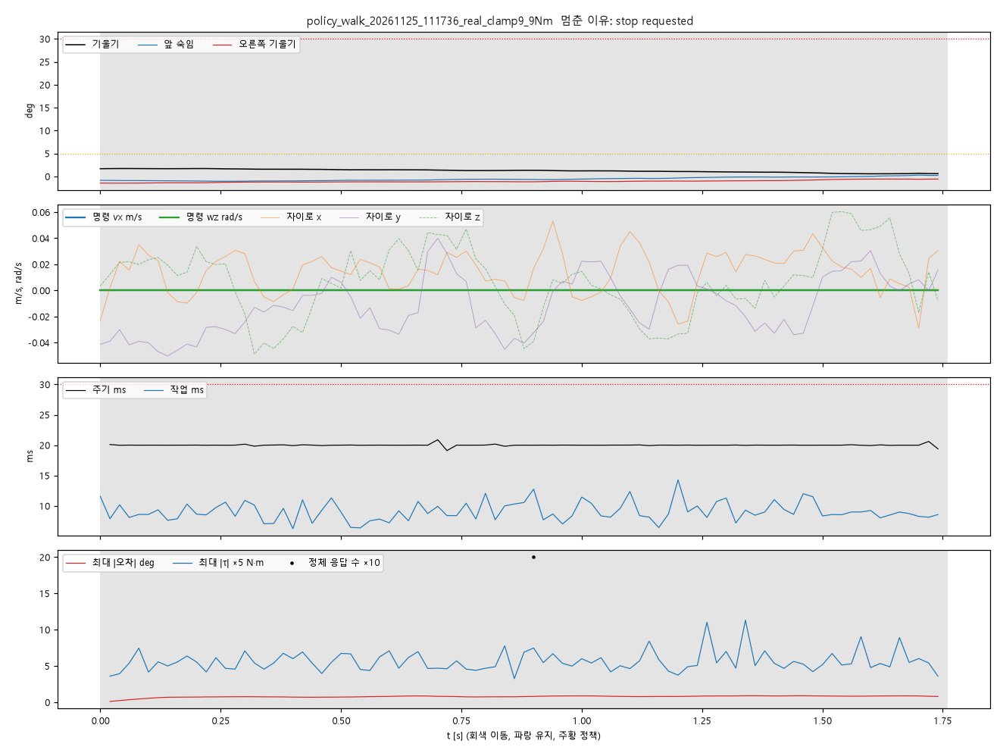
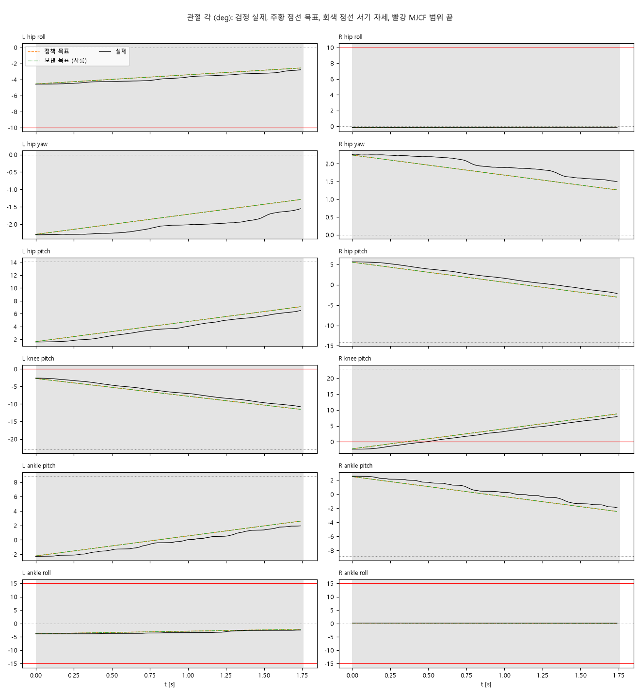
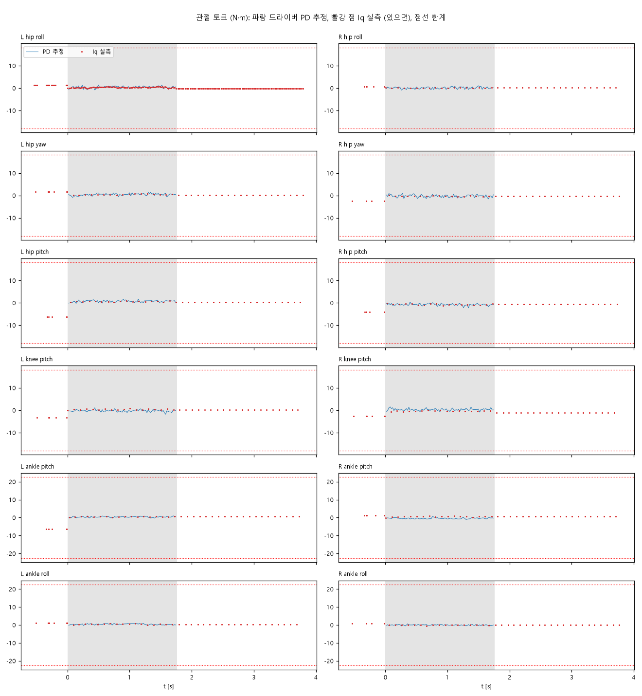
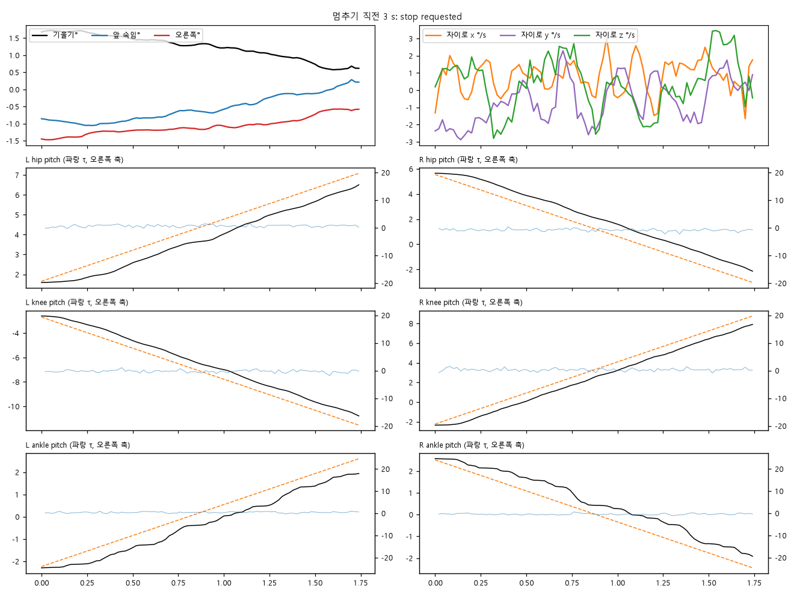

# 정책 보행 기록 분석: policy_walk_20261125_111736_real_clamp9_9Nm

## 한눈에

- ℹ 정책을 켜지 않은 기록입니다 (이동·유지만).
- ℹ 운영자·GUI 쪽에서 멈춤: 멈춤: 정책 보행 '멈춤' 버튼
- ℹ 엔코더 정체 응답 2번 (정책 중 0.00 %). 5주기 연속이면 Radxa가 멈춤.
- ✓ 주기 최대 20.9 ms (30 ms 넘은 적 없음).

## 개요

- 폴더: `logs\policy_walk_20261125_111736_real_clamp9_9Nm`
- 파일: real_walk.npz, real_walk_io.npz, status.csv, events.txt, meta.json, gui_frames.csv, gui_log.txt
- 시작: 2026-11-25T11:17:36.073, 시작 명령: [0.2, 0.0, 0.0], IMU 축: ['+y', '-x', '+z']
- 정책: real_clamp9 (학습에 넣은 자르기 9 N·m), 정지 기준: {'tilt_deg': 30.0, 'track_deg': 30.0, 'track_s': 0.5, 'vbus_v': 21.5, 'lean_ok_deg': 2.0}
- 토크: 드라이버 전류 한계 18 A (CAN으로 못 바꿈). Radxa 목표 자르기: radxa_target 9.0 N·m (보낸 목표 89행 중 1번째부터 npz 88주기와 맞춤)
- 주기 88개, 1.8 s: 이동 1.8 s → 유지 0.0 s → 정책 0.0 s
- Radxa 멈춘 이유 (npz): `stop requested`
- GUI 이벤트: `멈춤: 정책 보행 '멈춤' 버튼`
- meta.json ↔ npz: 관절 순서 같음, 부호 차이 0, 영점 차이 0.00e+00 turn

## 1. 타이밍·통신

Radxa 루프 (npz): 주기 = 이웃한 주기 시작 간격, 작업 = 한 주기에서 읽기+정책+전송에 든 시간

| 단계 | 주기 수 | 주기 p50 ms | p99 | 최대 | >25 ms | >30 ms | >30 연속 | 작업 p50 ms | p99 | 최대 |
|---|---|---|---|---|---|---|---|---|---|---|
| 이동 | 87 | 20.00 | 20.65 | 20.89 | 0 | 0 | 0 | 8.66 | 12.98 | 14.30 |


엔코더 정체 응답 (움직이는 중인데 값이 직전 주기와 완전히 같음 = 8 ms 안에 새 응답 못 받음, 지난 값 사용)

정체 응답이 있는 주기 1개, 그중 6개 넘는 관절이 한꺼번에 정체 (읽기를 통째로 놓침, 보통 Radxa 쪽 지연) 0개

| 관절 | node | 이동 | 유지 | 정책 | 연속 최대 |
|---|---|---|---|---|---|
| L ankle roll | 13 | 1 | 0 | 0 | 1 |
| R ankle roll | 14 | 1 | 0 | 0 | 1 |


GUI가 받은 상태 (status.csv, 10 Hz 표본): 엔코더 12개 읽기 시간, 정책이 쓴 IMU 값의 나이

| 단계 | 표본 | 읽기 p50 ms | p99 | 최대 | IMU 나이 p50 ms | p99 | 최대 | 놓침 연속 최대 |
|---|---|---|---|---|---|---|---|---|
| 이동 | 18 | 5.71 | 6.96 | 6.99 | 3.45 | 6.60 | 6.80 | 0 |

## 2. IMU

| 단계 | 기울기 평균° | p95 | 최대 | 앞 숙임 평균° | 오른쪽 기울기 평균° | 중력 평균 (x y z) | 자이로 평균 °/s (x y z) | |자이로| p99 °/s |
|---|---|---|---|---|---|---|---|---|
| 이동 | 1.2 | 1.7 | 1.7 | -0.5 | -1.1 | -0.010 0.019 -1.000 | 0.791 -0.638 0.387 | 2.6 2.7 3.4 |


쿼터니언 크기 1.0000~1.0000. 앞으로 숙이면 중력 x > 0, 오른쪽으로 기울면 중력 y < 0 (절차서 4절). 이동·유지는 매단 상태라 몸통이 하네스에 따라 기울 수 있음.


자이로 ↔ 쿼터니언 변화 (같은 축이면 상관·기울기 > 0; 걸을 때는 표본 시각 차이로 0.7–0.9도 정상. 축 혼동·부호 오류 점검용)

| 축 | 쿼터니언 각속도 표준편차 rad/s | 상관 | 기울기 (자이로/쿼터니언) |
|---|---|---|---|
| x | 0.016 | 움직임 작음 | – |
| y | 0.023 | 움직임 작음 | – |
| z | 0.026 | 움직임 작음 | – |


IMU ↔ 다리 기구학: 디딤발 발바닥이 바닥에 평평하다고 보고 관절 각(MJCF)으로 계산한 몸통 기울기와 IMU를 비교. 서기 자세는 hip+knee+ankle pitch 합이 0이라 발이 평평하면 몸통이 수직. 차이가 일정하면 IMU 장착(또는 가속도계) 기울기, 영점 오차 합, 발이 평평하지 않음(하네스가 몸통을 당김) 중 하나. 발이 바닥에 닿아 체중이 실렸을 때만 의미.

| 구간 | IMU 앞° | 기구학 앞° | 차이° | IMU 오른쪽° | 기구학 오른쪽° | 차이° |
|---|---|---|---|---|---|---|

## 3. 서기 자세 (S2)

시작 자세 (첫 주기, deg): L hip roll -4.6, L hip yaw -2.3, L hip pitch +1.6, L knee pitch -2.6, L ankle pitch -2.3, L ankle roll -3.9, R hip roll -0.2, R hip yaw +2.3, R hip pitch +5.6, R knee pitch -2.3, R ankle pitch +2.6, R ankle roll +0.2

유지 구간이 짧아 S2 판정 안 함.

## 6. 드라이버 (GUI가 받은 값)

시각 맞추기: 엔코더 응답 1028개가 npz 값과 정확히 일치 → t_npz = t_gui − 320.279 s (차이 p5–p95 -3~+136 ms)


heartbeat 처음 상태: IDLE (node 1,2,3,4,5,6,7,8,11,12,13,14)

heartbeat 상태 변화

| t s | 상태 | axis_error | 관절 |
|---|---|---|---|
| 0.01 | CLOSED_LOOP_CONTROL | 0 | 12개: R ankle pitch, L hip yaw, L knee pitch, R hip roll, L hip pitch, R knee pitch, L ankle pitch, R hip pitch, L hip roll, R ankle roll, R hip yaw, L ankle roll |
| 1.81 | IDLE | 0 | 12개: R ankle pitch, L hip yaw, L knee pitch, R hip roll, L hip pitch, R knee pitch, L ankle pitch, L hip roll, R hip pitch, R ankle roll, R hip yaw, L ankle roll |


Iq (정책 중 표본; 없으면 기록 전체). 9 N·m 전류 = 학습 토크 한계에 해당하는 전류, '넘음 %' = |Iq 명령|이 그 95 % 이상인 표본. τ(Iq) = 방향 × torque_sign × Iq × kt × 15 를 드라이버 PD 추정 τ와 비교 (기울기 ≈ 1, 상관 ≈ 1이면 PD 모델이 맞음)

| 관절 | node | 표본 Hz | |Iq| p95 A | |Iq| 최대 | |Iq 명령| 최대 | 9 N·m 전류 A | 넘음 % | τ(Iq)/τ(PD) 기울기 | 상관 |
|---|---|---|---|---|---|---|---|---|---|
| L hip roll | 1 | 50 | 0.60 | 0.70 | 1.26 | 8.96 | 0.0 | 0.39 | 0.34 |
| L hip yaw | 3 | 10 | 0.79 | 0.84 | 1.15 | 8.96 | 0.0 | 0.46 | 0.23 |
| L hip pitch | 5 | 10 | 0.84 | 0.86 | 1.55 | 8.96 | 0.0 | 0.60 | 0.55 |
| L knee pitch | 7 | 10 | 0.73 | 0.91 | 1.37 | 8.96 | 0.0 | -0.65 | -0.12 |
| L ankle pitch | 11 | 10 | 0.52 | 0.61 | 0.79 | 7.18 | 0.0 | 0.93 | 0.51 |
| L ankle roll | 13 | 10 | 0.57 | 0.58 | 0.61 | 7.18 | 0.0 | 0.86 | 0.68 |
| R hip roll | 2 | 10 | 0.27 | 0.30 | 0.86 | 8.96 | 0.0 | 0.21 | 0.46 |
| R hip yaw | 4 | 10 | 0.48 | 0.49 | 1.03 | 8.96 | 0.0 | 0.21 | 0.52 |
| R hip pitch | 6 | 10 | 1.08 | 1.18 | 1.48 | 8.96 | 0.0 | 0.82 | 0.34 |
| R knee pitch | 8 | 10 | 0.67 | 0.70 | 1.00 | 8.96 | 0.0 | -0.40 | -0.45 |
| R ankle pitch | 12 | 10 | 0.72 | 0.74 | 0.71 | 7.18 | 0.0 | -0.94 | -0.72 |
| R ankle roll | 14 | 10 | 0.20 | 0.33 | 0.24 | 7.18 | 0.0 | -0.04 | -0.08 |


버스 전압 (Vbus, 2 s마다 node별): 최소 23.67 V, 중앙 23.86 V, 최대 24.05 V, 표본 68개

## 7. 멈추기 직전

마지막 2 s (0.2 s 간격 + 마지막 주기). 멈춘 이유: `stop requested`. 안전 정지를 일으킨 주기는 기록되지 않음 (기록 전에 멈춤).

| t s | 단계 | 기울기° | 앞 숙임° | 오른쪽° | 최대 |오차|° | 최대 |τ| N·m | 포화 관절 수 | 작업 ms | 명령 |
|---|---|---|---|---|---|---|---|---|---|
| 0.00 | 이동 | 1.7 | -0.9 | -1.4 | L hip roll 0 | L hip roll 0.0 | 0 | 11.6 | 0.00 0.00 0.00 |
| 0.20 | 이동 | 1.7 | -1.0 | -1.4 | R hip pitch 1 | R hip yaw 1.1 | 0 | 8.6 | 0.00 0.00 0.00 |
| 0.40 | 이동 | 1.6 | -1.0 | -1.2 | R hip pitch 1 | L hip pitch 1.2 | 0 | 6.3 | 0.00 0.00 0.00 |
| 0.60 | 이동 | 1.5 | -0.8 | -1.2 | R hip pitch 1 | R hip pitch 1.4 | 0 | 7.2 | 0.00 0.00 0.00 |
| 0.80 | 이동 | 1.3 | -0.6 | -1.1 | R hip pitch 1 | L knee pitch 0.9 | 0 | 12.1 | 0.00 0.00 0.00 |
| 1.00 | 이동 | 1.2 | -0.6 | -1.1 | R hip pitch 1 | L hip yaw 1.2 | 0 | 11.5 | 0.00 0.00 0.00 |
| 1.20 | 이동 | 1.1 | -0.3 | -1.0 | R hip pitch 1 | R ankle pitch 0.7 | 0 | 14.3 | 0.00 0.00 0.00 |
| 1.40 | 이동 | 0.9 | -0.2 | -0.9 | R hip pitch 1 | R hip pitch 1.1 | 0 | 11.0 | 0.00 0.00 0.00 |
| 1.60 | 이동 | 0.6 | 0.0 | -0.6 | R hip pitch 1 | L hip pitch 1.0 | 0 | 9.3 | 0.00 0.00 0.00 |
| 1.74 | 이동 | 0.6 | 0.2 | -0.6 | R hip pitch 1 | R hip pitch 0.7 | 0 | 8.6 | 0.00 0.00 0.00 |

## 8. 이벤트·GUI 기록

events.txt
```
11:17:36.077 [npz -0.54 s] 시작 요청 (정책 real_clamp9, 앞으로 0.20 m/s, 토크 한계 9 N·m 켬 (Radxa 목표 자르기, 정책 학습 값), 정지: 기울기 30°·추종 오차 30° 0.5 s·Vbus 21.5 V): L hip roll 부호 -1 영점 0.5236, L hip yaw 부호 -1 영점 0.2441, L hip pitch 부호 -1 영점 0.8354, L knee pitch 부호 -1 영점 0.6002, L ankle pitch 부호 -1 영점 -0.0162, L ankle roll 부호 -1 영점 0.2539, R hip roll 부호 -1 영점 0.0262, R hip yaw 부호 -1 영점 0.3778, R hip pitch 부호 -1 영점 0.8512, R knee pitch 부호 -1 영점 
11:17:36.492 [npz -0.12 s] Radxa에서 시작: 서기 자세로 4 s 이동 (정책 real_clamp9, 토크 한계 9 N·m, 기울기 정지 30.0°, 추종 오차 정지 30.0° 0.5 s)
11:17:38.363 [npz +1.75 s] 멈춤 요청: 정책 보행 '멈춤' 버튼
11:17:38.411 [npz +1.80 s] 목표를 자른 주기 0 / 89, 추종 오차 최대 1.0°, 버스 전압 최저 23.67 V (node 6)
11:17:38.412 [npz +1.80 s] 멈춤: 정책 보행 '멈춤' 버튼
11:17:39.214 [npz +2.60 s] Radxa 기록 → logs/policy_walk_20261125_111736_real_clamp9_9Nm/real_walk.npz (72 KB) + real_walk_io.npz
```

gui_log.txt 중 경고·Radxa 줄
```
   320.157 [CAN] [Radxa] [bridge] 정책 보행: {'type': 'started', 'log': '/home/radxa/motor_bridge/logs/real_walk_20261125_111736_real_clamp9_9Nm.npz', 'policy': 'real_clamp9', 'torque_clamp': True, 'limit_nm': 9.0, 'trained_clamp': True, 'tilt_limit_deg': 30.0, 'track_limit_deg': 30.0, 'track_time_s': 0.5}
   322.032 [CAN] 모든 노드 IDLE 명령 (12개, 버스 2개)
   322.034 [CAN] [Radxa] [bridge] 모두 힘 풀기 (정책 멈춤: 정책 보행 '멈춤' 버튼): IDLE 프레임 24개
   322.063 [CAN] [Radxa] stopped: stop requested; log -> /home/radxa/motor_bridge/logs/real_walk_20261125_111736_real_clamp9_9Nm.npz
   322.078 [CAN] [Radxa] [bridge] 정책 보행: {'type': 'stopped', 'reason': "정책 보행 '멈춤' 버튼", 'log': '/home/radxa/motor_bridge/logs/real_walk_20261125_111736_real_clamp9_9Nm.npz', 'log_size': 73838, 'io_log': '/home/radxa/motor_bridge/logs/real_walk_20261125_111736_real_clamp9_9Nm_io.npz', 'clamp_cycles': 0, 'sent': 89, 'policy': 'real_clamp9', 'track_err_max_deg': 1.0}
```

## 그림





