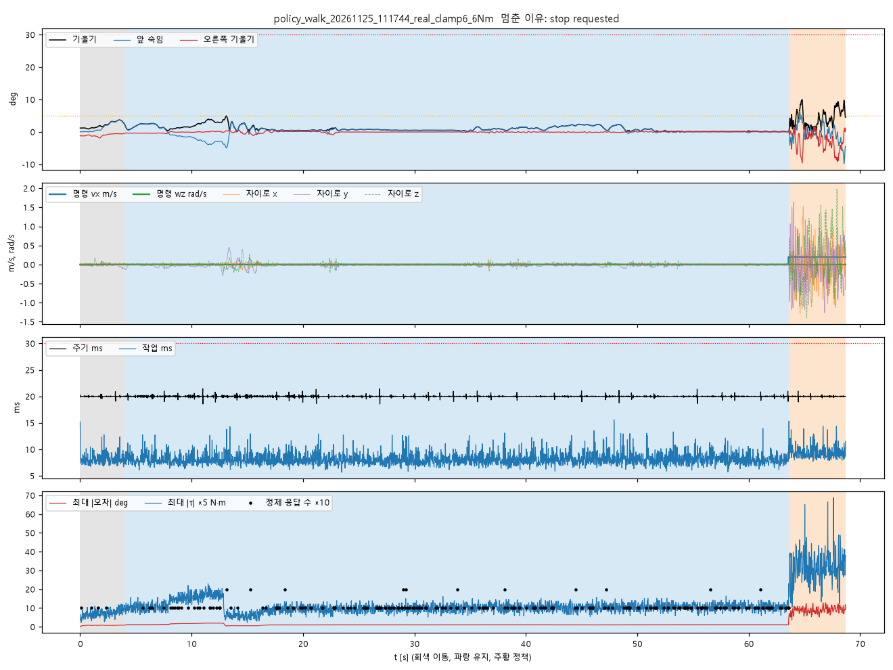
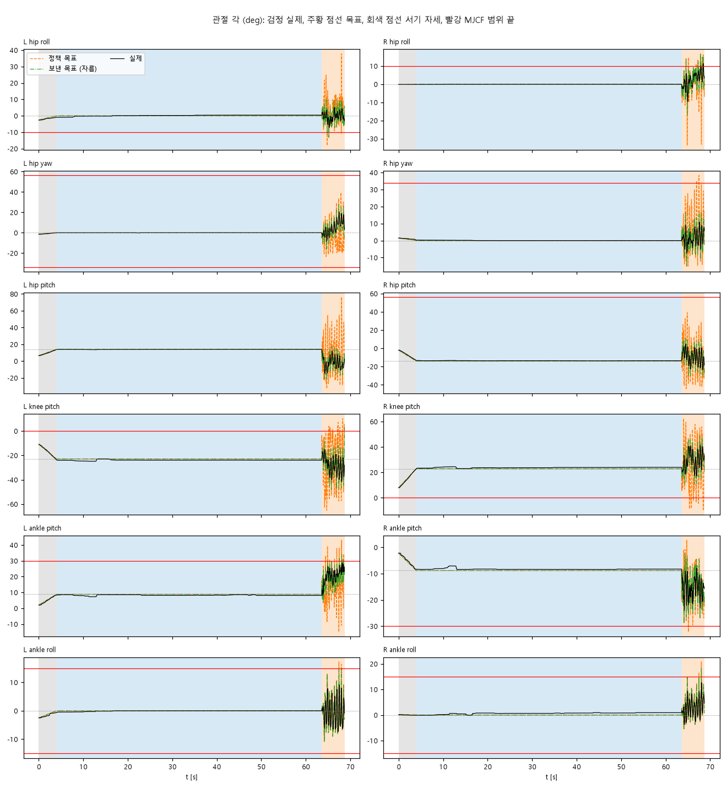
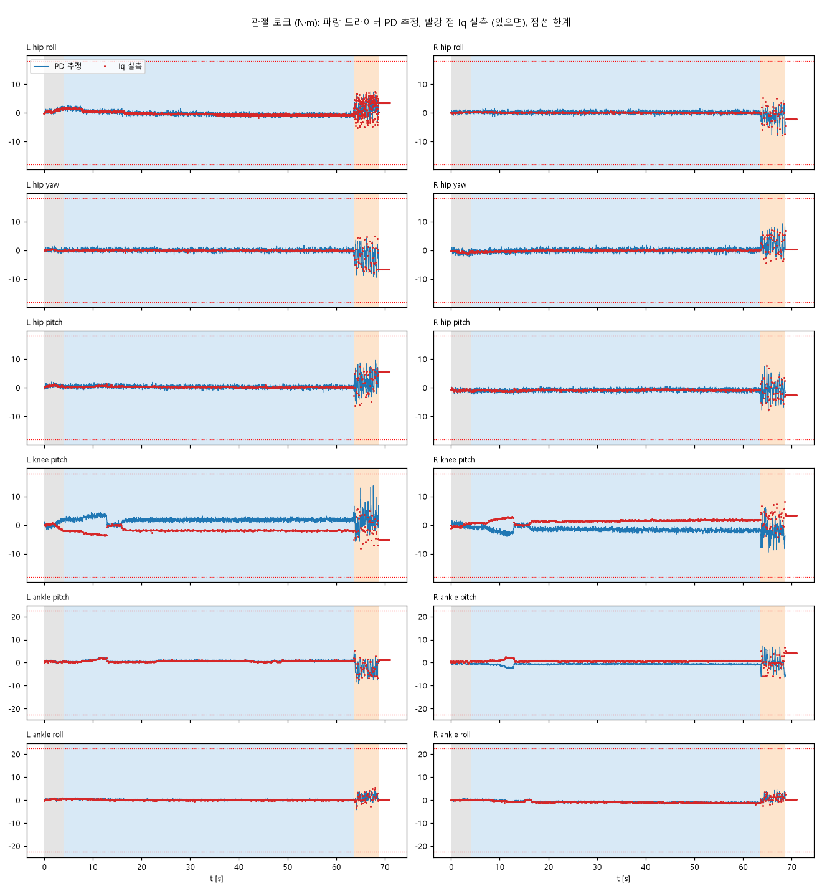
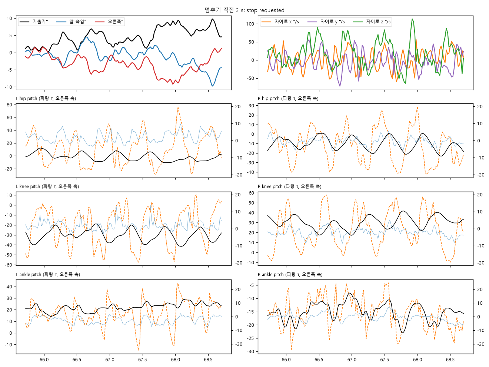
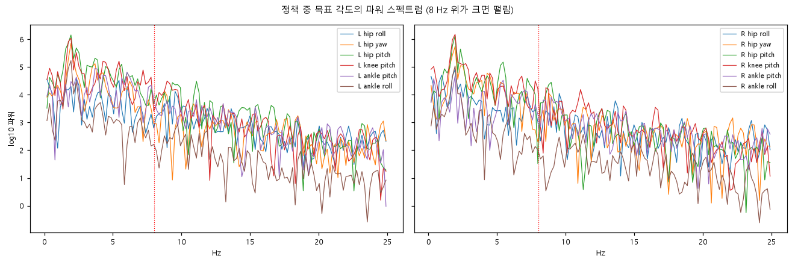

# 정책 보행 기록 분석: policy_walk_20261125_111744_real_clamp6_6Nm

## 한눈에

- ⚠ 엔코더 정체 응답 218번 (정책 중 0.03 %). 5주기 연속이면 Radxa가 멈춤.
- ⚠ 정책 중 기울기 최대 10.0° (5° 넘은 시간 36 %). S3 통과 기준은 5° 안.
- ⚠ 정책 켜기 직전(발이 바닥에 닿은 서기 자세) IMU가 다리 기구학보다 앞 +2.2°, 오른쪽 -0.9° 기울어 있음 (학습 IMU 장착 기울기 ±2°). 수평계로 몸통 실제 기울기 확인 필요.
- ⚠ S2: 서기 자세 목표와 1° 넘게 차이: L knee pitch +1.1° (마찰 0.36 N·m ≈ 0.2°, 다리 무게 포함).
- ⚠ L hip roll가 MJCF 관절 범위 끝 2.7° 안까지 감 (기구 끝·영점 확인).
- ⚠ L hip yaw 토크가 학습 한계 6 N·m를 넘은 시간 16 % (최대 9.5 N·m; 학습 때는 6에서 잘림, 정책 주기마다 한 번).
- ⚠ L hip pitch 토크가 학습 한계 6 N·m를 넘은 시간 9 % (최대 9.8 N·m; 학습 때는 6에서 잘림, 정책 주기마다 한 번).
- ⚠ L knee pitch 토크가 학습 한계 6 N·m를 넘은 시간 5 % (최대 13.7 N·m; 학습 때는 6에서 잘림, 정책 주기마다 한 번).
- ⚠ L ankle pitch가 MJCF 관절 범위 끝 1.2° 안까지 감 (기구 끝·영점 확인).
- ⚠ L ankle pitch 토크가 학습 한계 6 N·m를 넘은 시간 14 % (최대 9.3 N·m; 학습 때는 6에서 잘림, 정책 주기마다 한 번).
- ⚠ R hip roll가 MJCF 관절 범위 끝 -1.3° 안까지 감 (기구 끝·영점 확인).
- ⚠ R hip yaw 토크가 학습 한계 6 N·m를 넘은 시간 10 % (최대 9.3 N·m; 학습 때는 6에서 잘림, 정책 주기마다 한 번).
- ⚠ R knee pitch 토크가 학습 한계 6 N·m를 넘은 시간 9 % (최대 9.5 N·m; 학습 때는 6에서 잘림, 정책 주기마다 한 번).
- ⚠ R ankle pitch 토크가 학습 한계 6 N·m를 넘은 시간 5 % (최대 7.4 N·m; 학습 때는 6에서 잘림, 정책 주기마다 한 번).
- ⚠ R ankle roll가 MJCF 관절 범위 끝 2.4° 안까지 감 (기구 끝·영점 확인).
- ⚠ Iq 명령이 학습 한계 6 N·m에 해당하는 전류(6512 5.97 A, 발목 4.78 A)를 넘음: L hip roll 8.2 A, L hip yaw 7.5 A, L hip pitch 8.4 A, L knee pitch 8.2 A, L ankle pitch 5.8 A, L ankle roll 5.4 A, R hip roll 8.4 A, R hip yaw 8.0 A, R hip pitch 7.5 A, R knee pitch 8.4 A, R ankle roll 5.4 A. 드라이버 전류 한계는 18 A 그대로 (ODrive 0.5.1의 CAN 0x00F는 속도 한계만 바꿈); 목표 자르기는 정책 주기마다 한 번이라 주기 사이에는 넘을 수 있음 (학습도 같음).
- ℹ 운영자·GUI 쪽에서 멈춤: 멈춤: 정책 보행 '멈춤' 버튼
- ℹ 엔코더 읽기가 8 ms 기다림 한도에 닿은 표본이 있습니다 (최대 15.3 ms).
- ℹ 추종 오차 정지 기준(30°·0.5 s, 같은 주기 |보낸 목표 − 엔코더|): 최대 31.8° (L knee pitch), 30° 넘은 최장 0.02 s.
- ℹ Radxa가 목표를 자른 비율 (정책 중): L knee pitch 92 %, L hip pitch 92 %, R knee pitch 89 %, R hip pitch 86 %
- ✓ 주기 최대 21.5 ms (30 ms 넘은 적 없음).

## 개요

- 폴더: `logs\policy_walk_20261125_111744_real_clamp6_6Nm`
- 파일: real_walk.npz, real_walk_io.npz, status.csv, events.txt, meta.json, gui_frames.csv, gui_log.txt
- 시작: 2026-11-25T11:17:44.207, 시작 명령: [0.2, 0.0, 0.0], IMU 축: ['+y', '-x', '+z']
- 정책: real_clamp6 (학습에 넣은 자르기 6 N·m), 정지 기준: {'tilt_deg': 30.0, 'track_deg': 30.0, 'track_s': 0.5, 'vbus_v': 21.5, 'lean_ok_deg': 2.0}
- 토크: 드라이버 전류 한계 18 A (CAN으로 못 바꿈). Radxa 목표 자르기: radxa_target 6.0 N·m (보낸 목표를 t_send·t_read 시각으로 맞춤 (3435/3436주기))
- 주기 3436개, 68.7 s: 이동 4.0 s → 유지 59.6 s → 정책 5.1 s
- Radxa 멈춘 이유 (npz): `stop requested`
- GUI 이벤트: `멈춤: 정책 보행 '멈춤' 버튼`
- meta.json ↔ npz: 관절 순서 같음, 부호 차이 0, 영점 차이 0.00e+00 turn

## 1. 타이밍·통신

Radxa 루프 (npz): 주기 = 이웃한 주기 시작 간격, 작업 = 한 주기에서 읽기+정책+전송에 든 시간

| 단계 | 주기 수 | 주기 p50 ms | p99 | 최대 | >25 ms | >30 ms | >30 연속 | 작업 p50 ms | p99 | 최대 |
|---|---|---|---|---|---|---|---|---|---|---|
| 이동 | 199 | 20.00 | 20.42 | 20.91 | 0 | 0 | 0 | 8.01 | 12.30 | 12.79 |
| 유지 | 2979 | 20.00 | 20.49 | 21.46 | 0 | 0 | 0 | 7.90 | 11.97 | 15.58 |
| 정책 | 257 | 20.00 | 20.27 | 20.99 | 0 | 0 | 0 | 9.10 | 14.10 | 15.33 |


엔코더 정체 응답 (움직이는 중인데 값이 직전 주기와 완전히 같음 = 8 ms 안에 새 응답 못 받음, 지난 값 사용)

정체 응답이 있는 주기 207개, 그중 6개 넘는 관절이 한꺼번에 정체 (읽기를 통째로 놓침, 보통 Radxa 쪽 지연) 0개

| 관절 | node | 이동 | 유지 | 정책 | 연속 최대 |
|---|---|---|---|---|---|
| L hip roll | 1 | 1 | 16 | 0 | 2 |
| L hip yaw | 3 | 1 | 24 | 0 | 1 |
| L hip pitch | 5 | 0 | 16 | 0 | 1 |
| L knee pitch | 7 | 0 | 18 | 0 | 1 |
| L ankle pitch | 11 | 0 | 17 | 0 | 1 |
| L ankle roll | 13 | 1 | 17 | 0 | 1 |
| R hip roll | 2 | 1 | 15 | 0 | 1 |
| R hip yaw | 4 | 0 | 15 | 1 | 1 |
| R hip pitch | 6 | 0 | 18 | 0 | 1 |
| R knee pitch | 8 | 0 | 17 | 0 | 1 |
| R ankle pitch | 12 | 0 | 19 | 0 | 1 |
| R ankle roll | 14 | 0 | 21 | 0 | 2 |


GUI가 받은 상태 (status.csv, 10 Hz 표본): 엔코더 12개 읽기 시간, 정책이 쓴 IMU 값의 나이

| 단계 | 표본 | 읽기 p50 ms | p99 | 최대 | IMU 나이 p50 ms | p99 | 최대 | 놓침 연속 최대 |
|---|---|---|---|---|---|---|---|---|
| 이동 | 40 | 5.35 | 11.84 | 15.31 | 2.80 | 5.22 | 5.30 | 0 |
| 유지 | 585 | 5.28 | 7.27 | 8.09 | 3.00 | 6.25 | 7.30 | 1 |
| 정책 | 53 | 5.13 | 9.12 | 9.12 | 2.80 | 5.44 | 5.60 | 0 |

## 2. IMU

| 단계 | 기울기 평균° | p95 | 최대 | 앞 숙임 평균° | 오른쪽 기울기 평균° | 중력 평균 (x y z) | 자이로 평균 °/s (x y z) | |자이로| p99 °/s |
|---|---|---|---|---|---|---|---|---|
| 이동 | 2.1 | 3.6 | 3.7 | 1.5 | -1.0 | 0.027 0.017 -0.999 | 0.541 -0.811 0.715 | 4.3 6.1 9.3 |
| 유지 | 1.0 | 2.6 | 5.0 | 0.5 | -0.0 | 0.008 0.001 -1.000 | 0.271 -0.993 0.669 | 4.0 11.9 9.1 |
| 정책 | 4.1 | 8.8 | 10.0 | -0.5 | -2.8 | -0.008 0.049 -0.996 | 0.477 -1.599 5.951 | 72.0 77.1 88.5 |


쿼터니언 크기 1.0000~1.0000. 앞으로 숙이면 중력 x > 0, 오른쪽으로 기울면 중력 y < 0 (절차서 4절). 이동·유지는 매단 상태라 몸통이 하네스에 따라 기울 수 있음.


자이로 ↔ 쿼터니언 변화 (같은 축이면 상관·기울기 > 0; 걸을 때는 표본 시각 차이로 0.7–0.9도 정상. 축 혼동·부호 오류 점검용)

| 축 | 쿼터니언 각속도 표준편차 rad/s | 상관 | 기울기 (자이로/쿼터니언) |
|---|---|---|---|
| x | 0.153 | 0.915 | 0.76 |
| y | 0.163 | 0.916 | 0.81 |
| z | 0.187 | 0.989 | 0.97 |


IMU ↔ 다리 기구학: 디딤발 발바닥이 바닥에 평평하다고 보고 관절 각(MJCF)으로 계산한 몸통 기울기와 IMU를 비교. 서기 자세는 hip+knee+ankle pitch 합이 0이라 발이 평평하면 몸통이 수직. 차이가 일정하면 IMU 장착(또는 가속도계) 기울기, 영점 오차 합, 발이 평평하지 않음(하네스가 몸통을 당김) 중 하나. 발이 바닥에 닿아 체중이 실렸을 때만 의미.

| 구간 | IMU 앞° | 기구학 앞° | 차이° | IMU 오른쪽° | 기구학 오른쪽° | 차이° |
|---|---|---|---|---|---|---|
| 유지 마지막 3 s (정책 켜기 직전) | 0.1 | -2.1 | 2.2 | 0.0 | 1.0 | -0.9 |
| 정책 | -0.5 | -7.0 | 6.5 | -2.8 | 2.0 | -4.9 |

## 3. 서기 자세 (S2)

시작 자세 (첫 주기, deg): L hip roll -2.6, L hip yaw -1.4, L hip pitch +6.5, L knee pitch -10.9, L ankle pitch +2.0, L ankle roll -2.5, R hip roll -0.2, R hip yaw +1.5, R hip pitch -2.0, R knee pitch +7.9, R ankle pitch -2.2, R ankle roll +0.2

유지 구간 4.5~63.6 s (2954주기, 유지 시작 0.5 s 뒤부터). 목표−실제 = 서기 자세 − 엔코더 (드라이버 PD가 남긴 오차), τ = Kp·오차 − Kd·속도

| 관절 | 서기 목표° | 실제 평균° | 목표−실제 평균° | 표준편차° | PD 토크 평균 N·m | 좌우 합° (L+R) |
|---|---|---|---|---|---|---|
| L hip roll | 0.00 | 0.16 | -0.16 | 0.33 | -0.29 | 0.09 |
| L hip yaw | 0.00 | -0.01 | 0.01 | 0.02 | 0.01 | 0.04 |
| L hip pitch | 14.08 | 13.92 | 0.17 | 0.08 | 0.29 | 0.31 |
| L knee pitch | -22.92 | -23.98 | 1.06 | 0.32 | 1.87 | -0.15 |
| L ankle pitch | 8.84 | 8.26 | 0.58 | 0.26 | 0.72 | -0.03 |
| L ankle roll | 0.00 | -0.07 | 0.07 | 0.13 | 0.09 | 0.58 |
| R hip roll | 0.00 | -0.08 | 0.08 | 0.03 | 0.13 |  |
| R hip yaw | 0.00 | 0.04 | -0.04 | 0.09 | -0.06 |  |
| R hip pitch | -14.08 | -13.61 | -0.47 | 0.07 | -0.84 |  |
| R knee pitch | 22.92 | 23.83 | -0.91 | 0.28 | -1.59 |  |
| R ankle pitch | -8.84 | -8.29 | -0.55 | 0.24 | -0.69 |  |
| R ankle roll | 0.00 | 0.65 | -0.65 | 0.29 | -0.81 |  |


좌우 합: 오른쪽 관절은 왼쪽의 거울(부호 반대)이라 대칭이면 0. 최대 0.58°.

이동 끝 (서기 목표 도달 직후) 목표−실제°: L hip roll +0.9, L hip yaw -0.0, L hip pitch +0.3, L knee pitch +0.8, L ankle pitch +0.5, L ankle roll +0.6, R hip roll +0.2, R hip yaw -0.3, R hip pitch -0.7, R knee pitch -0.1, R ankle pitch -0.5, R ankle roll +0.1

## 4. 관절 (정책 중)

정책 real_clamp6, 정책 중 (첫 주기 제외). 오차 = 직전 목표 − 지금 실제 (deg), τ = 드라이버 PD 토크 추정 (N·m, 드라이버 전류 한계 18 A로 자름; 학습 한계는 6 N·m). 시뮬 보행: 오차 p99 19°, 최대 약 27°, 12° 초과 최장 0.28 s, 관절 속도 최대 11 rad/s.

목표 자르기 기록이 있어 오차·τ는 드라이버로 보낸(자른) 목표로 계산. '6 N·m 넘음'은 자른 뒤에도 주기 사이에 남은 초과 (20 ms 사이 관절이 움직여서). 잘린 양 = 정책 목표 − 보낸 목표.

| 관절 | 범위° | MJCF 끝까지 여유° | |오차| p95 | p99 | 최대 | 12° 초과 최장 s | |τ| p95 | 6 N·m 넘음 % | 6 N·m 넘음 최장 s | |q̇| 최대 rad/s | 정체 응답 | 목표 잘림 % | 잘린 양 최대° |
|---|---|---|---|---|---|---|---|---|---|---|---|---|---|
| L hip roll | -7~+5 | 2.7 | 5.8 | 7.5 | 8.4 | 0.00 | 5.97 | 4.7 | 0.06 | 1.8 | 0 | 53.1 | 30.9 |
| L hip yaw | -8~+21 | 25.5 | 9.1 | 9.9 | 10.8 | 0.00 | 7.47 | 16.4 | 0.10 | 2.3 | 0 | 73.4 | 33.7 |
| L hip pitch | -15~+14 | 41.7 | 9.9 | 10.5 | 10.6 | 0.00 | 6.90 | 9.0 | 0.08 | 2.3 | 0 | 91.8 | 75.9 |
| L knee pitch | -42~-15 | 15.1 | 11.3 | 12.2 | 12.7 | 0.04 | 5.97 | 5.1 | 0.06 | 2.8 | 0 | 91.8 | 44.5 |
| L ankle pitch | +8~+29 | 1.2 | 7.3 | 8.2 | 8.8 | 0.00 | 6.92 | 14.5 | 0.14 | 3.4 | 0 | 54.7 | 32.1 |
| L ankle roll | -7~+9 | 5.9 | 6.9 | 8.1 | 8.5 | 0.00 | 3.51 | 0.0 | 0.00 | 2.8 | 0 | 8.6 | 5.0 |
| R hip roll | -10~+11 | -1.3 | 7.3 | 9.1 | 10.9 | 0.00 | 5.49 | 4.3 | 0.08 | 2.4 | 0 | 47.3 | 31.5 |
| R hip yaw | -7~+11 | 22.9 | 8.2 | 9.6 | 10.2 | 0.00 | 6.95 | 10.2 | 0.14 | 2.0 | 1 | 71.9 | 24.7 |
| R hip pitch | -23~+5 | 51.5 | 10.8 | 12.3 | 12.7 | 0.04 | 5.74 | 4.3 | 0.04 | 2.7 | 0 | 85.9 | 30.4 |
| R knee pitch | +17~+42 | 17.3 | 9.4 | 11.3 | 11.6 | 0.00 | 6.69 | 8.6 | 0.06 | 2.8 | 0 | 89.1 | 36.6 |
| R ankle pitch | -24~-8 | 5.9 | 6.3 | 7.8 | 9.4 | 0.00 | 6.03 | 5.5 | 0.06 | 3.3 | 0 | 32.0 | 12.4 |
| R ankle roll | -4~+13 | 2.4 | 4.5 | 5.8 | 7.7 | 0.00 | 3.45 | 0.0 | 0.00 | 2.3 | 0 | 2.0 | 2.5 |


관절 속도 (ODrive vel_estimate) ↔ 위치 차분 상관: L hip roll 0.97, L hip yaw 0.99, L hip pitch 0.99, L knee pitch 0.99, L ankle pitch 0.97, L ankle roll 0.99, R hip roll 0.97, R hip yaw 0.98, R hip pitch 0.99, R knee pitch 0.99, R ankle pitch 0.97, R ankle roll 0.98

## 5. 정책 입력·출력

관측 조립 점검 (기록된 값끼리 비교)

| 항목 | 최대 차이 | 결과 |
|---|---|---|
| 명령 0–2 | 0.0e+00 | 같음 |
| 각속도 3–5 | 0.0e+00 | 같음 |
| 중력 6–8 | 4.3e-08 | 같음 |
| 관절 각 9–20 | 3.6e-08 | 같음 |
| 관절 속도 21–32 | 1.1e-07 | 같음 |
| 직전 행동 33–44 | 0.0e+00 | 같음 |
| 목표 = 서기 + 0.25·clip(행동) | 4.5e-08 | 같음 |
| 정책 재생 (PC numpy) vs Radxa 행동 | 7.2e-07 | 같음 |


정책 첫 주기 (t = 63.58 s): 중력 [0.002, -0.001, -1.0], 각속도 rad/s [0.011, -0.011, 0.016], 관절 − 서기 최대 1.1°, 명령 [0.2, 0.0, 0.0]

첫 목표 − 서기 자세 (deg): L hip roll +0.1, L hip yaw -5.7, L hip pitch -7.2, L knee pitch +10.1, L ankle pitch +8.0, L ankle roll +0.6, R hip roll -6.7, R hip yaw +6.1, R hip pitch +8.7, R knee pitch -12.9, R ankle pitch -11.0, R ankle roll +0.9


행동 (정책 출력, 배율 전) 257주기. 진동수 = 목표의 주 성분 (0.3–5 Hz), 8 Hz 넘는 비율 = 떨림 지표, Δa/a = 이웃 주기 차이의 표준편차 ÷ 행동 표준편차 (1 Hz 부드러운 움직임 ≈ 0.13, 번갈아 튀면 ≈ 2)

| 관절 | |a| p50 | p99 | 최대 | ±20 잘림 % | 목표−서기 최대° | 주 진동수 Hz | 8 Hz 넘는 비율 | Δa/a |
|---|---|---|---|---|---|---|---|---|
| L hip roll | 0.31 | 1.69 | 2.63 | 0.0 | 37.7 | 2.33 | 0.22 | 0.78 |
| L hip yaw | 0.82 | 2.33 | 2.75 | 0.0 | 39.4 | 1.95 | 0.04 | 0.44 |
| L hip pitch | 1.38 | 3.26 | 4.35 | 0.0 | 62.3 | 1.95 | 0.05 | 0.45 |
| L knee pitch | 1.19 | 2.58 | 2.94 | 0.0 | 42.2 | 1.95 | 0.05 | 0.47 |
| L ankle pitch | 0.63 | 2.07 | 2.39 | 0.0 | 34.2 | 3.70 | 0.10 | 0.64 |
| L ankle roll | 0.31 | 1.08 | 1.21 | 0.0 | 17.3 | 1.95 | 0.02 | 0.37 |
| R hip roll | 0.34 | 2.06 | 2.36 | 0.0 | 33.8 | 1.95 | 0.14 | 0.52 |
| R hip yaw | 0.56 | 2.42 | 2.67 | 0.0 | 38.3 | 1.95 | 0.04 | 0.46 |
| R hip pitch | 1.13 | 3.19 | 3.71 | 0.0 | 53.2 | 1.95 | 0.03 | 0.43 |
| R knee pitch | 0.97 | 2.48 | 2.75 | 0.0 | 39.4 | 1.95 | 0.03 | 0.42 |
| R ankle pitch | 0.46 | 1.37 | 1.63 | 0.0 | 23.3 | 1.95 | 0.19 | 0.71 |
| R ankle roll | 0.28 | 1.13 | 1.45 | 0.0 | 20.8 | 1.95 | 0.02 | 0.34 |


정책 구간 1개 (주파수 분석은 가장 긴 구간 63.6~68.7 s)

| # | 시작 t s | 길이 s | 명령 | 켤 때 앞 숙임° | 앞 숙임 평균° (0.5 s 뒤) | 최대 기울기° | 첫 목표−서기 최대° | 끝 |
|---|---|---|---|---|---|---|---|---|
| 1 | 63.6 | 5.1 | 0.20 0.00 0.00 | 0.1 | -0.3 | 10.0 | 12.9 | 기록 끝 (stop requested) |


명령 구간 (속도 측정이 없어 vx는 영상으로 확인; 회전은 자이로 z로 비교 가능, 시뮬 0.8 → 0.85 rad/s)

| t s | 길이 s | 명령 vx vy wz | 자이로 z 평균 rad/s | 기울기 평균° | 최대° | 앞 숙임 평균° | 오른쪽 기울기 평균° |
|---|---|---|---|---|---|---|---|
| 63.6~68.7 | 5.1 | 0.20 0.00 0.00 | 0.104 | 4.1 | 10.0 | -0.5 | -2.8 |

## 6. 드라이버 (GUI가 받은 값)

시각 맞추기: 엔코더 응답 13471개가 npz 값과 정확히 일치 → t_npz = t_gui − 328.057 s (차이 p5–p95 -3~+14 ms)


heartbeat 처음 상태: IDLE (node 1,2,3,4,5,6,7,8,11,12,13,14)

heartbeat 상태 변화

| t s | 상태 | axis_error | 관절 |
|---|---|---|---|
| 0.03 | CLOSED_LOOP_CONTROL | 0 | 12개: R ankle pitch, L hip yaw, R hip roll, L hip pitch, L knee pitch, R knee pitch, L ankle pitch, L hip roll, R hip pitch, R ankle roll, R hip yaw, L ankle roll |
| 68.72 | IDLE | 0 | 12개: R ankle pitch, L hip yaw, L hip pitch, L knee pitch, L ankle pitch, R hip roll, R hip pitch, R knee pitch, L hip roll, R hip yaw, L ankle roll, R ankle roll |


Iq (정책 중 표본; 없으면 기록 전체). 6 N·m 전류 = 학습 토크 한계에 해당하는 전류, '넘음 %' = |Iq 명령|이 그 95 % 이상인 표본. τ(Iq) = 방향 × torque_sign × Iq × kt × 15 를 드라이버 PD 추정 τ와 비교 (기울기 ≈ 1, 상관 ≈ 1이면 PD 모델이 맞음)

| 관절 | node | 표본 Hz | |Iq| p95 A | |Iq| 최대 | |Iq 명령| 최대 | 6 N·m 전류 A | 넘음 % | τ(Iq)/τ(PD) 기울기 | 상관 |
|---|---|---|---|---|---|---|---|---|---|
| L hip roll | 1 | 50 | 5.90 | 7.32 | 8.20 | 5.97 | 22.7 | 0.90 | 0.64 |
| L hip yaw | 3 | 10 | 6.94 | 7.60 | 7.51 | 5.97 | 47.1 | 0.86 | 0.71 |
| L hip pitch | 5 | 10 | 6.36 | 7.49 | 8.36 | 5.97 | 39.2 | 0.94 | 0.67 |
| L knee pitch | 7 | 10 | 6.68 | 8.13 | 8.18 | 5.97 | 33.3 | -0.76 | -0.57 |
| L ankle pitch | 11 | 10 | 5.38 | 5.83 | 5.83 | 4.78 | 30.8 | 0.91 | 0.87 |
| L ankle roll | 13 | 10 | 3.46 | 4.35 | 5.40 | 4.78 | 2.0 | 1.05 | 0.81 |
| R hip roll | 2 | 10 | 6.47 | 7.90 | 8.44 | 5.97 | 17.6 | 0.84 | 0.66 |
| R hip yaw | 4 | 10 | 6.63 | 6.95 | 8.01 | 5.97 | 37.3 | 0.94 | 0.74 |
| R hip pitch | 6 | 10 | 6.47 | 7.56 | 7.54 | 5.97 | 32.7 | 0.79 | 0.63 |
| R knee pitch | 8 | 10 | 6.86 | 8.25 | 8.43 | 5.97 | 23.5 | -0.98 | -0.77 |
| R ankle pitch | 12 | 10 | 4.74 | 5.30 | 5.06 | 4.78 | 13.7 | -0.97 | -0.96 |
| R ankle roll | 14 | 10 | 2.54 | 2.72 | 5.38 | 4.78 | 2.0 | 0.99 | 0.86 |


버스 전압 (Vbus, 2 s마다 node별): 최소 23.37 V, 중앙 23.83 V, 최대 24.19 V, 표본 1672개

## 7. 멈추기 직전

마지막 2 s (0.2 s 간격 + 마지막 주기). 멈춘 이유: `stop requested`. 안전 정지를 일으킨 주기는 기록되지 않음 (기록 전에 멈춤).

| t s | 단계 | 기울기° | 앞 숙임° | 오른쪽° | 최대 |오차|° | 최대 |τ| N·m | 포화 관절 수 | 작업 ms | 명령 |
|---|---|---|---|---|---|---|---|---|---|
| 66.72 | 정책 | 6.9 | 2.8 | -6.3 | R hip pitch 11 | R hip pitch 6.3 | 1 | 8.4 | 0.20 0.00 0.00 |
| 66.92 | 정책 | 5.0 | -1.2 | -4.9 | L knee pitch 11 | L ankle pitch 6.1 | 1 | 9.4 | 0.20 0.00 0.00 |
| 67.12 | 정책 | 2.3 | -0.2 | -2.3 | R hip pitch 7 | L hip yaw 7.8 | 2 | 7.9 | 0.20 0.00 0.00 |
| 67.32 | 정책 | 3.5 | -1.0 | -3.3 | R hip roll 6 | L hip yaw 7.9 | 1 | 9.9 | 0.20 0.00 0.00 |
| 67.52 | 정책 | 2.0 | -0.7 | -1.9 | R hip pitch 10 | R hip yaw 4.9 | 0 | 9.2 | 0.20 0.00 0.00 |
| 67.72 | 정책 | 7.9 | 1.8 | -7.7 | R knee pitch 11 | L ankle pitch 6.5 | 1 | 9.0 | 0.20 0.00 0.00 |
| 67.92 | 정책 | 7.8 | -1.2 | -7.7 | L knee pitch 9 | L ankle pitch 5.9 | 0 | 8.7 | 0.20 0.00 0.00 |
| 68.12 | 정책 | 7.5 | -3.6 | -6.6 | R knee pitch 8 | R hip yaw 6.6 | 1 | 10.0 | 0.20 0.00 0.00 |
| 68.32 | 정책 | 6.7 | -3.7 | -5.7 | R hip pitch 9 | R hip pitch 7.0 | 1 | 9.2 | 0.20 0.00 0.00 |
| 68.52 | 정책 | 7.7 | -7.4 | -2.1 | R hip yaw 7 | R ankle pitch 5.3 | 0 | 9.3 | 0.20 0.00 0.00 |
| 68.70 | 정책 | 4.6 | -4.4 | 1.2 | L knee pitch 9 | L hip yaw 7.6 | 1 | 11.5 | 0.20 0.00 0.00 |

## 8. 이벤트·GUI 기록

events.txt
```
11:17:44.210 [npz -0.18 s] 시작 요청 (정책 real_clamp6, 앞으로 0.20 m/s, 토크 한계 6 N·m 켬 (Radxa 목표 자르기, 정책 학습 값), 정지: 기울기 30°·추종 오차 30° 0.5 s·Vbus 21.5 V): L hip roll 부호 -1 영점 0.5236, L hip yaw 부호 -1 영점 0.2441, L hip pitch 부호 -1 영점 0.8354, L knee pitch 부호 -1 영점 0.6002, L ankle pitch 부호 -1 영점 -0.0162, L ankle roll 부호 -1 영점 0.2539, R hip roll 부호 -1 영점 0.0262, R hip yaw 부호 -1 영점 0.3778, R hip pitch 부호 -1 영점 0.8512, R knee pitch 부호 -1 영점 
11:17:44.292 [npz -0.10 s] Radxa에서 시작: 서기 자세로 4 s 이동 (정책 real_clamp6, 토크 한계 6 N·m, 기울기 정지 30.0°, 추종 오차 정지 30.0° 0.5 s)
11:17:48.463 [npz +4.07 s] 서기 자세 도달, 유지 중 (발이 바닥에 닿으면 '정책 켜기')
11:18:47.967 [npz +63.57 s] 정책 켜기 (발이 바닥에 닿음, IMU 앞 숙임 +0.1° 오른쪽 +0.0°)
11:18:48.027 [npz +63.63 s] 정책 보행 시작
11:18:53.090 [npz +68.70 s] 멈춤 요청: 정책 보행 '멈춤' 버튼
11:18:53.386 [npz +68.99 s] 목표를 자른 주기 256 / 3436, 추종 오차 최대 15.6°, 버스 전압 최저 23.37 V (node 4)
11:18:53.386 [npz +68.99 s] 멈춤: 정책 보행 '멈춤' 버튼
11:18:54.250 [npz +69.86 s] Radxa 기록 → logs/policy_walk_20261125_111744_real_clamp6_6Nm/real_walk.npz (2609 KB) + real_walk_io.npz
```

gui_log.txt 중 경고·Radxa 줄
```
   327.957 [CAN] [Radxa] [bridge] 정책 보행: {'type': 'started', 'log': '/home/radxa/motor_bridge/logs/real_walk_20261125_111744_real_clamp6_6Nm.npz', 'policy': 'real_clamp6', 'torque_clamp': True, 'limit_nm': 6.0, 'trained_clamp': True, 'tilt_limit_deg': 30.0, 'track_limit_deg': 30.0, 'track_time_s': 0.5}
   396.759 [CAN] 모든 노드 IDLE 명령 (12개, 버스 2개)
   396.772 [CAN] [Radxa] [bridge] 모두 힘 풀기 (정책 멈춤: 정책 보행 '멈춤' 버튼): IDLE 프레임 48개
   396.922 [CAN] [Radxa] stopped: stop requested; log -> /home/radxa/motor_bridge/logs/real_walk_20261125_111744_real_clamp6_6Nm.npz
   397.051 [CAN] [Radxa] [bridge] 정책 보행: {'type': 'stopped', 'reason': "정책 보행 '멈춤' 버튼", 'log': '/home/radxa/motor_bridge/logs/real_walk_20261125_111744_real_clamp6_6Nm.npz', 'log_size': 2671886, 'io_log': '/home/radxa/motor_bridge/logs/real_walk_20261125_111744_real_clamp6_6Nm_io.npz', 'clamp_cycles': 256, 'sent': 3436, 'policy': 'real_clamp6', 'track_err_max_deg': 15.6}
```

## 그림






