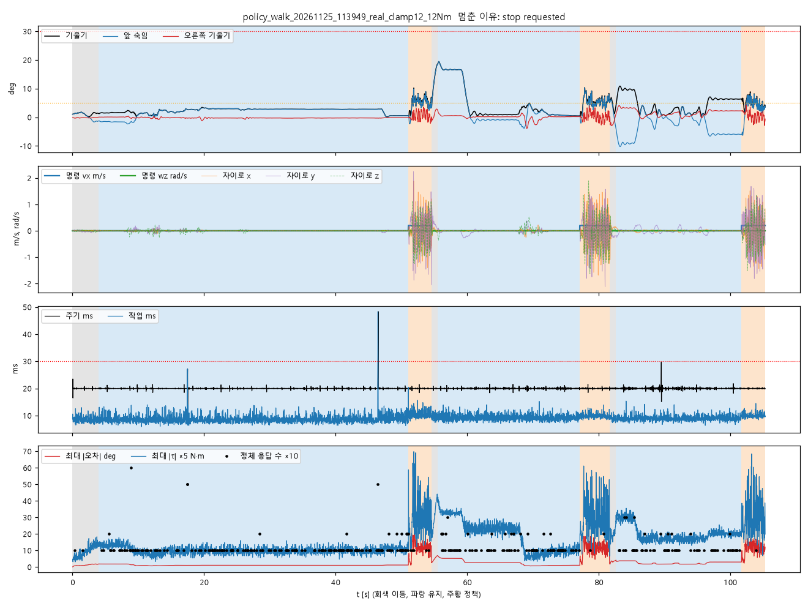
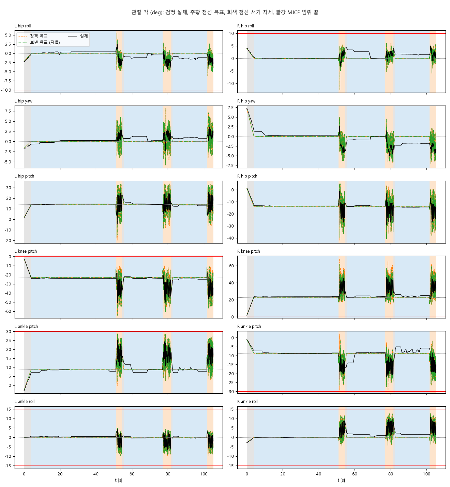
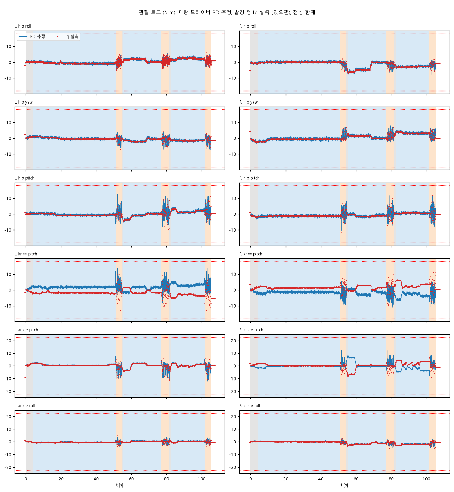
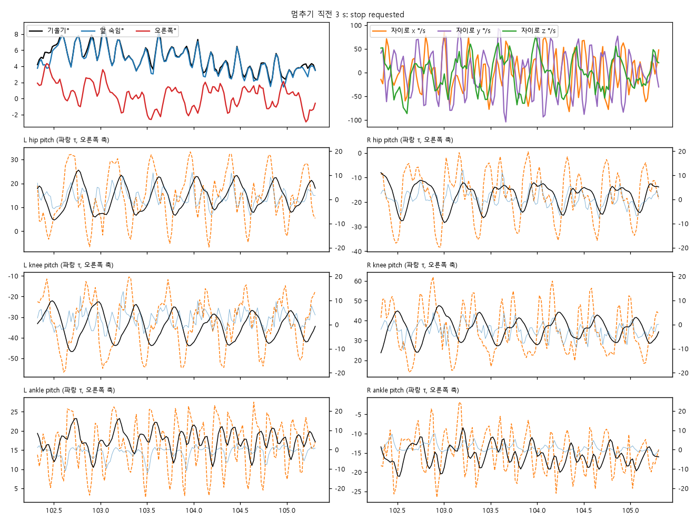
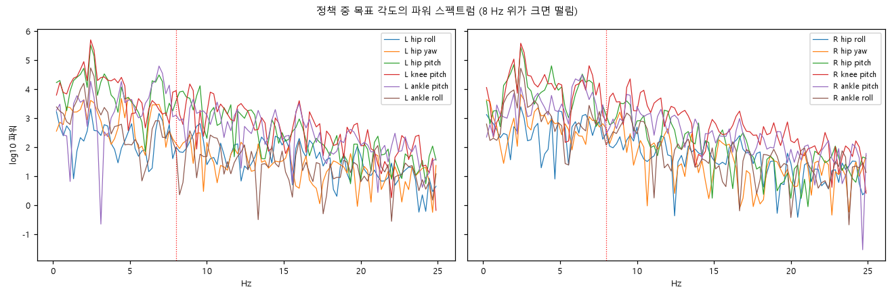

# 정책 보행 기록 분석: policy_walk_20261125_113949_real_clamp12_12Nm

## 한눈에

- ⚠ 주기가 30 ms를 넘은 곳 1번 (최대 48.3 ms, 연속 최대 1번). 절차서 공통 중단 기준은 '30 ms 이상이 이어짐'.
- ⚠ 엔코더 정체 응답 386번 (정책 중 0.16 %). 5주기 연속이면 Radxa가 멈춤.
- ⚠ 정책 중 기울기 최대 10.4° (5° 넘은 시간 56 %). S3 통과 기준은 5° 안.
- ⚠ 정책 켜기 직전(발이 바닥에 닿은 서기 자세) IMU가 다리 기구학보다 앞 -1.1°, 오른쪽 +3.1° 기울어 있음 (학습 IMU 장착 기울기 ±2°). 수평계로 몸통 실제 기울기 확인 필요.
- ⚠ S2: 서기 자세 목표와 1° 넘게 차이: L knee pitch +1.1°, R knee pitch -1.1° (마찰 0.36 N·m ≈ 0.2°, 다리 무게 포함).
- ⚠ Iq 명령이 학습 한계 12 N·m에 해당하는 전류(6512 11.94 A, 발목 9.57 A)를 넘음: L knee pitch 14.3 A, R hip pitch 14.8 A. 드라이버 전류 한계는 18 A 그대로 (ODrive 0.5.1의 CAN 0x00F는 속도 한계만 바꿈); 목표 자르기는 정책 주기마다 한 번이라 주기 사이에는 넘을 수 있음 (학습도 같음).
- ℹ 운영자·GUI 쪽에서 멈춤: 멈춤: 정책 보행 '멈춤' 버튼
- ℹ IMU 쿼터니언이 직전 주기와 같은 주기 5번 (연속 최대 1). imu_reader가 멈칫한 것.
- ℹ 엔코더 읽기가 8 ms 기다림 한도에 닿은 표본이 있습니다 (최대 8.6 ms).
- ℹ 추종 오차 정지 기준(30°·0.5 s, 같은 주기 |보낸 목표 − 엔코더|): 최대 25.9° (L knee pitch), 30° 넘은 최장 0.00 s.
- ℹ Radxa가 목표를 자른 비율 (정책 중): R knee pitch 44 %, L knee pitch 35 %, L hip pitch 20 %, R hip pitch 15 %

## 개요

- 폴더: `logs\policy_walk_20261125_113949_real_clamp12_12Nm`
- 파일: real_walk.npz, real_walk_io.npz, status.csv, events.txt, meta.json, gui_frames.csv, gui_log.txt
- 시작: 2026-11-25T11:39:49.996, 시작 명령: [0.2, 0.0, 0.0], IMU 축: ['+y', '-x', '+z']
- 정책: real_clamp12 (학습에 넣은 자르기 12 N·m), 정지 기준: {'tilt_deg': 30.0, 'track_deg': 30.0, 'track_s': 0.5, 'vbus_v': 21.5, 'lean_ok_deg': 2.0}
- 토크: 드라이버 전류 한계 18 A (CAN으로 못 바꿈). Radxa 목표 자르기: radxa_target 12.0 N·m (보낸 목표 5265행 중 1번째부터 npz 5264주기와 맞춤)
- 주기 5264개, 105.3 s: 이동 6.0 s → 유지 87.7 s → 정책 11.6 s
- Radxa 멈춘 이유 (npz): `stop requested`
- GUI 이벤트: `멈춤: 정책 보행 '멈춤' 버튼`
- meta.json ↔ npz: 관절 순서 같음, 부호 차이 0, 영점 차이 0.00e+00 turn

## 1. 타이밍·통신

Radxa 루프 (npz): 주기 = 이웃한 주기 시작 간격, 작업 = 한 주기에서 읽기+정책+전송에 든 시간

| 단계 | 주기 수 | 주기 p50 ms | p99 | 최대 | >25 ms | >30 ms | >30 연속 | 작업 p50 ms | p99 | 최대 |
|---|---|---|---|---|---|---|---|---|---|---|
| 이동 | 299 | 20.00 | 20.74 | 23.50 | 0 | 0 | 0 | 8.67 | 11.81 | 12.97 |
| 유지 | 4384 | 20.00 | 20.77 | 48.34 | 4 | 1 | 1 | 8.71 | 12.74 | 48.33 |
| 정책 | 580 | 20.00 | 20.45 | 21.55 | 0 | 0 | 0 | 9.73 | 13.94 | 20.46 |


엔코더 정체 응답 (움직이는 중인데 값이 직전 주기와 완전히 같음 = 8 ms 안에 새 응답 못 받음, 지난 값 사용)

정체 응답이 있는 주기 332개, 그중 6개 넘는 관절이 한꺼번에 정체 (읽기를 통째로 놓침, 보통 Radxa 쪽 지연) 0개

| 관절 | node | 이동 | 유지 | 정책 | 연속 최대 |
|---|---|---|---|---|---|
| L hip roll | 1 | 0 | 24 | 0 | 1 |
| L hip yaw | 3 | 1 | 24 | 0 | 1 |
| L hip pitch | 5 | 0 | 19 | 0 | 1 |
| L knee pitch | 7 | 0 | 25 | 0 | 2 |
| L ankle pitch | 11 | 0 | 30 | 0 | 1 |
| L ankle roll | 13 | 1 | 41 | 4 | 1 |
| R hip roll | 2 | 0 | 25 | 0 | 1 |
| R hip yaw | 4 | 0 | 21 | 0 | 2 |
| R hip pitch | 6 | 0 | 31 | 0 | 1 |
| R knee pitch | 8 | 0 | 24 | 0 | 2 |
| R ankle pitch | 12 | 0 | 46 | 2 | 1 |
| R ankle roll | 14 | 0 | 63 | 5 | 1 |


GUI가 받은 상태 (status.csv, 10 Hz 표본): 엔코더 12개 읽기 시간, 정책이 쓴 IMU 값의 나이

| 단계 | 표본 | 읽기 p50 ms | p99 | 최대 | IMU 나이 p50 ms | p99 | 최대 | 놓침 연속 최대 |
|---|---|---|---|---|---|---|---|---|
| 이동 | 40 | 5.71 | 7.62 | 7.86 | 2.85 | 38.92 | 59.40 | 0 |
| 유지 | 862 | 5.88 | 8.10 | 8.56 | 3.00 | 6.34 | 7.50 | 1 |
| 정책 | 119 | 6.07 | 8.24 | 8.43 | 2.90 | 6.17 | 6.50 | 1 |

## 2. IMU

| 단계 | 기울기 평균° | p95 | 최대 | 앞 숙임 평균° | 오른쪽 기울기 평균° | 중력 평균 (x y z) | 자이로 평균 °/s (x y z) | |자이로| p99 °/s |
|---|---|---|---|---|---|---|---|---|
| 이동 | 3.6 | 16.5 | 18.7 | 2.8 | -0.2 | 0.048 0.004 -0.995 | 1.044 -0.216 0.021 | 40.3 51.1 18.7 |
| 유지 | 3.3 | 10.4 | 19.5 | 1.1 | 0.2 | 0.020 -0.004 -0.996 | -0.017 -0.271 0.069 | 5.5 13.0 12.4 |
| 정책 | 5.1 | 8.2 | 10.4 | 4.4 | 0.5 | 0.076 -0.008 -0.995 | -0.225 0.837 -4.610 | 84.1 97.7 82.2 |


쿼터니언 크기 1.0000~1.0000. 앞으로 숙이면 중력 x > 0, 오른쪽으로 기울면 중력 y < 0 (절차서 4절). 이동·유지는 매단 상태라 몸통이 하네스에 따라 기울 수 있음.


자이로 ↔ 쿼터니언 변화 (같은 축이면 상관·기울기 > 0; 걸을 때는 표본 시각 차이로 0.7–0.9도 정상. 축 혼동·부호 오류 점검용)

| 축 | 쿼터니언 각속도 표준편차 rad/s | 상관 | 기울기 (자이로/쿼터니언) |
|---|---|---|---|
| x | 0.192 | 0.931 | 0.89 |
| y | 0.234 | 0.932 | 0.87 |
| z | 0.211 | 0.985 | 0.96 |


IMU ↔ 다리 기구학: 디딤발 발바닥이 바닥에 평평하다고 보고 관절 각(MJCF)으로 계산한 몸통 기울기와 IMU를 비교. 서기 자세는 hip+knee+ankle pitch 합이 0이라 발이 평평하면 몸통이 수직. 차이가 일정하면 IMU 장착(또는 가속도계) 기울기, 영점 오차 합, 발이 평평하지 않음(하네스가 몸통을 당김) 중 하나. 발이 바닥에 닿아 체중이 실렸을 때만 의미.

| 구간 | IMU 앞° | 기구학 앞° | 차이° | IMU 오른쪽° | 기구학 오른쪽° | 차이° |
|---|---|---|---|---|---|---|
| 유지 마지막 3 s (정책 켜기 직전) | -5.9 | -4.9 | -1.1 | 2.2 | -0.8 | 3.1 |
| 정책 | 4.4 | -1.7 | 6.1 | 0.5 | 1.0 | -0.5 |

## 3. 서기 자세 (S2)

시작 자세 (첫 주기, deg): L hip roll -2.2, L hip yaw -1.7, L hip pitch +1.4, L knee pitch -2.3, L ankle pitch -3.0, L ankle roll -0.2, R hip roll +4.0, R hip yaw +7.2, R hip pitch +1.4, R knee pitch +1.7, R ankle pitch -1.0, R ankle roll -2.8

유지 구간 4.5~101.7 s (4358주기, 유지 시작 0.5 s 뒤부터). 목표−실제 = 서기 자세 − 엔코더 (드라이버 PD가 남긴 오차), τ = Kp·오차 − Kd·속도

| 관절 | 서기 목표° | 실제 평균° | 목표−실제 평균° | 표준편차° | PD 토크 평균 N·m | 좌우 합° (L+R) |
|---|---|---|---|---|---|---|
| L hip roll | 0.00 | -0.32 | 0.32 | 0.73 | 0.56 | 0.40 |
| L hip yaw | 0.00 | 0.39 | -0.39 | 0.48 | -0.70 | 0.05 |
| L hip pitch | 14.08 | 14.11 | -0.03 | 0.75 | -0.03 | 0.46 |
| L knee pitch | -22.92 | -24.02 | 1.10 | 0.65 | 1.94 | -0.02 |
| L ankle pitch | 8.84 | 8.34 | 0.50 | 0.94 | 0.62 | -0.05 |
| L ankle roll | 0.00 | 0.13 | -0.13 | 0.39 | -0.17 | 0.79 |
| R hip roll | 0.00 | 0.72 | -0.72 | 1.15 | -1.24 |  |
| R hip yaw | 0.00 | -0.34 | 0.34 | 0.96 | 0.61 |  |
| R hip pitch | -14.08 | -13.64 | -0.44 | 0.46 | -0.77 |  |
| R knee pitch | 22.92 | 24.00 | -1.08 | 0.69 | -1.90 |  |
| R ankle pitch | -8.84 | -8.39 | -0.45 | 1.59 | -0.56 |  |
| R ankle roll | 0.00 | 0.66 | -0.66 | 0.79 | -0.83 |  |


좌우 합: 오른쪽 관절은 왼쪽의 거울(부호 반대)이라 대칭이면 0. 최대 0.79°.

이동 끝 (서기 목표 도달 직후) 목표−실제°: L hip roll +1.5, L hip yaw -1.0, L hip pitch +0.7, L knee pitch +4.2, L ankle pitch -0.1, L ankle roll +0.4, R hip roll -1.7, R hip yaw +2.3, R hip pitch +0.3, R knee pitch -3.5, R ankle pitch -2.0, R ankle roll -2.6

## 4. 관절 (정책 중)

정책 real_clamp12, 정책 중 (첫 주기 제외). 오차 = 직전 목표 − 지금 실제 (deg), τ = 드라이버 PD 토크 추정 (N·m, 드라이버 전류 한계 18 A로 자름; 학습 한계는 12 N·m). 시뮬 보행: 오차 p99 19°, 최대 약 27°, 12° 초과 최장 0.28 s, 관절 속도 최대 11 rad/s.

목표 자르기 기록이 있어 오차·τ는 드라이버로 보낸(자른) 목표로 계산. '12 N·m 넘음'은 자른 뒤에도 주기 사이에 남은 초과 (20 ms 사이 관절이 움직여서). 잘린 양 = 정책 목표 − 보낸 목표.

| 관절 | 범위° | MJCF 끝까지 여유° | |오차| p95 | p99 | 최대 | 12° 초과 최장 s | |τ| p95 | 12 N·m 넘음 % | 12 N·m 넘음 최장 s | |q̇| 최대 rad/s | 정체 응답 | 목표 잘림 % | 잘린 양 최대° |
|---|---|---|---|---|---|---|---|---|---|---|---|---|---|
| L hip roll | -4~+3 | 5.8 | 3.1 | 4.1 | 4.8 | 0.00 | 3.71 | 0.0 | 0.00 | 0.9 | 0 | 0.0 | 0.0 |
| L hip yaw | -2~+4 | 31.4 | 4.5 | 5.4 | 6.1 | 0.00 | 4.93 | 0.0 | 0.00 | 1.2 | 0 | 0.0 | 0.0 |
| L hip pitch | -5~+27 | 51.5 | 14.0 | 15.8 | 19.3 | 0.16 | 6.82 | 0.2 | 0.02 | 3.7 | 0 | 20.3 | 11.7 |
| L knee pitch | -51~-18 | 17.8 | 15.2 | 17.4 | 21.1 | 0.14 | 7.44 | 0.3 | 0.02 | 4.8 | 0 | 35.4 | 15.9 |
| L ankle pitch | +8~+25 | 4.7 | 9.7 | 11.4 | 13.3 | 0.02 | 7.73 | 0.3 | 0.02 | 4.8 | 0 | 4.2 | 4.4 |
| L ankle roll | -7~+4 | 8.4 | 3.7 | 4.4 | 5.2 | 0.00 | 2.56 | 0.0 | 0.00 | 1.9 | 4 | 0.0 | 0.0 |
| R hip roll | -4~+5 | 5.0 | 3.9 | 5.2 | 11.2 | 0.00 | 4.84 | 0.0 | 0.00 | 2.4 | 0 | 0.2 | 2.0 |
| R hip yaw | -5~+3 | 31.2 | 3.8 | 4.4 | 5.3 | 0.00 | 5.63 | 0.0 | 0.00 | 1.1 | 0 | 0.0 | 0.0 |
| R hip pitch | -29~-1 | 57.5 | 14.0 | 17.0 | 19.2 | 0.10 | 6.00 | 0.2 | 0.02 | 4.0 | 0 | 14.6 | 14.2 |
| R knee pitch | +20~+49 | 20.5 | 14.7 | 17.0 | 18.7 | 0.12 | 7.64 | 0.0 | 0.00 | 3.9 | 0 | 44.2 | 13.5 |
| R ankle pitch | -23~-6 | 6.8 | 8.0 | 9.8 | 12.1 | 0.02 | 6.13 | 0.3 | 0.02 | 3.5 | 2 | 2.4 | 9.6 |
| R ankle roll | -0~+11 | 4.2 | 5.5 | 6.6 | 9.0 | 0.00 | 2.82 | 0.0 | 0.00 | 2.3 | 5 | 0.0 | 0.0 |


관절 속도 (ODrive vel_estimate) ↔ 위치 차분 상관: L hip roll 0.93, L hip yaw 0.96, L hip pitch 0.99, L knee pitch 0.99, L ankle pitch 0.97, L ankle roll 0.97, R hip roll 0.95, R hip yaw 0.93, R hip pitch 0.99, R knee pitch 0.99, R ankle pitch 0.97, R ankle roll 0.97

## 5. 정책 입력·출력

관측 조립 점검 (기록된 값끼리 비교)

| 항목 | 최대 차이 | 결과 |
|---|---|---|
| 명령 0–2 | 0.0e+00 | 같음 |
| 각속도 3–5 | 0.0e+00 | 같음 |
| 중력 6–8 | 3.0e-08 | 같음 |
| 관절 각 9–20 | 3.6e-08 | 같음 |
| 관절 속도 21–32 | 2.3e-07 | 같음 |
| 직전 행동 33–44 | 0.0e+00 | 같음 |
| 목표 = 서기 + 0.25·clip(행동) | 3.6e-08 | 같음 |
| 정책 재생 (PC numpy) vs Radxa 행동 | 6.0e-07 | 같음 |


정책 첫 주기 (t = 51.06 s): 중력 [0.01, 0.002, -1.0], 각속도 rad/s [0.005, -0.001, -0.003], 관절 − 서기 최대 1.2°, 명령 [0.2, 0.0, 0.0]

첫 목표 − 서기 자세 (deg): L hip roll +0.7, L hip yaw -0.3, L hip pitch -3.8, L knee pitch +7.3, L ankle pitch +5.6, L ankle roll +1.6, R hip roll -0.4, R hip yaw +1.0, R hip pitch +2.2, R knee pitch -4.0, R ankle pitch -5.1, R ankle roll -1.0


행동 (정책 출력, 배율 전) 580주기. 진동수 = 목표의 주 성분 (0.3–5 Hz), 8 Hz 넘는 비율 = 떨림 지표, Δa/a = 이웃 주기 차이의 표준편차 ÷ 행동 표준편차 (1 Hz 부드러운 움직임 ≈ 0.13, 번갈아 튀면 ≈ 2)

| 관절 | |a| p50 | p99 | 최대 | ±20 잘림 % | 목표−서기 최대° | 주 진동수 Hz | 8 Hz 넘는 비율 | Δa/a |
|---|---|---|---|---|---|---|---|---|
| L hip roll | 0.10 | 0.36 | 0.42 | 0.0 | 6.1 | 2.44 | 0.29 | 0.76 |
| L hip yaw | 0.12 | 0.41 | 0.57 | 0.0 | 8.1 | 4.89 | 0.06 | 0.66 |
| L hip pitch | 0.57 | 1.58 | 2.37 | 0.0 | 33.9 | 2.44 | 0.08 | 0.50 |
| L knee pitch | 0.62 | 2.50 | 2.91 | 0.0 | 41.7 | 2.44 | 0.07 | 0.46 |
| L ankle pitch | 0.47 | 1.31 | 1.38 | 0.0 | 19.8 | 2.44 | 0.16 | 0.85 |
| L ankle roll | 0.20 | 0.64 | 0.68 | 0.0 | 9.7 | 2.44 | 0.02 | 0.37 |
| R hip roll | 0.09 | 0.39 | 0.88 | 0.0 | 12.6 | 2.44 | 0.19 | 0.75 |
| R hip yaw | 0.14 | 0.45 | 0.52 | 0.0 | 7.4 | 2.44 | 0.16 | 0.67 |
| R hip pitch | 0.42 | 1.69 | 1.94 | 0.0 | 27.8 | 2.44 | 0.03 | 0.49 |
| R knee pitch | 0.52 | 2.53 | 3.16 | 0.0 | 45.3 | 2.44 | 0.09 | 0.54 |
| R ankle pitch | 0.38 | 1.18 | 1.44 | 0.0 | 20.6 | 2.44 | 0.19 | 0.84 |
| R ankle roll | 0.23 | 0.81 | 0.87 | 0.0 | 12.5 | 2.44 | 0.07 | 0.47 |


정책 구간 3개 (주파수 분석은 가장 긴 구간 77.1~81.6 s)

| # | 시작 t s | 길이 s | 명령 | 켤 때 앞 숙임° | 앞 숙임 평균° (0.5 s 뒤) | 최대 기울기° | 첫 목표−서기 최대° | 끝 |
|---|---|---|---|---|---|---|---|---|
| 1 | 51.1 | 3.5 | 0.20 0.00 0.00 | 0.6 | 5.5 | 10.2 | 7.3 | 서기 버튼 |
| 2 | 77.1 | 4.5 | 0.20 0.00 0.00 | 0.5 | 5.6 | 10.4 | 6.8 | 서기 버튼 |
| 3 | 101.7 | 3.6 | 0.20 0.00 0.00 | -6.0 | 4.6 | 8.9 | 8.8 | 기록 끝 (stop requested) |


명령 구간 (속도 측정이 없어 vx는 영상으로 확인; 회전은 자이로 z로 비교 가능, 시뮬 0.8 → 0.85 rad/s)

| t s | 길이 s | 명령 vx vy wz | 자이로 z 평균 rad/s | 기울기 평균° | 최대° | 앞 숙임 평균° | 오른쪽 기울기 평균° |
|---|---|---|---|---|---|---|---|
| 51.1~54.5 | 3.5 | 0.20 0.00 0.00 | -0.042 | 5.2 | 10.2 | 4.7 | 0.6 |
| 77.1~81.6 | 4.5 | 0.20 0.00 0.00 | -0.123 | 5.3 | 10.4 | 5.0 | 0.3 |
| 101.7~105.3 | 3.6 | 0.20 0.00 0.00 | -0.064 | 4.9 | 8.9 | 3.4 | 0.6 |

## 6. 드라이버 (GUI가 받은 값)

시각 맞추기: 엔코더 응답 27885개가 npz 값과 정확히 일치 → t_npz = t_gui − 27.320 s (차이 p5–p95 -3~+9 ms)


heartbeat 처음 상태: IDLE (node 1,2,3,4,5,6,7,8,11,12,13,14)

heartbeat 상태 변화

| t s | 상태 | axis_error | 관절 |
|---|---|---|---|
| 0.06 | CLOSED_LOOP_CONTROL | 0 | 12개: R ankle pitch, L hip yaw, L knee pitch, L hip pitch, R hip pitch, L hip roll, R hip roll, R knee pitch, L ankle pitch, R ankle roll, R hip yaw, L ankle roll |
| 105.35 | IDLE | 0 | 12개: R ankle pitch, L knee pitch, L hip yaw, L hip pitch, R hip pitch, R knee pitch, L ankle pitch, R ankle roll, R hip roll, L hip roll, R hip yaw, L ankle roll |


Iq (정책 중 표본; 없으면 기록 전체). 12 N·m 전류 = 학습 토크 한계에 해당하는 전류, '넘음 %' = |Iq 명령|이 그 95 % 이상인 표본. τ(Iq) = 방향 × torque_sign × Iq × kt × 15 를 드라이버 PD 추정 τ와 비교 (기울기 ≈ 1, 상관 ≈ 1이면 PD 모델이 맞음)

| 관절 | node | 표본 Hz | |Iq| p95 A | |Iq| 최대 | |Iq 명령| 최대 | 12 N·m 전류 A | 넘음 % | τ(Iq)/τ(PD) 기울기 | 상관 |
|---|---|---|---|---|---|---|---|---|---|
| L hip roll | 1 | 11 | 3.77 | 6.15 | 5.89 | 11.94 | 0.0 | 0.85 | 0.80 |
| L hip yaw | 3 | 2 | 4.68 | 6.91 | 6.74 | 11.94 | 0.0 | 0.67 | 0.71 |
| L hip pitch | 5 | 2 | 8.91 | 10.99 | 11.01 | 11.94 | 0.0 | 0.56 | 0.42 |
| L knee pitch | 7 | 2 | 9.71 | 13.12 | 14.32 | 11.94 | 4.3 | -0.83 | -0.55 |
| L ankle pitch | 11 | 2 | 6.59 | 8.69 | 10.27 | 9.57 | 0.9 | 0.89 | 0.83 |
| L ankle roll | 13 | 2 | 2.14 | 4.37 | 4.38 | 9.57 | 0.0 | 0.75 | 0.78 |
| R hip roll | 2 | 2 | 5.01 | 5.89 | 7.13 | 11.94 | 0.0 | 0.83 | 0.64 |
| R hip yaw | 4 | 2 | 5.30 | 7.14 | 6.89 | 11.94 | 0.0 | 0.80 | 0.82 |
| R hip pitch | 6 | 2 | 7.19 | 11.64 | 14.80 | 11.94 | 2.6 | 0.53 | 0.42 |
| R knee pitch | 8 | 2 | 8.54 | 11.17 | 11.04 | 11.94 | 0.0 | -0.89 | -0.61 |
| R ankle pitch | 12 | 2 | 4.86 | 7.50 | 7.49 | 9.57 | 0.0 | -0.83 | -0.75 |
| R ankle roll | 14 | 2 | 2.34 | 4.11 | 4.43 | 9.57 | 0.0 | 0.69 | 0.61 |


버스 전압 (Vbus, 2 s마다 node별): 최소 23.04 V, 중앙 23.82 V, 최대 24.12 V, 표본 2571개

## 7. 멈추기 직전

마지막 2 s (0.2 s 간격 + 마지막 주기). 멈춘 이유: `stop requested`. 안전 정지를 일으킨 주기는 기록되지 않음 (기록 전에 멈춤).

| t s | 단계 | 기울기° | 앞 숙임° | 오른쪽° | 최대 |오차|° | 최대 |τ| N·m | 포화 관절 수 | 작업 ms | 명령 |
|---|---|---|---|---|---|---|---|---|---|
| 103.32 | 정책 | 5.0 | 5.0 | 0.1 | L hip pitch 14 | R ankle pitch 5.8 | 0 | 9.7 | 0.20 0.00 0.00 |
| 103.52 | 정책 | 5.1 | 4.4 | -2.6 | R knee pitch 13 | L ankle pitch 9.3 | 0 | 9.7 | 0.20 0.00 0.00 |
| 103.72 | 정책 | 5.5 | 5.3 | 1.5 | L hip pitch 10 | L knee pitch 4.4 | 0 | 10.1 | 0.20 0.00 0.00 |
| 103.92 | 정책 | 6.5 | 6.2 | -1.8 | R hip pitch 15 | L ankle pitch 10.9 | 0 | 9.6 | 0.20 0.00 0.00 |
| 104.12 | 정책 | 3.4 | 2.7 | 2.0 | R knee pitch 6 | R knee pitch 8.7 | 0 | 11.9 | 0.20 0.00 0.00 |
| 104.32 | 정책 | 4.4 | 4.4 | 0.7 | L knee pitch 16 | R knee pitch 3.7 | 0 | 9.5 | 0.20 0.00 0.00 |
| 104.52 | 정책 | 3.1 | 2.8 | 1.3 | L knee pitch 11 | R knee pitch 5.6 | 0 | 9.4 | 0.20 0.00 0.00 |
| 104.72 | 정책 | 4.4 | 4.2 | 1.3 | L knee pitch 13 | R knee pitch 4.0 | 0 | 11.3 | 0.20 0.00 0.00 |
| 104.92 | 정책 | 3.6 | 3.5 | 0.7 | L knee pitch 11 | L hip roll 1.4 | 0 | 9.9 | 0.20 0.00 0.00 |
| 105.12 | 정책 | 3.8 | 3.8 | 0.7 | R knee pitch 12 | R knee pitch 4.8 | 0 | 10.1 | 0.20 0.00 0.00 |
| 105.30 | 정책 | 3.5 | 3.5 | -0.6 | L knee pitch 12 | L knee pitch 4.0 | 0 | 9.6 | 0.20 0.00 0.00 |

## 8. 이벤트·GUI 기록

events.txt
```
11:39:49.998 [npz -0.90 s] 시작 요청 (정책 real_clamp12, 앞으로 0.20 m/s, 토크 한계 12 N·m 켬 (Radxa 목표 자르기, 정책 학습 값), 정지: 기울기 30°·추종 오차 30° 0.5 s·Vbus 21.5 V): L hip roll 부호 -1 영점 0.5236, L hip yaw 부호 -1 영점 0.2441, L hip pitch 부호 -1 영점 0.8354, L knee pitch 부호 -1 영점 0.6002, L ankle pitch 부호 -1 영점 0.9838, L ankle roll 부호 -1 영점 0.2539, R hip roll 부호 -1 영점 0.0262, R hip yaw 부호 -1 영점 0.3778, R hip pitch 부호 -1 영점 0.8512, R knee pitch 부호 -1 영점
11:39:50.634 [npz -0.27 s] Radxa에서 시작: 서기 자세로 4 s 이동 (정책 real_clamp12, 토크 한계 12 N·m, 기울기 정지 30.0°, 추종 오차 정지 30.0° 0.5 s)
11:39:54.934 [npz +4.03 s] 서기 자세 도달, 유지 중 (발이 바닥에 닿으면 '정책 켜기')
11:40:41.964 [npz +51.06 s] 정책 켜기 (발이 바닥에 닿음, IMU 앞 숙임 +0.6° 오른쪽 -0.1°)
11:40:41.974 [npz +51.07 s] 정책 보행 시작
11:40:45.433 [npz +54.53 s] 제자리에 서기 요청 (정책 끄고 서기 자세로 1 s, 드라이버 PD로 유지)
11:40:45.542 [npz +54.64 s] 정책 끔, 서기 자세로 돌아가는 중 (1 s)
11:40:46.456 [npz +55.55 s] 서기 자세 도달, 유지 중 (발이 바닥에 닿으면 '정책 켜기')
11:41:08.011 [npz +77.11 s] 정책 켜기 (발이 바닥에 닿음, IMU 앞 숙임 +0.5° 오른쪽 +0.2°)
11:41:08.050 [npz +77.15 s] 정책 보행 시작
11:41:12.526 [npz +81.62 s] 제자리에 서기 요청 (정책 끄고 서기 자세로 1 s, 드라이버 PD로 유지)
11:41:12.625 [npz +81.72 s] 정책 끔, 서기 자세로 돌아가는 중 (1 s)
11:41:13.554 [npz +82.64 s] 서기 자세 도달, 유지 중 (발이 바닥에 닿으면 '정책 켜기')
11:41:32.598 [npz +101.69 s] 정책 켜기 (발이 바닥에 닿음, IMU 앞 숙임 -6.0° 오른쪽 +2.2°)
11:41:32.690 [npz +101.79 s] 정책 보행 시작
11:41:36.218 [npz +105.32 s] 멈춤 요청: 정책 보행 '멈춤' 버튼
11:41:36.656 [npz +105.75 s] 목표를 자른 주기 391 / 5265, 추종 오차 최대 25.9°, 버스 전압 최저 23.04 V (node 2)
11:41:36.657 [npz +105.75 s] 멈춤: 정책 보행 '멈춤' 버튼
11:41:37.639 [npz +106.74 s] Radxa 기록 → logs/policy_walk_20261125_113949_real_clamp12_12Nm/real_walk.npz (3994 KB) + real_walk_io.npz
```

gui_log.txt 중 경고·Radxa 줄
```
    27.052 [CAN] [Radxa] [bridge] 정책 보행: {'type': 'started', 'log': '/home/radxa/motor_bridge/logs/real_walk_20261125_113949_real_clamp12_12Nm.npz', 'policy': 'real_clamp12', 'torque_clamp': True, 'limit_nm': 12.0, 'trained_clamp': True, 'tilt_limit_deg': 30.0, 'track_limit_deg': 30.0, 'track_time_s': 0.5}
   132.640 [CAN] 모든 노드 IDLE 명령 (12개, 버스 2개)
   132.644 [CAN] [Radxa] [bridge] 모두 힘 풀기 (정책 멈춤: 정책 보행 '멈춤' 버튼): IDLE 프레임 26개
   132.885 [CAN] [Radxa] stopped: stop requested; log -> /home/radxa/motor_bridge/logs/real_walk_20261125_113949_real_clamp12_12Nm.npz
   133.065 [CAN] [Radxa] [bridge] 정책 보행: {'type': 'stopped', 'reason': "정책 보행 '멈춤' 버튼", 'log': '/home/radxa/motor_bridge/logs/real_walk_20261125_113949_real_clamp12_12Nm.npz', 'log_size': 4090414, 'io_log': '/home/radxa/motor_bridge/logs/real_walk_20261125_113949_real_clamp12_12Nm_io.npz', 'clamp_cycles': 391, 'sent': 5265, 'policy': 'real_clamp12', 'track_err_max_deg': 25.9}
```

## 그림






